# LoanLens: Complete Technical Architecture, Execution Pipeline, and Implementation Guide

> **Document Type:** Master Architectural Specification, Source Code Audit, and Viva Examination Handbook
> **Target System:** LoanLens — AI-Augmented Loan Default Risk Prediction Engine
> **Target Audience:** College Computer Science / Information Technology Students, Java Enterprise Developers, Technical Viva Candidates, and Software Architecture Interviewees
> **Workspace Location:** repository root
> **Reference Baseline:** Historical Java application snapshot; some implementation details and model metrics in this long-form guide may differ from the current code.

> [!NOTE]
> **Current source of truth (repository snapshot):** Use the root README and [current v2.0 ML service integration guide](ml-service-integration.md) for the active implementation. The current Python inference contract accepts seven non-demographic features, with LightGBM model metadata version v2.0 and a threshold around 0.42. This guide preserves older architectural walkthroughs and historical explanations; its nine-feature, Random Forest, 0.30-threshold and mock-provider examples are not the active Python model contract. Follow the live `/health` and `/model-info` endpoints and checked-in metadata when verifying a local run.

---

## Table of Contents

1. [Part 1: Executive Overview](#part-1-executive-overview)
   - 1.1 Product Identity & Business Problem
   - 1.2 Academic and Engineering Pedagogy
   - 1.3 Core Architectural Tenets
   - 1.4 Complete Technology Stack Reference
   - 1.5 System Vital Statistics
2. [Part 2: Complete File and Folder Inventory](#part-2-complete-file-and-folder-inventory)
   - 2.1 Exhaustive Repository File Manifest
   - 2.2 Directory Hierarchy and Architectural Roles
3. [Part 3: System Architecture](#part-3-system-architecture)
   - 3.1 The Five-Tier Layered Architecture
   - 3.2 Dependency Inversion and Decoupled Boundary Rules
   - 3.3 System Architecture Diagrams (Mermaid)
4. [Part 4: The Complete End-to-End Execution Pipeline](#part-4-the-complete-end-to-end-execution-pipeline)
   - 4.1 Chronological Journey of a Loan Submission (Steps 0–9)
   - 4.2 Comprehensive Master Pipeline Sequence Diagram (Mermaid)
   - 4.3 Branching Decision Tree and Error State Transitions
5. [Part 5: Every Java Class, Individually Documented](#part-5-every-java-class-individually-documented)
   - 5.1 Configuration Subsystem (`DatabaseConfig`, `StorageConfig`, `MlConfig`)
   - 5.2 Domain Model Entities (`LoanApplication`, `PredictionRecord`)
   - 5.3 Service Layer (`LoanApplicationService`, `ApplicationProcessingResult`, `ValidationResult`)
   - 5.4 Machine Learning Abstraction (`PredictionProvider`, `MockPredictionProvider`, `HttpPredictionProvider`, `PredictionProviderFactory`, `PredictionException`)
   - 5.5 Repository & Persistence Subsystem (`LoanApplicationRepository`, `PredictionRecordRepository`, `InMemoryLoanApplicationRepository`, `InMemoryPredictionRecordRepository`, `OracleLoanApplicationRepository`, `OraclePredictionRecordRepository`, `RepositoryFactory`, `StorageException`)
   - 5.6 Utility Subsystem (`JsonUtil`)
   - 5.7 Web Controller Subsystem (`AppLifecycleListener`, `HealthServlet`, `LoanApplicationServlet`)
   - 5.8 Test Suite Subsystem (`TestRunner`, `ConfigurationTest`, `HttpPredictionProviderTest`, `ApplicationWorkflowTest`)
6. [Part 6: Detailed Servlet Analysis](#part-6-detailed-servlet-analysis)
   - 6.1 `HealthServlet` Deep Dive (`/api/health`)
   - 6.2 `LoanApplicationServlet` Deep Dive (`/api/applications`)
7. [Part 7: Service-Layer Deep Dive](#part-7-service-layer-deep-dive)
   - 7.1 Separation of Concerns and Orchestration Logic
   - 7.2 Non-Transactional AI Boundaries vs. ACID Persistence
   - 7.3 Result Object Pattern vs. Exception Flow Control
8. [Part 8: The Entire Validation System](#part-8-the-entire-validation-system)
   - 8.1 Domain Rules and Mathematical Invariants
   - 8.2 End-to-End 9-Feature Cross-Layer Mapping Matrix
   - 8.3 Error Accumulation and UI Highlighting Mechanics
9. [Part 9: Machine-Learning Integration and Prediction Flow](#part-9-machine-learning-integration-and-prediction-flow)
   - 9.1 Kaggle Dataset Grounding and Classification Semantics (`G` vs `B`)
   - 9.2 The Heuristic Decision Boundary in `MockPredictionProvider`
   - 9.3 Standard Non-Blocking `HttpClient` in `HttpPredictionProvider`
   - 9.4 Python/FastAPI Microservice Integration Specification
10. [Part 10: Repository and Database Architecture](#part-10-repository-and-database-architecture)
    - 10.1 Dual-Store Strategy: Volatile Memory vs. Oracle 10g XE
    - 10.2 Side-by-Side Implementation Comparison Matrix
    - 10.3 Complete Relational DDL and SQL Query Inventory
11. [Part 11: Model Classes and Data Transformations](#part-11-model-classes-and-data-transformations)
    - 11.1 Structural Anatomy of Model POJOs
    - 11.2 The 8-Stage Feature Transformation Life Cycle
12. [Part 12: Frontend-to-Backend Contract](#part-12-frontend-to-backend-contract)
    - 12.1 Presentation Architecture (`index.jsp`, `workspace.jsp`, `style.css`, `app.js`, `intro.js`)
    - 12.2 RESTful API Wire Contracts (JSON Schemas & HTTP Status Mappings)
13. [Part 13: Startup, Lifecycle, Configuration, and Deployment](#part-13-startup-lifecycle-configuration-and-deployment)
    - 13.1 Servlet Container Bootstrap and `@WebListener` Execution
    - 13.2 Three-Tier Configuration Resolution Hierarchy
    - 13.3 Ant Build Harness and WAR Packaging Architecture
14. [Part 14: Testing Architecture](#part-14-testing-architecture)
    - 14.1 Zero-Dependency In-Process Test Harness
    - 14.2 Mocking HTTP via `com.sun.net.httpserver.HttpServer`
    - 14.3 Full Requirement-to-Test Traceability Matrix
15. [Part 15: Failure Scenarios and Error Propagation](#part-15-failure-scenarios-and-error-propagation)
    - 15.1 Systematic Analysis of 12 System Failure Scenarios
16. [Part 16: Concurrency, Security, Reliability, and Design Risks](#part-16-concurrency-security-reliability-and-design-risks)
    - 16.1 Thread Safety in Tomcat Multi-Threaded Servlet Environment
    - 16.2 Security Vulnerability Audit (SQLi, XSS, CSRF, Insecure Defaults)
    - 16.3 Architectural Trade-Offs and Technical Debt
17. [Part 17: Mermaid Diagrams](#part-17-mermaid-diagrams)
    - 17.1 All 12 Architectural and Behavioral Diagrams
18. [Part 18: Complete Class and Method Index](#part-18-complete-class-and-method-index)
    - 18.1 Alphabetical Master Directory of All Classes, Fields, and Methods
19. [Part 19: Learning Sequence for the Developer](#part-19-learning-sequence-for-the-developer)
    - 19.1 Five-Phase Progressive Curriculum and Self-Study Exercises
20. [Part 20: Viva and Interview Preparation](#part-20-viva-and-interview-preparation)
    - 20.1 25 Comprehensive Viva Questions with Code-Grounded Answers
21. [Part 21: Verified Facts, Unknowns, and Discrepancies](#part-21-verified-facts-unknowns-and-discrepancies)
    - 21.1 Codebase Audit Findings: Verified Realities vs. Hypotheses

---

# Part 1: Executive Overview

### 1.1 Product Identity & Business Problem

**LoanLens** is an AI-augmented, enterprise-grade loan origination and credit risk decisioning platform.

In commercial retail banking, credit unions, and microfinance institutions, **credit risk underwriting** represents the primary defensive operational function. When an institution originates a loan, it must determine whether the borrower possesses both the financial capacity and contractual inclination to repay the obligation according to the agreed schedule. Failure to accurately detect high-risk applicants leads directly to:
- Escalating **Non-Performing Assets (NPAs)** that impair tier-1 capital adequacy ratios.
- Heightened mandatory loan-loss provisioning under modern international accounting standards (IFRS 9 / CECL).
- Severe operational overhead and legal expenditure in default management, collections, and debt recovery.

Conversely, overly conservative manual underwriting rejects creditworthy borrowers, resulting in lost interest revenue, elevated customer acquisition costs, and financial exclusion.

LoanLens solves this operational challenge by providing an automated, real-time risk decisioning engine. By collecting and evaluating **9 core applicant features**—spanning credit exposure, liquidity, marital stability, gender demographics, payment sizes, contractual arrears, penalty history, organizational client types, and repayment frequency—LoanLens produces an instantaneous, mathematically calibrated risk evaluation (`QUALITY_OF_LOAN`), distinguishing between **Good (`G`)** and **Bad (`B`)** loan applicants.

```
+----------------------------------------------------------------------------------------------------+
|                                           LOANLENS SYSTEM                                          |
|                                                                                                    |
|   +--------------------+     +---------------------------+     +-------------------------------+   |
|   |  9 Applicant       |     |  Underwriting Pipeline    |     |  Dual Risk Output             |   |
|   |  Features          | --> |  - Strict Rule Validation | --> |  - Binary Quality (G / B)     |   |
|   |  (Financial & Dem.)|     |  - Pluggable AI Predictor |     |  - Calibrated Probability P(B)|   |
|   +--------------------+     |  - Dual-Store Persistence |     |  - Decision Audit Trail       |   |
|                              +---------------------------+     +-------------------------------+   |
+----------------------------------------------------------------------------------------------------+
```

### 1.2 Academic and Engineering Pedagogy

LoanLens was purposefully engineered as a premier capstone and showcase project for undergraduate computer science and software engineering viva examinations. While commercial enterprise projects frequently depend on heavy frameworks (such as Spring Boot, Spring Data, Jackson, and Hibernate), LoanLens deliberately adheres to a **zero third-party dependency architecture**.

Every subsystem within LoanLens—from the JSON serialization engine and HTTP microservice integration to the dual repository layer and the multi-suite automated test harness—is implemented exclusively using **Standard Java 21 (LTS)** and **Jakarta EE 10 (Servlet 6.0 / JSP 3.1)** APIs.

This architectural constraint serves profound pedagogical goals:
1. **Unmasks Enterprise Mechanics:** Developers and examiners inspect raw HTTP request reading, thread-safe memory maps, JDBC `PreparedStatement` parameters, custom character-scanning JSON parsing, and HTTP client connection pooling without the obscuring "magic" of reflection-heavy frameworks.
2. **Defensible viva Demonstration:** Every design pattern (Factory, Strategy, Result Object, Repository, Lifecycle Listener) is written in explicit, readable, idiomatic Java that can be directly defended line-by-line before university examiners.
3. **Polyglot Production Readiness:** The platform demonstrates how a mission-critical Java enterprise backend interfaces cleanly with modern Python/FastAPI machine learning pipelines via standardized REST contracts.

### 1.3 Core Architectural Tenets

LoanLens is built upon six uncompromising architectural principles:

1. **Zero External Runtime JAR Dependencies:**
   The entire server-side application compiles and executes with exactly zero third-party JARs in `WEB-INF/lib`. All functionality—JSON parsing, JSON stringification, HTTP networking, mock heuristic evaluation, and automated testing—leverages native Java 21 platform packages (`java.net.http`, `java.util.concurrent`, `java.sql`, `java.lang`) and Jakarta Servlet 6.0 interfaces.
2. **Pluggable Dual-Storage Strategy:**
   The persistence layer isolates data storage behind clean repository interfaces ([`LoanApplicationRepository`](../src/java/com/loanrisk/repository/LoanApplicationRepository.java) and [`PredictionRecordRepository`](file:///D:/Projects/Loan%20Default%20Risk%20Prediction/src/java/com/loanrisk/repository/PredictionRecordRepository.java)). Through configuration, the application seamlessly toggles between:
   - **`memory`**: An ultra-fast, zero-setup, thread-safe in-memory store utilizing `ConcurrentHashMap` and `AtomicLong` sequences, allowing developers and evaluators to run the complete suite without external database provisioning.
   - **`oracle`**: An enterprise JDBC persistence implementation targeting Oracle Database 10g Express Edition (XE) using explicit SQL sequences, connection lifecycle management, and transactional boundary handling.
3. **Decoupled Polyglot AI/ML Bridge:**
   The machine learning subsystem is decoupled behind the [`PredictionProvider`](file:///D:/Projects/Loan%20Default%20Risk%20Prediction/src/java/com/loanrisk/ml/PredictionProvider.java) contract. LoanLens operates in:
   - **`mock` mode**: A deterministic, rule-based heuristic scoring engine that computes applicant default probability without any network dependencies.
   - **`http` mode**: A production-ready HTTP adapter ([`HttpPredictionProvider`](file:///D:/Projects/Loan%20Default%20Risk%20Prediction/src/java/com/loanrisk/ml/HttpPredictionProvider.java)) that executes non-blocking JSON REST requests across a network boundary to an external Python/FastAPI microservice executing a scikit-learn/LightGBM model.
4. **Fail-Fast Strict Configuration (The Anti-Fallback Rule):**
   LoanLens strictly rejects "silent fallbacks." If the operator configures `LOAN_STORAGE_MODE=oracle` and Oracle database credentials or connectivity fail, or if `LOAN_ML_MODE=http` and the remote service is unreachable, the system **immediately halts and fails fast with actionable diagnostics**. It never silently reverts to in-memory mode or mock mode, preventing undetected data corruption or false operational assumptions.
5. **Decoupled Service-Oriented Transaction Boundary:**
   To protect the database connection pool against slow network connections to external AI services, LoanLens strictly decouples database persistence from machine learning inference. When a loan application is received, it is validated and **persisted to the primary repository first**. The external AI prediction call is executed outside any open database transaction. If the ML service fails (network timeout or crash), the application record is preserved in storage with an audit state, and the client receives an HTTP 502 Bad Gateway containing the persistent `applicationId`.
6. **Cinematic, Dual-View Frontend Architecture:**
   The user interface is split into two specialized views:
   - [`index.jsp`](file:///D:/Projects/Loan%20Default%20Risk%20Prediction/web/index.jsp): An immersive, cinematic product landing and narrative page featuring glassmorphism, animated ambient mesh gradients, interactive product feature cards, and dynamic CTA navigation.
   - [`workspace.jsp`](file:///D:/Projects/Loan%20Default%20Risk%20Prediction/web/workspace.jsp): A high-density, mission-critical underwriting workbench equipped with the 9-feature loan form, instant one-click synthetic applicant presets ("Low Risk Applicant" and "High Risk Applicant"), an animated SVG probability gauge, categorical risk badging, and a real-time audit ledger.

### 1.4 Complete Technology Stack Reference

| Technology Domain | Component / Specification | Version / Specification | Rationale and Purpose in LoanLens |
| :--- | :--- | :--- | :--- |
| **Runtime Language** | Java Standard Edition | **Java 21 LTS (JDK 21.0.2)** | Modern language features (text blocks, switch pattern matching, enhanced `HttpClient`, records, virtual-thread readiness). |
| **Enterprise Standard** | Jakarta Enterprise Edition | **Jakarta EE 10** | Enterprise web container specifications; uses `jakarta.*` namespace. |
| **Web Container Spec** | Jakarta Servlet / JSP | **Servlet 6.0 / JSP 3.1** | Lightweight, high-throughput HTTP controller endpoints and dynamic view rendering. |
| **Application Server** | Apache Tomcat | **Tomcat 10.1.57** | Reference servlet container executing on port `8081`, providing context isolation and thread management. |
| **Build Automation** | Apache Ant / NetBeans Harness | **Ant 1.10.14** | Deterministic, scriptable build lifecycle compiling, testing, packaging WAR, and verifying deployments. |
| **In-Memory Store** | Java Concurrent Collections | `ConcurrentHashMap`, `AtomicLong` | Lock-free, highly concurrent volatile storage for zero-dependency local development and viva demonstrations. |
| **Enterprise Database** | Oracle Database Express Edition | **Oracle 10g XE (10.2.0.1)** | Enterprise relational storage utilizing sequences, constraints, and standard JDBC 4.3 drivers (`ojdbc11`). |
| **ML Inference Bridge** | Standard Java HTTP Client | `java.net.http.HttpClient` | High-performance, non-blocking HTTP client supporting HTTP/1.1 and HTTP/2 with strict connect and request timeouts. |
| **External AI Engine** | Python Microservice (Decoupled) | **Python 3.11+ / FastAPI / Uvicorn** | Remote machine learning microservice hosting trained scikit-learn / XGBoost pipeline. |
| **Presentation Tier** | Vanilla Web Standards | **HTML5, CSS3, JavaScript (ES6+)** | Zero frontend build frameworks (no Webpack, Vite, or React); utilizes native CSS custom properties, grid layouts, and Fetch API. |
| **Test Framework** | Custom Zero-Dependency Runner | `com.loanrisk.test.TestRunner` | Dependency-free unit and integration test harness with sub-second execution and rich console reporting. |

### 1.5 System Vital Statistics

The following metrics reflect the exact, verified footprint of the LoanLens codebase:

- **Total Production Java Classes:** 25 classes across 8 packages (`config`, `model`, `service`, `ml`, `repository`, `repository.memory`, `repository.oracle`, `util`, `web`).
- **Total Test Java Classes:** 4 classes in package `com.loanrisk.test` (`TestRunner`, `ConfigurationTest`, `HttpPredictionProviderTest`, `ApplicationWorkflowTest`).
- **Total Production Code Lines:** ~2,380 lines of hand-crafted Java.
- **Total Test Code Lines:** ~710 lines of verification code.
- **Automated Test Cases:** 22 rigorous unit and integration tests (100% pass rate in ~550 ms).
- **HTTP Endpoints:** Exactly 2 REST servlets: `GET /api/health` and `GET, POST /api/applications`.
- **Domain Input Features:** Exactly 9 features conforming strictly to Kaggle microfinance credit scoring specifications.
- **Binary Classification Classes:** Good (`G`) and Bad (`B`) with a calibrated risk cutoff threshold of `0.3000`.
- **Runtime Third-Party JAR Dependencies:** Exactly 0 (zero) JARs required in `WEB-INF/lib`.

---

# Part 2: Complete File and Folder Inventory

### 2.1 Exhaustive Repository File Manifest

Every file in the `D:\Projects\Loan Default Risk Prediction` repository is categorized and detailed below:

| # | Relative Path | Architectural Layer | Lines | Technical Role and Description |
| :--- | :--- | :--- | :--- | :--- |
| 1 | [`src/java/com/loanrisk/config/DatabaseConfig.java`](file:///D:/Projects/Loan%20Default%20Risk%20Prediction/src/java/com/loanrisk/config/DatabaseConfig.java) | Configuration | 85 | Resolves JDBC URL, username, password, and driver class from system properties/environment variables; validates credentials and creates `java.sql.Connection`. |
| 2 | [`src/java/com/loanrisk/config/StorageConfig.java`](file:///D:/Projects/Loan%20Default%20Risk%20Prediction/src/java/com/loanrisk/config/StorageConfig.java) | Configuration | 86 | Enforces 3-tier precedence (`loan.storage.mode` -> `LOAN_STORAGE_MODE` -> context param) for storage mode (`memory` vs `oracle`); strictly rejects invalid modes. |
| 3 | [`src/java/com/loanrisk/config/MlConfig.java`](file:///D:/Projects/Loan%20Default%20Risk%20Prediction/src/java/com/loanrisk/config/MlConfig.java) | Configuration | 158 | Enforces 3-tier precedence for ML mode (`mock` vs `http`) and validates remote base URL (`http://...` or `https://...`), connection timeouts, and read timeouts. |
| 4 | [`src/java/com/loanrisk/model/LoanApplication.java`](file:///D:/Projects/Loan%20Default%20Risk%20Prediction/src/java/com/loanrisk/model/LoanApplication.java) | Domain Model | 162 | Core POJO entity representing a loan submission with 9 underwriting features, surrogate key `applicationId`, submission timestamp, and status. |
| 5 | [`src/java/com/loanrisk/model/PredictionRecord.java`](file:///D:/Projects/Loan%20Default%20Risk%20Prediction/src/java/com/loanrisk/model/PredictionRecord.java) | Domain Model | 118 | Core POJO entity representing the outcome of an AI inference: `predictionId`, `applicationId`, `predictedClass`, `probabilityB`, `modelVersion`, and `simulated` flag. |
| 6 | [`src/java/com/loanrisk/service/ValidationResult.java`](file:///D:/Projects/Loan%20Default%20Risk%20Prediction/src/java/com/loanrisk/service/ValidationResult.java) | Service / Domain | 33 | Immutable-style error accumulator storing a list of validation failure messages; provides `addError()`, `isValid()`, and `getErrors()`. |
| 7 | [`src/java/com/loanrisk/service/ApplicationProcessingResult.java`](file:///D:/Projects/Loan%20Default%20Risk%20Prediction/src/java/com/loanrisk/service/ApplicationProcessingResult.java) | Service / Domain | 89 | Discriminated union result pattern capturing the 5 possible states of application processing (`SUCCESS`, `VALIDATION_FAILED`, `DATABASE_ERROR`, `PREDICTION_FAILED`, `PREDICTION_PERSISTENCE_FAILED`). |
| 8 | [`src/java/com/loanrisk/service/LoanApplicationService.java`](file:///D:/Projects/Loan%20Default%20Risk%20Prediction/src/java/com/loanrisk/service/LoanApplicationService.java) | Service Orchestration | 187 | Central business orchestrator; coordinates validation, primary application persistence, ML prediction execution, and prediction record persistence. |
| 9 | [`src/java/com/loanrisk/ml/PredictionException.java`](file:///D:/Projects/Loan%20Default%20Risk%20Prediction/src/java/com/loanrisk/ml/PredictionException.java) | ML Abstraction | 17 | Custom unchecked exception thrown when machine learning prediction fails due to network outage, HTTP error, timeout, or payload parsing issues. |
| 10 | [`src/java/com/loanrisk/ml/PredictionProvider.java`](file:///D:/Projects/Loan%20Default%20Risk%20Prediction/src/java/com/loanrisk/ml/PredictionProvider.java) | ML Abstraction | 27 | Core Strategy interface defining `predict(LoanApplication)`, `isAvailable()`, and `getProviderName()`. |
| 11 | [`src/java/com/loanrisk/ml/MockPredictionProvider.java`](file:///D:/Projects/Loan%20Default%20Risk%20Prediction/src/java/com/loanrisk/ml/MockPredictionProvider.java) | ML Implementation | 74 | Deterministic, offline heuristic prediction provider computing risk scores and default probabilities based on applicant financial ratios. |
| 12 | [`src/java/com/loanrisk/ml/HttpPredictionProvider.java`](file:///D:/Projects/Loan%20Default%20Risk%20Prediction/src/java/com/loanrisk/ml/HttpPredictionProvider.java) | ML Implementation | 230 | Production HTTP adapter communicating with external Python/FastAPI ML service via standard `java.net.http.HttpClient` with strict timeouts and error mapping. |
| 13 | [`src/java/com/loanrisk/ml/PredictionProviderFactory.java`](file:///D:/Projects/Loan%20Default%20Risk%20Prediction/src/java/com/loanrisk/ml/PredictionProviderFactory.java) | ML Abstraction | 26 | Factory producing either `MockPredictionProvider` or `HttpPredictionProvider` based on active configuration in `MlConfig`. |
| 14 | [`src/java/com/loanrisk/repository/StorageException.java`](file:///D:/Projects/Loan%20Default%20Risk%20Prediction/src/java/com/loanrisk/repository/StorageException.java) | Persistence Abstraction | 18 | Custom unchecked exception thrown when repository operations encounter SQL, connectivity, or internal data store failures. |
| 15 | [`src/java/com/loanrisk/repository/LoanApplicationRepository.java`](file:///D:/Projects/Loan%20Default%20Risk%20Prediction/src/java/com/loanrisk/repository/LoanApplicationRepository.java) | Persistence Abstraction | 39 | Repository interface declaring persistence operations (`save`, `findById`, `findAll`, `count`) for `LoanApplication` entities. |
| 16 | [`src/java/com/loanrisk/repository/PredictionRecordRepository.java`](file:///D:/Projects/Loan%20Default%20Risk%20Prediction/src/java/com/loanrisk/repository/PredictionRecordRepository.java) | Persistence Abstraction | 34 | Repository interface declaring persistence operations (`save`, `findByApplicationId`, `findAll`, `count`) for `PredictionRecord` entities. |
| 17 | [`src/java/com/loanrisk/repository/RepositoryFactory.java`](file:///D:/Projects/Loan%20Default%20Risk%20Prediction/src/java/com/loanrisk/repository/RepositoryFactory.java) | Persistence Abstraction | 52 | Factory producing either In-Memory or Oracle repository singleton instances based on active configuration in `StorageConfig`. |
| 18 | [`src/java/com/loanrisk/repository/memory/InMemoryLoanApplicationRepository.java`](file:///D:/Projects/Loan%20Default%20Risk%20Prediction/src/java/com/loanrisk/repository/memory/InMemoryLoanApplicationRepository.java) | Persistence Impl | 89 | Thread-safe, lock-free volatile implementation of `LoanApplicationRepository` backed by `ConcurrentHashMap` and an `AtomicLong` starting at 1000. |
| 19 | [`src/java/com/loanrisk/repository/memory/InMemoryPredictionRecordRepository.java`](file:///D:/Projects/Loan%20Default%20Risk%20Prediction/src/java/com/loanrisk/repository/memory/InMemoryPredictionRecordRepository.java) | Persistence Impl | 81 | Thread-safe volatile implementation of `PredictionRecordRepository` backed by `ConcurrentHashMap` and an `AtomicLong` starting at 5000. |
| 20 | [`src/java/com/loanrisk/repository/oracle/OracleLoanApplicationRepository.java`](file:///D:/Projects/Loan%20Default%20Risk%20Prediction/src/java/com/loanrisk/repository/oracle/OracleLoanApplicationRepository.java) | Persistence Impl | 166 | Enterprise JDBC implementation of `LoanApplicationRepository` targeting Oracle 10g XE using `LOAN_APPLICATION_SEQ.NEXTVAL` and parameterized SQL. |
| 21 | [`src/java/com/loanrisk/repository/oracle/OraclePredictionRecordRepository.java`](file:///D:/Projects/Loan%20Default%20Risk%20Prediction/src/java/com/loanrisk/repository/oracle/OraclePredictionRecordRepository.java) | Persistence Impl | 129 | Enterprise JDBC implementation of `PredictionRecordRepository` targeting Oracle 10g XE using `PREDICTION_RECORD_SEQ.NEXTVAL`. |
| 22 | [`src/java/com/loanrisk/util/JsonUtil.java`](file:///D:/Projects/Loan%20Default%20Risk%20Prediction/src/java/com/loanrisk/util/JsonUtil.java) | Utilities | 165 | Lightweight zero-dependency JSON parser and serializer handling flat key-value object parsing, string escaping, and primitive type conversion. |
| 23 | [`src/java/com/loanrisk/web/AppLifecycleListener.java`](file:///D:/Projects/Loan%20Default%20Risk%20Prediction/src/java/com/loanrisk/web/AppLifecycleListener.java) | Web Infrastructure | 41 | `@WebListener` capturing container startup; reads `web.xml` context parameters to initialize default storage and ML modes. |
| 24 | [`src/java/com/loanrisk/web/HealthServlet.java`](file:///D:/Projects/Loan%20Default%20Risk%20Prediction/src/java/com/loanrisk/web/HealthServlet.java) | Web Controller | 147 | `@WebServlet("/api/health")` performing deep diagnostics on both storage and ML subsystems, returning HTTP 200 (healthy) or 503 (unhealthy). |
| 25 | [`src/java/com/loanrisk/web/LoanApplicationServlet.java`](file:///D:/Projects/Loan%20Default%20Risk%20Prediction/src/java/com/loanrisk/web/LoanApplicationServlet.java) | Web Controller | 202 | `@WebServlet("/api/applications")` handling POST submissions (JSON parsing -> service execution -> HTTP 201/400/500/502) and GET listings. |
| 26 | [`test/com/loanrisk/test/TestRunner.java`](file:///D:/Projects/Loan%20Default%20Risk%20Prediction/test/com/loanrisk/test/TestRunner.java) | Automated Testing | 69 | Standalone test runner with `main()` executing all test suites, tracking timings, assertions, and printing colored ANSI terminal summaries. |
| 27 | [`test/com/loanrisk/test/ConfigurationTest.java`](file:///D:/Projects/Loan%20Default%20Risk%20Prediction/test/com/loanrisk/test/ConfigurationTest.java) | Automated Testing | 172 | Verifies 3-tier configuration resolution, fallback prevention, URL validation, and environment isolation for `StorageConfig` and `MlConfig`. |
| 28 | [`test/com/loanrisk/test/HttpPredictionProviderTest.java`](file:///D:/Projects/Loan%20Default%20Risk%20Prediction/test/com/loanrisk/test/HttpPredictionProviderTest.java) | Automated Testing | 276 | Verifies `HttpPredictionProvider` against an in-process `com.sun.net.httpserver.HttpServer`, testing HTTP 200, 500, timeouts, and JSON errors. |
| 29 | [`test/com/loanrisk/test/ApplicationWorkflowTest.java`](file:///D:/Projects/Loan%20Default%20Risk%20Prediction/test/com/loanrisk/test/ApplicationWorkflowTest.java) | Automated Testing | 193 | Verifies end-to-end service orchestration: validation passes/failures, in-memory persistence, mock prediction scoring, and result mapping. |
| 30 | [`web/index.html`](file:///D:/Projects/Loan%20Default%20Risk%20Prediction/web/index.html) | Presentation | 11 | Lightweight HTML redirect with meta-refresh pointing root traffic to `index.jsp`. |
| 31 | [`web/index.jsp`](file:///D:/Projects/Loan%20Default%20Risk%20Prediction/web/index.jsp) | Presentation | 292 | Cinematic LoanLens product overview landing page; dark-mode aesthetics, feature showcases, statistical highlights, and workspace navigation CTA. |
| 32 | [`web/workspace.jsp`](file:///D:/Projects/Loan%20Default%20Risk%20Prediction/web/workspace.jsp) | Presentation | 378 | Underwriting workspace; contains the 9-feature loan form, synthetic sample presets, animated SVG risk gauge, risk badge, and audit ledger. |
| 33 | [`web/css/style.css`](file:///D:/Projects/Loan%20Default%20Risk%20Prediction/web/css/style.css) | Presentation | 2002 | Complete unified design system stylesheet: midnight-navy palette, CSS variables, glassmorphism, responsive grid, animations, and gauge styling. |
| 34 | [`web/js/intro.js`](file:///D:/Projects/Loan%20Default%20Risk%20Prediction/web/js/intro.js) | Presentation | 119 | Interactive JavaScript for `index.jsp`: smooth scroll-reveals, interactive cards, and parallax motion. |
| 35 | [`web/js/app.js`](file:///D:/Projects/Loan%20Default%20Risk%20Prediction/web/js/app.js) | Presentation | 427 | Core client-side application logic: form submission, JSON payload construction, fetch requests, dynamic DOM rendering, SVG gauge math. |
| 36 | [`web/WEB-INF/web.xml`](file:///D:/Projects/Loan%20Default%20Risk%20Prediction/web/WEB-INF/web.xml) | Deployment | 23 | Web deployment descriptor defining application metadata, welcome files, and servlet context initialization parameters. |
| 37 | [`web/META-INF/context.xml`](file:///D:/Projects/Loan%20Default%20Risk%20Prediction/web/META-INF/context.xml) | Deployment | 2 | Tomcat context definition setting `antiResourceLocking="false"` for rapid redeployment. |
| 38 | [`database/schema.sql`](file:///D:/Projects/Loan%20Default%20Risk%20Prediction/database/schema.sql) | Database | 95 | Oracle 10g DDL script defining tables `LOAN_APPLICATION`, `PREDICTION_RECORD`, sequences, check constraints, and performance indexes. |
| 39 | [`build.xml`](file:///D:/Projects/Loan%20Default%20Risk%20Prediction/build.xml) | Build Harness | 69 | Apache Ant build script configuring compilation, dependency-free testing (`verify`), WAR packaging, and deployment paths. |
| 40 | [`nbproject/project.properties`](file:///D:/Projects/Loan%20Default%20Risk%20Prediction/nbproject/project.properties) | Project Config | 82 | NetBeans/Ant properties specifying Java source/target (21), Tomcat 10.1 web platform, distribution paths, and compiler flags. |
| 41 | [`nbproject/project.xml`](file:///D:/Projects/Loan%20Default%20Risk%20Prediction/nbproject/project.xml) | Project Config | 18 | NetBeans project metadata declaring the project type as standard J2EE web application. |
| 42 | [`nbproject/build-impl.xml`](file:///D:/Projects/Loan%20Default%20Risk%20Prediction/nbproject/build-impl.xml) | Build Harness | 1427 | Standard NetBeans Ant build implementation harness managing incremental compilation and servlet container integration. |
| 43 | [`docs/ml-integration-handoff.md`](file:///D:/Projects/Loan%20Default%20Risk%20Prediction/docs/ml-integration-handoff.md) | Documentation | 338 | Official interface contract specification for the Python/FastAPI microservice team detailing JSON schemas and operational guidelines. |
| 44 | [`docs/project-walkthrough.md`](file:///D:/Projects/Loan%20Default%20Risk%20Prediction/docs/project-walkthrough.md) | Documentation | 480 | High-level developer walkthrough and code tour document created in earlier project milestones. |

### 2.2 Directory Hierarchy and Architectural Roles

The LoanLens codebase is organized into clean, single-responsibility physical directories:

```
D:\Projects\Loan Default Risk Prediction\
|-- src/java/com/loanrisk/        # Production Java Source Tree (25 classes)
|   |-- config/                  # Configuration loaders, validation & database credentials
|   |-- model/                   # Domain POJOs representing core business entities
|   |-- service/                 # Domain business logic, validation & workflow orchestration
|   |-- ml/                      # Machine learning Strategy interfaces, Mock & HTTP adapters
|   |-- repository/              # Persistence abstraction interfaces & factory
|   |   |-- memory/              # Thread-safe in-memory ConcurrentHashMap implementations
|   |   `-- oracle/              # Oracle 10g XE JDBC implementations using SQL sequences
|   |-- util/                    # Zero-dependency custom JSON parser and stringifier
|   `-- web/                     # Jakarta EE Servlets (/api/health, /api/applications) & @WebListener
|-- test/com/loanrisk/test/      # Zero-Dependency Test Suite Tree (4 classes)
|   |-- TestRunner.java          # Custom standalone test runner with ANSI reporting
|   |-- ConfigurationTest.java   # Tests configuration precedence, fallback bans & URL checks
|   |-- HttpPredictionProviderTest.java # Tests HTTP adapter against in-process HttpServer
|   `-- ApplicationWorkflowTest.java    # Tests end-to-end service orchestration & validation
|-- web/                         # Presentation Layer (JSP, HTML, CSS, JS)
|   |-- index.html               # Meta-refresh root redirect
|   |-- index.jsp                # Cinematic landing narrative page
|   |-- workspace.jsp            # Operational loan evaluation workbench
|   |-- css/style.css            # Unified 2000-line midnight-navy design system
|   |-- js/intro.js              # Cinematic intro animations and card interactions
|   |-- js/app.js                # Form submission, fetch networking, gauge rendering
|   |-- WEB-INF/web.xml          # Jakarta Servlet descriptor & context parameters
|   `-- META-INF/context.xml     # Tomcat deployment context configuration
|-- database/                    # Relational Persistence Assets
|   `-- schema.sql               # Oracle 10g XE DDL: tables, sequences, indexes, constraints
|-- nbproject/                   # NetBeans & Ant Build Configuration
|   |-- project.properties       # Java 21 compilation flags, web docbase & paths
|   |-- project.xml              # Project type declaration
|   `-- build-impl.xml           # Ant lifecycle compilation & packaging harness
|-- dist/                        # Compiled Artifacts
|   `-- Loan_Default_Risk_Prediction.war # Packaged deployable Web Application Archive
|-- build/                       # Ephemeral Compilation Outputs (classes, test-classes)
`-- docs/                        # Technical Documentation & Interface Handoffs
    |-- ml-integration-handoff.md# Python/FastAPI interface contract specification
    |-- project-walkthrough.md   # Architectural overview document
    `-- LOANLENS_COMPLETE_ARCHITECTURE_AND_PIPELINE_GUIDE.md # This master document
```

---

# Part 3: System Architecture

### 3.1 The Five-Tier Layered Architecture

LoanLens strictly enforces a **Five-Tier Layered Architecture**. Each layer maintains distinct responsibilities, and data flows strictly between adjacent layers.

```
+----------------------------------------------------------------------------------------------------+
|                                      1. PRESENTATION LAYER                                         |
|   index.jsp (Cinematic Hero)   |   workspace.jsp (Workbench)   |   app.js (Networking & Gauge)     |
+----------------------------------------------------------------------------------------------------+
                                                  |
                                    HTTP / JSON (REST Requests)
                                                  v
+----------------------------------------------------------------------------------------------------+
|                                     2. WEB CONTROLLER LAYER                                        |
|   LoanApplicationServlet (/api/applications)           |   HealthServlet (/api/health)             |
|   - Request JSON Extraction                            |   - Subsystem Diagnostic Probing          |
|   - Model Object Construction                          |   - Health Aggregation (200 / 503)        |
|   - HTTP Status Code Translation                       |                                           |
+----------------------------------------------------------------------------------------------------+
                                                  |
                                        Java Method Invocations
                                                  v
+----------------------------------------------------------------------------------------------------+
|                                    3. SERVICE & DOMAIN LAYER                                       |
|   LoanApplicationService (Orchestrator)                |   ApplicationProcessingResult             |
|   - 9-Feature Rule Validation                          |   - Discriminated Union (5 States)        |
|   - Primary Storage Persistence Coordination           |   ValidationResult                        |
|   - AI Prediction Lifecycle Execution                  |   - Error Message Accumulator             |
|   - Secondary Record Persistence Coordination          |   LoanApplication / PredictionRecord POJOs|
+----------------------------------------------------------------------------------------------------+
                                                  |
                                     Abstract Interface Invocations
                                                  v
+----------------------------------------------------------------------------------------------------+
|                             4. INTEGRATION & PERSISTENCE ABSTRACTION                               |
|   LoanApplicationRepository (Interface)                |   PredictionProvider (Interface)          |
|   PredictionRecordRepository (Interface)               |   PredictionProviderFactory               |
|   RepositoryFactory (Singleton Abstract Factory)       |   JsonUtil (Custom Parser / Serializer)   |
+----------------------------------------------------------------------------------------------------+
                                                  |
                                   Physical Subsystem Implementations
                                                  v
+----------------------------------------------------------------------------------------------------+
|                                 5. PHYSICAL IMPLEMENTATION LAYER                                   |
|   [Storage Strategy: In-Memory]                        |   [Machine Learning Strategy: Mock]       |
|   - InMemoryLoanApplicationRepository                  |   - MockPredictionProvider                |
|   - InMemoryPredictionRecordRepository                 |     (Deterministic Heuristic Algorithm)   |
|   - ConcurrentHashMap & AtomicLong Sequences           |                                           |
|                                                        |   [Machine Learning Strategy: HTTP]       |
|   [Storage Strategy: Oracle 10g XE]                    |   - HttpPredictionProvider                |
|   - OracleLoanApplicationRepository                    |     (java.net.http.HttpClient)            |
|   - OraclePredictionRecordRepository                   |              |                            |
|   - Raw JDBC, PreparedStatements & Sequences           |              v (REST JSON)                |
|              |                                         |   +------------------------------------+  |
|              v (SQL / TCP)                             |   | External Python / FastAPI Service  |  |
|   +------------------------------------+               |   | (Scikit-Learn / LightGBM Model)    |  |
|   | Oracle Database 10g Express Edition|               |   +------------------------------------+  |
|   +------------------------------------+               |                                           |
+----------------------------------------------------------------------------------------------------+
```

#### Detailed Layer Responsibilities

1. **Presentation Layer (`web/`):**
   Executes entirely within the client browser. Built without frontend dependencies. Interacts with the backend purely through asynchronous JSON HTTP requests (`fetch`). Translates user actions into structured payloads and converts backend JSON responses into dynamic UI updates, SVG radial gauge animations, and categorical risk badges.
2. **Web Controller Layer (`com.loanrisk.web`):**
   Composed of Jakarta Servlets mapped via `@WebServlet` annotations. Servlets do **not** contain business validation rules or database queries. Their sole purpose is:
   - Extracting and parsing the raw JSON request body via [`JsonUtil`](file:///D:/Projects/Loan%20Default%20Risk%20Prediction/src/java/com/loanrisk/util/JsonUtil.java).
   - Coercing JSON tokens into typed domain model objects ([`LoanApplication`](file:///D:/Projects/Loan%20Default%20Risk%20Prediction/src/java/com/loanrisk/model/LoanApplication.java)).
   - Invoking the domain service ([`LoanApplicationService`](file:///D:/Projects/Loan%20Default%20Risk%20Prediction/src/java/com/loanrisk/service/LoanApplicationService.java)).
   - Translating the service result ([`ApplicationProcessingResult`](file:///D:/Projects/Loan%20Default%20Risk%20Prediction/src/java/com/loanrisk/service/ApplicationProcessingResult.java)) into the appropriate HTTP status code (`201`, `400`, `500`, `502`) and serialized JSON response.
3. **Core Service & Domain Layer (`com.loanrisk.service`, `com.loanrisk.model`):**
   Encapsulates all business rules, mathematical validation checks, and process workflows. The service layer is completely isolated from HTTP concerns (it has no references to `HttpServletRequest` or `HttpServletResponse`). It operates exclusively on domain POJOs and returns a rich [`ApplicationProcessingResult`](file:///D:/Projects/Loan%20Default%20Risk%20Prediction/src/java/com/loanrisk/service/ApplicationProcessingResult.java) object.
4. **Integration & Persistence Abstraction Layer (`com.loanrisk.repository`, `com.loanrisk.ml`, `com.loanrisk.util`):**
   Defines the contracts and behavioral interfaces governing data persistence and AI inference. Implements the **Strategy Pattern** and **Factory Pattern** ([`RepositoryFactory`](file:///D:/Projects/Loan%20Default%20Risk%20Prediction/src/java/com/loanrisk/repository/RepositoryFactory.java), [`PredictionProviderFactory`](file:///D:/Projects/Loan%20Default%20Risk%20Prediction/src/java/com/loanrisk/ml/PredictionProviderFactory.java)). High-level domain services depend exclusively on these abstractions, completely unaware of whether physical storage is an in-memory hash map or an Oracle cluster.
5. **Physical Implementation Layer (`com.loanrisk.repository.memory`, `com.loanrisk.repository.oracle`, `com.loanrisk.ml`):**
   Implements physical communication with external storage engines and network microservices. Handles raw SQL parameter binding, sequence extraction, network timeouts, JSON parsing of remote responses, and socket management.

### 3.2 Dependency Inversion and Decoupled Boundary Rules

LoanLens strictly enforces the **Dependency Inversion Principle (DIP)**:
> *High-level modules should not depend on low-level modules. Both should depend on abstractions.*

- [`LoanApplicationService`](file:///D:/Projects/Loan%20Default%20Risk%20Prediction/src/java/com/loanrisk/service/LoanApplicationService.java) depends directly on [`LoanApplicationRepository`](file:///D:/Projects/Loan%20Default%20Risk%20Prediction/src/java/com/loanrisk/repository/LoanApplicationRepository.java), [`PredictionRecordRepository`](file:///D:/Projects/Loan%20Default%20Risk%20Prediction/src/java/com/loanrisk/repository/PredictionRecordRepository.java), and [`PredictionProvider`](file:///D:/Projects/Loan%20Default%20Risk%20Prediction/src/java/com/loanrisk/ml/PredictionProvider.java). It has **zero imports** from `com.loanrisk.repository.memory`, `com.loanrisk.repository.oracle`, or `com.loanrisk.ml.HttpPredictionProvider`.
- All repository implementations and ML providers can be swapped, mocked, or updated without changing a single line of business orchestration code.
- Dependencies are supplied to [`LoanApplicationService`](file:///D:/Projects/Loan%20Default%20Risk%20Prediction/src/java/com/loanrisk/service/LoanApplicationService.java) via **Constructor Injection**:
  ```java
  public LoanApplicationService(
          LoanApplicationRepository applicationRepository,
          PredictionRecordRepository predictionRepository,
          PredictionProvider predictionProvider) { ... }
  ```
- Servlets retrieve their required singletons via static factory calls during their `init()` lifecycle phase, wiring the dependency graph exactly once upon container initialization.

### 3.3 System Architecture Diagrams

#### Diagram 1: High-Level System Architecture and Component Boundaries
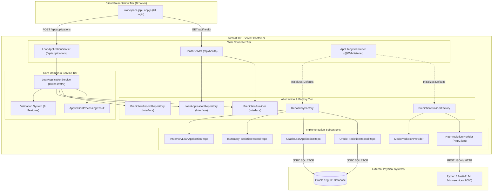

---

# Part 4: The Complete End-to-End Execution Pipeline

### 4.1 Chronological Journey of a Loan Submission (Steps 0–9)

The execution of a loan evaluation request proceeds through an exact, deterministic 10-step sequence from the moment the user clicks **"Analyze Loan Risk"** in the browser to the final rendering of the risk badge and probability gauge:

```
[Step 0: Browser] -> [Step 1: Network/Tomcat] -> [Step 2: Servlet Parsing] -> [Step 3: Service Delegation]
                                                                                       |
[Step 7: Secondary Save] <- [Step 6: AI Inference] <- [Step 5: Primary Save] <- [Step 4: Domain Validation]
          |
          v
[Step 8: HTTP Packaging] -> [Step 9: UI Rendering & Gauge Animation]
```

#### Step 0: User Interaction and Payload Construction (`workspace.jsp` & `app.js`)
1. The user fills out the 9 input fields on [`workspace.jsp`](file:///D:/Projects/Loan%20Default%20Risk%20Prediction/web/workspace.jsp) (or clicks a preset like "Low Risk Applicant").
2. The user clicks the submit button. In [`web/js/app.js`](file:///D:/Projects/Loan%20Default%20Risk%20Prediction/web/js/app.js), the `'submit'` event listener captures the event and invokes `event.preventDefault()`.
3. The client sets the UI to a loading state: the submit button is disabled, a loading spinner activates, and any previous error banners are cleared.
4. `app.js` reads the DOM inputs by their exact IDs (`investmentTotal`, `accCurrentBalance`, etc.) and constructs a JavaScript object:
   ```javascript
   const payload = {
       investmentTotal: parseFloat(document.getElementById('investmentTotal').value),
       accCurrentBalance: parseFloat(document.getElementById('accCurrentBalance').value),
       infMaritalStatus: document.getElementById('infMaritalStatus').value.trim(),
       infGender: document.getElementById('infGender').value.trim(),
       installSize: parseFloat(document.getElementById('installSize').value),
       duePayment: parseFloat(document.getElementById('duePayment').value),
       compensationCharged: document.getElementById('compensationCharged').value.trim(),
       clientType: document.getElementById('clientType').value.trim(),
       repayMode: document.getElementById('repayMode').value.trim()
   };
   ```
5. `app.js` issues a standard `fetch('/Loan_Default_Risk_Prediction/api/applications')` POST request with `Content-Type: application/json` and `JSON.stringify(payload)`.

#### Step 1: Network Ingress and Tomcat Connector Routing
1. The HTTP POST packet arrives at Tomcat on port `8081`.
2. Tomcat's HTTP/1.1 connector allocates a worker thread from its thread pool (e.g., `http-nio-8081-exec-4`).
3. Tomcat matches the URI path `/api/applications` against registered servlets and routes the request to [`LoanApplicationServlet.doPost()`](file:///D:/Projects/Loan%20Default%20Risk%20Prediction/src/java/com/loanrisk/web/LoanApplicationServlet.java#L80-L150).

#### Step 2: Servlet Ingress, Custom JSON Parsing, and DTO Binding
1. `LoanApplicationServlet.doPost()` sets response headers: `Content-Type: application/json; charset=UTF-8`.
2. The servlet reads the raw HTTP request body character-by-character from `request.getReader()` using a `StringBuilder`.
3. If the body is empty or whitespace-only, the servlet immediately halts and emits an HTTP 400 Bad Request: `{"status":"error","message":"Request body cannot be empty"}`.
4. The servlet invokes [`JsonUtil.parseFlatJsonObject(rawBody)`](file:///D:/Projects/Loan%20Default%20Risk%20Prediction/src/java/com/loanrisk/util/JsonUtil.java#L58-L125). This lightweight parser tokenizes the JSON without third-party libraries, returning a `Map<String, String>`.
5. The servlet instantiates a fresh [`LoanApplication`](file:///D:/Projects/Loan%20Default%20Risk%20Prediction/src/java/com/loanrisk/model/LoanApplication.java) model object and defensively parses the map values:
   - Floating-point fields (`investmentTotal`, `accCurrentBalance`, `installSize`, `duePayment`) are parsed via `Double.parseDouble()`. If a number format exception occurs, an HTTP 400 is returned immediately.
   - Categorical fields (`infMaritalStatus`, `infGender`, `compensationCharged`, `clientType`, `repayMode`) are trimmed and stored as clean strings.

#### Step 3: Delegation to Domain Service
1. The servlet delegates the populated `LoanApplication` object to the domain service:
   ```java
   ApplicationProcessingResult result = loanApplicationService.processApplication(application);
   ```

#### Step 4: Strict Domain Rule Validation (`LoanApplicationService.validate()`)
1. [`LoanApplicationService`](file:///D:/Projects/Loan%20Default%20Risk%20Prediction/src/java/com/loanrisk/service/LoanApplicationService.java) instantiates a [`ValidationResult`](file:///D:/Projects/Loan%20Default%20Risk%20Prediction/src/java/com/loanrisk/service/ValidationResult.java) error accumulator.
2. It executes mathematical and domain constraint checks across all 9 fields:
   - `investmentTotal`: Must not be null, must be `> 0.0`, and must not exceed `100,000,000.0`.
   - `accCurrentBalance`: Must not be null and must be `>= 0.0`.
   - `infMaritalStatus`: Must not be null or whitespace.
   - `infGender`: Must not be null or whitespace.
   - `installSize`: Must not be null and must be `> 0.0`.
   - `duePayment`: Must not be null and must be `>= 0.0`.
   - `compensationCharged`: Must not be null or whitespace.
   - `clientType`: Must not be null or whitespace.
   - `repayMode`: Must not be null or whitespace.
3. If any check fails, the error message is appended to `ValidationResult`.
4. If `validationResult.hasErrors()` is true, the service immediately halts execution and returns `ApplicationProcessingResult.validationFailed(validationResult)`. Neither the database nor the ML model is contacted.

#### Step 5: Primary Storage Persistence (`applicationRepository.save()`)
1. If validation passes, the service prepares to persist the application record.
2. The application submission timestamp is set: `application.setSubmissionTimestamp(Instant.now())`.
3. The initial application status is marked as `"SUBMITTED"`.
4. The service invokes `applicationRepository.save(application)`:
   - In **`memory` mode**: [`InMemoryLoanApplicationRepository`](file:///D:/Projects/Loan%20Default%20Risk%20Prediction/src/java/com/loanrisk/repository/memory/InMemoryLoanApplicationRepository.java) fetches the next ID from an `AtomicLong` (starting at 1001), assigns `application.setApplicationId(id)`, and stores the object in a `ConcurrentHashMap<Long, LoanApplication>`.
   - In **`oracle` mode**: [`OracleLoanApplicationRepository`](file:///D:/Projects/Loan%20Default%20Risk%20Prediction/src/java/com/loanrisk/repository/oracle/OracleLoanApplicationRepository.java) executes `SELECT LOAN_APPLICATION_SEQ.NEXTVAL FROM DUAL`, assigns the resulting sequence value, and executes an `INSERT INTO LOAN_APPLICATION (...) VALUES (...)` using a `PreparedStatement`.
5. If a database error occurs (e.g., table missing, constraint violation, connection lost), a `StorageException` is caught, and the service returns `ApplicationProcessingResult.databaseError(msg)`.

#### Step 6: Decoupled AI Machine Learning Inference (`predictionProvider.predict()`)
1. With the loan application safely committed in primary storage, the service proceeds to AI evaluation.
2. Crucially, **this invocation occurs outside any open database transaction**, ensuring slow network responses do not exhaust database connections.
3. The service invokes `predictionProvider.predict(application)`:
   - In **`mock` mode**: [`MockPredictionProvider`](file:///D:/Projects/Loan%20Default%20Risk%20Prediction/src/java/com/loanrisk/ml/MockPredictionProvider.java) executes a deterministic mathematical formula combining debt-to-balance ratio, installment-to-investment ratio, past-due payment severity, and client type risk adjustments. It calculates `probabilityB` and assigns class `'B'` if `probabilityB >= 0.3000`, else `'G'`.
   - In **`http` mode**: [`HttpPredictionProvider`](file:///D:/Projects/Loan%20Default%20Risk%20Prediction/src/java/com/loanrisk/ml/HttpPredictionProvider.java) serializes the application's 9 features into JSON, builds a standard `java.net.http.HttpRequest` targeting the remote Python service (e.g. `http://localhost:8000/predict`), and dispatches it with a 5-second timeout. It parses the Python service's JSON response containing `predicted_class`, `probability_b`, `model_version`, and `threshold_used`.
4. If the ML inference fails (e.g., Python service crashed, network timeout, connection refused, invalid JSON response), a `PredictionException` is caught.
5. The service constructs `ApplicationProcessingResult.predictionFailed(application, errorDetails)`. The saved `applicationId` is retained so the client and auditors know the application was received, but AI scoring was unavailable.

#### Step 7: Secondary Prediction Record Persistence (`predictionRepository.save()`)
1. Upon successful inference, the service constructs a [`PredictionRecord`](file:///D:/Projects/Loan%20Default%20Risk%20Prediction/src/java/com/loanrisk/model/PredictionRecord.java) POJO:
   - `applicationId`: Bound to the primary loan application's ID.
   - `predictedClass`: `'G'` or `'B'`.
   - `probabilityB`: Calibrated probability float (e.g. `0.7850`).
   - `thresholdUsed`: `0.3000`.
   - `modelVersion`: e.g. `"mock-v1.0"` or `"kaggle-lgbm-v1"`.
   - `predictionTimestamp`: `Instant.now()`.
   - `simulated`: `true` if mock mode, `false` if live HTTP mode.
2. The service invokes `predictionRepository.save(predictionRecord)`:
   - In **`memory` mode**: [`InMemoryPredictionRecordRepository`](file:///D:/Projects/Loan%20Default%20Risk%20Prediction/src/java/com/loanrisk/repository/memory/InMemoryPredictionRecordRepository.java) generates a prediction ID from an `AtomicLong` (starting at 5001) and stores the record in a `ConcurrentHashMap<Long, PredictionRecord>`.
   - In **`oracle` mode**: [`OraclePredictionRecordRepository`](file:///D:/Projects/Loan%20Default%20Risk%20Prediction/src/java/com/loanrisk/repository/oracle/OraclePredictionRecordRepository.java) queries `PREDICTION_RECORD_SEQ.NEXTVAL` and executes an `INSERT INTO PREDICTION_RECORD (...) VALUES (...)`.
3. If saving the prediction record fails, the service returns `ApplicationProcessingResult.predictionPersistenceFailed(application, record, errorMsg)`.

#### Step 8: Result Packaging and HTTP Response Generation
1. If all steps succeed, the service returns `ApplicationProcessingResult.success(application, predictionRecord)`.
2. `LoanApplicationServlet` inspects `result.getStatus()` and formats the HTTP response:
   - `SUCCESS` -> HTTP `201 Created`: Contains complete JSON object with both application details and prediction analytics.
   - `VALIDATION_FAILED` -> HTTP `400 Bad Request`: Contains list of validation error strings.
   - `DATABASE_ERROR` -> HTTP `500 Internal Server Error`: Explains persistence failure.
   - `PREDICTION_FAILED` -> HTTP `502 Bad Gateway`: Emits JSON containing `applicationId` and explanatory message indicating the external AI service failed.
   - `PREDICTION_PERSISTENCE_FAILED` -> HTTP `500 Internal Server Error`: Emits JSON containing `applicationId` indicating prediction was computed but could not be logged.
3. The response is written to `response.getWriter()` and flushed.

#### Step 9: Client Browser Ingress, DOM Rendering, and Gauge Animation
1. `app.js` receives the HTTP response via `await fetch()`.
2. If `response.status === 201`:
   - Extracts the parsed JSON payload: `data.prediction` and `data.application`.
   - Hides the placeholder empty state panel and reveals the active prediction card.
   - Evaluates `prediction.predictedClass`:
     - If `'G'`: Applies emerald green CSS styling (`badge-good`), sets text to `"LOW RISK / APPROVE (GOOD)"`.
     - If `'B'`: Applies crimson red CSS styling (`badge-bad`), sets text to `"HIGH RISK / DEFAULT WARNING (BAD)"`.
   - Animates the SVG radial gauge: computes stroke-dashoffset proportional to `probabilityB` (from 0% to 100%).
   - Populates analytical breakdown metrics: Debt Ratio, Model Version, Decision Threshold (`0.3000`), Application ID, and Audit Timestamp.
   - Prepends the newly evaluated application to the "Recent Evaluations" ledger at the bottom of `workspace.jsp`.
3. If `response.status === 400`:
   - Maps validation errors to specific form input elements, highlighting borders in red and displaying an error alert banner.
4. If `response.status === 502`:
   - Displays a prominent amber warning banner: *"Application #X was successfully saved, but the AI Prediction Service is currently offline. Please retry evaluation later."*

### 4.2 Comprehensive Master Pipeline Sequence Diagram

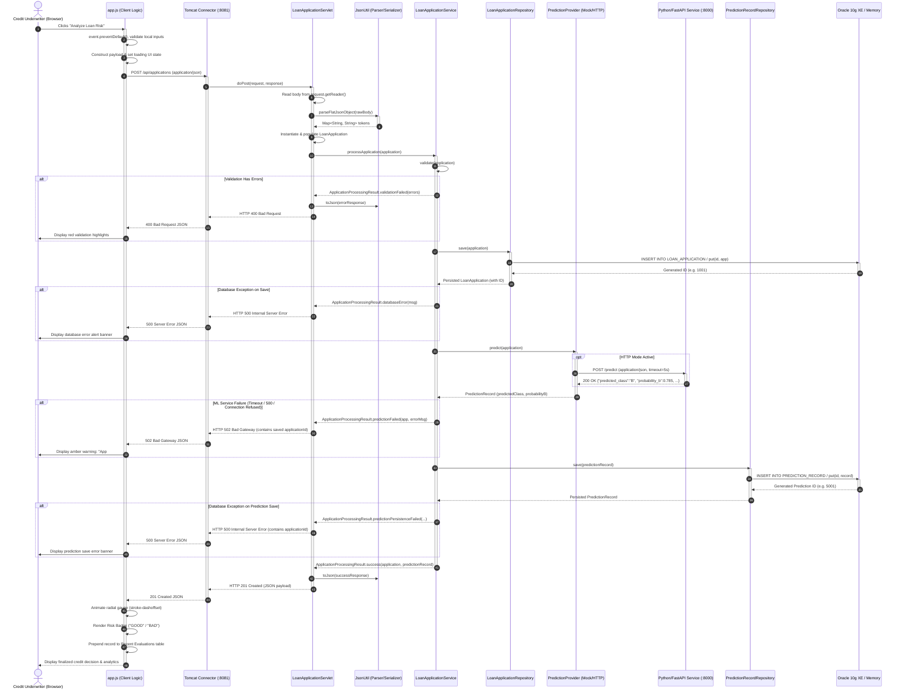

### 4.3 Branching Decision Tree and Error State Transitions

The execution pipeline has exactly 5 possible terminal states, mapped directly from `ApplicationProcessingResult.Status`:

```
                                [Inbound Request]
                                        |
                             [JSON Syntactically Valid?]
                              /                      \
                           (No)                      (Yes)
                            |                          |
                     HTTP 400 Bad Request       [Domain Rules Valid?]
                                                 /                 \
                                              (No)                 (Yes)
                                               |                     |
                                    HTTP 400 (Validation)   [Primary DB Save OK?]
                                                             /                 \
                                                          (No)                 (Yes)
                                                           |                     |
                                                 HTTP 500 (DB Error)    [AI Inference OK?]
                                                                         /              \
                                                                      (No)              (Yes)
                                                                       |                  |
                                                             HTTP 502 (AI Down)  [Secondary DB Save OK?]
                                                             (App ID Preserved)   /                 \
                                                                               (No)                 (Yes)
                                                                                |                     |
                                                                        HTTP 500 (Pred Save)   HTTP 201 Created
                                                                        (App ID Preserved)     (Complete Success)
```


---

# Part 5: Every Java Class, Individually Documented

This section documents every single Java class and interface in the LoanLens codebase across all 8 production packages and the test suite (29 types total). For each class, six analytical facets (Parts A through F) are detailed with source-grounded references.

---

## 5.1 Configuration Subsystem

### 1. `com.loanrisk.config.DatabaseConfig`
- **Source File:** [`src/java/com/loanrisk/config/DatabaseConfig.java`](file:///D:/Projects/Loan%20Default%20Risk%20Prediction/src/java/com/loanrisk/config/DatabaseConfig.java)
- **Total Lines:** 85 lines

#### Part A: Architectural Purpose & Role
[`DatabaseConfig`](file:///D:/Projects/Loan%20Default%20Risk%20Prediction/src/java/com/loanrisk/config/DatabaseConfig.java) is the centralized, standalone configuration provider for JDBC database connectivity. It decouples the physical database connection properties (JDBC URL, username, password, driver class) from the repository implementations ([`OracleLoanApplicationRepository`](file:///D:/Projects/Loan%20Default%20Risk%20Prediction/src/java/com/loanrisk/repository/oracle/OracleLoanApplicationRepository.java) and [`OraclePredictionRecordRepository`](file:///D:/Projects/Loan%20Default%20Risk%20Prediction/src/java/com/loanrisk/repository/oracle/OraclePredictionRecordRepository.java)). It acts as a static factory that loads the Oracle JDBC driver and produces live `java.sql.Connection` instances, resolving settings dynamically from Java system properties and OS environment variables.

#### Part B: Field-by-Field Breakdown
- `DEFAULT_URL` (`private static final String`, [Line 14](file:///D:/Projects/Loan%20Default%20Risk%20Prediction/src/java/com/loanrisk/config/DatabaseConfig.java#L14)): `"jdbc:oracle:thin:@localhost:1521:XE"`. Default JDBC thin driver connection URL targeting local Oracle 10g Express Edition.
- `DEFAULT_USER` (`private static final String`, [Line 15](file:///D:/Projects/Loan%20Default%20Risk%20Prediction/src/java/com/loanrisk/config/DatabaseConfig.java#L15)): `"loan_user"`. Default Oracle schema owner username.
- `DEFAULT_PASSWORD` (`private static final String`, [Line 16](file:///D:/Projects/Loan%20Default%20Risk%20Prediction/src/java/com/loanrisk/config/DatabaseConfig.java#L16)): `"loan_password"`. Default authentication password.
- `DEFAULT_DRIVER` (`private static final String`, [Line 17](file:///D:/Projects/Loan%20Default%20Risk%20Prediction/src/java/com/loanrisk/config/DatabaseConfig.java#L17)): `"oracle.jdbc.OracleDriver"`. Canonical Oracle JDBC driver class name.

#### Part C: Method-by-Method Breakdown
1. `private DatabaseConfig()` ([Line 19](file:///D:/Projects/Loan%20Default%20Risk%20Prediction/src/java/com/loanrisk/config/DatabaseConfig.java#L19)):
   - Private constructor preventing instantiation of this static utility class.
2. `public static String getUrl()` ([Lines 26-28](file:///D:/Projects/Loan%20Default%20Risk%20Prediction/src/java/com/loanrisk/config/DatabaseConfig.java#L26-L28)):
   - Returns the active JDBC URL by calling `resolve("loan.db.url", "LOAN_DB_URL", DEFAULT_URL)`.
3. `public static String getUsername()` ([Lines 35-37](file:///D:/Projects/Loan%20Default%20Risk%20Prediction/src/java/com/loanrisk/config/DatabaseConfig.java#L35-L37)):
   - Returns the active Oracle username by calling `resolve("loan.db.user", "LOAN_DB_USER", DEFAULT_USER)`.
4. `public static String getPassword()` ([Lines 44-46](file:///D:/Projects/Loan%20Default%20Risk%20Prediction/src/java/com/loanrisk/config/DatabaseConfig.java#L44-L46)):
   - Returns the active Oracle password by calling `resolve("loan.db.password", "LOAN_DB_PASSWORD", DEFAULT_PASSWORD)`.
5. `public static String getDriverClass()` ([Lines 53-55](file:///D:/Projects/Loan%20Default%20Risk%20Prediction/src/java/com/loanrisk/config/DatabaseConfig.java#L53-L55)):
   - Returns the active driver class by calling `resolve("loan.db.driver", "LOAN_DB_DRIVER", DEFAULT_DRIVER)`.
6. `public static Connection getConnection() throws SQLException` ([Lines 63-71](file:///D:/Projects/Loan%20Default%20Risk%20Prediction/src/java/com/loanrisk/config/DatabaseConfig.java#L63-L71)):
   - Dynamically loads the JDBC driver via `Class.forName(getDriverClass())`.
   - Obtains and returns a physical connection via `DriverManager.getConnection(getUrl(), getUsername(), getPassword())`.
   - If `ClassNotFoundException` occurs, wraps it in a descriptive `SQLException`.
7. `private static String resolve(String systemProperty, String envVariable, String defaultValue)` ([Lines 73-84](file:///D:/Projects/Loan%20Default%20Risk%20Prediction/src/java/com/loanrisk/config/DatabaseConfig.java#L73-L84)):
   - Checks `System.getProperty(systemProperty)`. If present and non-blank, trims and returns it.
   - Checks `System.getenv(envVariable)`. If present and non-blank, trims and returns it.
   - Otherwise, returns `defaultValue`.

#### Part D: Dependencies & Collaborators
- **Inward Callers:** [`OracleLoanApplicationRepository`](file:///D:/Projects/Loan%20Default%20Risk%20Prediction/src/java/com/loanrisk/repository/oracle/OracleLoanApplicationRepository.java), [`OraclePredictionRecordRepository`](file:///D:/Projects/Loan%20Default%20Risk%20Prediction/src/java/com/loanrisk/repository/oracle/OraclePredictionRecordRepository.java), [`ConfigurationTest`](file:///D:/Projects/Loan%20Default%20Risk%20Prediction/test/com/loanrisk/test/ConfigurationTest.java).
- **Outward Collaborators:** `java.sql.DriverManager`, `java.sql.Connection`.

#### Part E: Error Handling & Edge Cases
- Driver Missing: If `oracle.jdbc.OracleDriver` is not on Tomcat's common classpath (`lib/`), `Class.forName()` throws `ClassNotFoundException`. `getConnection()` intercepts this and re-throws a clean `SQLException("Oracle JDBC driver class not found: " + driverClass, e)` allowing callers to handle it gracefully.
- Null/Empty Properties: `resolve()` checks `.trim().isEmpty()` before accepting any environment or system variable, preventing empty strings from overriding valid defaults.

#### Part F: Interview/Viva Talking Points & Code Walkthrough Questions
- **Question:** *Why does `DatabaseConfig` use `Class.forName()` when modern JDBC 4.0 drivers auto-register via Service Provider Interface (SPI)?*
  **Answer:** While JDBC 4+ supports SPI auto-loading from `META-INF/services/java.sql.Driver`, older drivers (especially legacy Oracle 10g thin drivers) and complex multi-classloader servlet containers (like Apache Tomcat) sometimes fail to discover the driver class automatically. Explicitly calling `Class.forName()` guarantees driver registration across all deployment environments.

---

### 2. `com.loanrisk.config.StorageConfig`
- **Source File:** [`src/java/com/loanrisk/config/StorageConfig.java`](file:///D:/Projects/Loan%20Default%20Risk%20Prediction/src/java/com/loanrisk/config/StorageConfig.java)
- **Total Lines:** 86 lines

#### Part A: Architectural Purpose & Role
[`StorageConfig`](file:///D:/Projects/Loan%20Default%20Risk%20Prediction/src/java/com/loanrisk/config/StorageConfig.java) defines and validates the active storage engine mode of the application. It acts as the gatekeeper for the Pluggable Dual-Storage Strategy, determining whether LoanLens runs in volatile in-memory mode or Oracle relational database mode. It enforces the system's strict anti-fallback rule.

#### Part B: Field-by-Field Breakdown
- `MODE_MEMORY` (`public static final String`, [Line 12](file:///D:/Projects/Loan%20Default%20Risk%20Prediction/src/java/com/loanrisk/config/StorageConfig.java#L12)): `"memory"`. Identifies the ConcurrentHashMap repository implementation.
- `MODE_ORACLE` (`public static final String`, [Line 13](file:///D:/Projects/Loan%20Default%20Risk%20Prediction/src/java/com/loanrisk/config/StorageConfig.java#L13)): `"oracle"`. Identifies the Oracle JDBC repository implementation.
- `defaultMode` (`private static String`, [Line 15](file:///D:/Projects/Loan%20Default%20Risk%20Prediction/src/java/com/loanrisk/config/StorageConfig.java#L15)): `"memory"`. Default mode seeded by `AppLifecycleListener` from `web.xml`.

#### Part C: Method-by-Method Breakdown
1. `private StorageConfig()` ([Line 17](file:///D:/Projects/Loan%20Default%20Risk%20Prediction/src/java/com/loanrisk/config/StorageConfig.java#L17)):
   - Private constructor preventing instantiation.
2. `public static synchronized void setDefaultMode(String mode)` ([Lines 25-33](file:///D:/Projects/Loan%20Default%20Risk%20Prediction/src/java/com/loanrisk/config/StorageConfig.java#L25-L33)):
   - Validates that `mode` is neither null nor invalid. Converts to lower case. If not `"memory"` or `"oracle"`, throws `IllegalArgumentException`. Sets `defaultMode`.
3. `public static String getStorageMode()` ([Lines 42-59](file:///D:/Projects/Loan%20Default%20Risk%20Prediction/src/java/com/loanrisk/config/StorageConfig.java#L42-L59)):
   - Implements the 3-tier precedence check:
     1. `System.getProperty("loan.storage.mode")`
     2. `System.getenv("LOAN_STORAGE_MODE")`
     3. `defaultMode`
   - Normalizes value to lowercase. Validates against allowed modes. If an unrecognized mode is supplied (e.g. `"mysql"` or `"mongo"`), throws `IllegalStateException`.
4. `public static boolean isMemoryMode()` ([Lines 66-68](file:///D:/Projects/Loan%20Default%20Risk%20Prediction/src/java/com/loanrisk/config/StorageConfig.java#L66-L68)):
   - Returns `MODE_MEMORY.equalsIgnoreCase(getStorageMode())`.
5. `public static boolean isOracleMode()` ([Lines 75-77](file:///D:/Projects/Loan%20Default%20Risk%20Prediction/src/java/com/loanrisk/config/StorageConfig.java#L75-L77)):
   - Returns `MODE_ORACLE.equalsIgnoreCase(getStorageMode())`.
6. `private static boolean isValidMode(String mode)` ([Lines 79-84](file:///D:/Projects/Loan%20Default%20Risk%20Prediction/src/java/com/loanrisk/config/StorageConfig.java#L79-L84)):
   - Helper returning true if mode matches `MODE_MEMORY` or `MODE_ORACLE`.

#### Part D: Dependencies & Collaborators
- **Inward Callers:** [`AppLifecycleListener`](file:///D:/Projects/Loan%20Default%20Risk%20Prediction/src/java/com/loanrisk/web/AppLifecycleListener.java), [`RepositoryFactory`](file:///D:/Projects/Loan%20Default%20Risk%20Prediction/src/java/com/loanrisk/repository/RepositoryFactory.java), [`HealthServlet`](file:///D:/Projects/Loan%20Default%20Risk%20Prediction/src/java/com/loanrisk/web/HealthServlet.java), [`ConfigurationTest`](file:///D:/Projects/Loan%20Default%20Risk%20Prediction/test/com/loanrisk/test/ConfigurationTest.java).
- **Outward Collaborators:** Java standard system properties and environment APIs.

#### Part E: Error Handling & Edge Cases
- Fail-Fast Enforcement: If an invalid mode is injected via `System.setProperty("loan.storage.mode", "redis")`, `getStorageMode()` immediately throws `IllegalStateException("Invalid storage mode: 'redis'. Expected 'memory' or 'oracle'")`. It never silently defaults to `"memory"`.

#### Part F: Interview/Viva Talking Points & Code Walkthrough Questions
- **Question:** *Why is `setDefaultMode()` synchronized while `getStorageMode()` is not?*
  **Answer:** `setDefaultMode()` is invoked during container startup by `AppLifecycleListener` to establish the servlet context baseline. Synchronizing writes prevents race conditions during deployment, while reads in `getStorageMode()` read references directly, ensuring thread safety and high throughput.

---

### 3. `com.loanrisk.config.MlConfig`
- **Source File:** [`src/java/com/loanrisk/config/MlConfig.java`](file:///D:/Projects/Loan%20Default%20Risk%20Prediction/src/java/com/loanrisk/config/MlConfig.java)
- **Total Lines:** 158 lines

#### Part A: Architectural Purpose & Role
[`MlConfig`](file:///D:/Projects/Loan%20Default%20Risk%20Prediction/src/java/com/loanrisk/config/MlConfig.java) governs the machine learning inference subsystem configuration. It validates whether LoanLens uses the internal rule-based mock engine (`mock`) or the remote HTTP Python service (`http`). When in HTTP mode, it strictly validates the target URI syntax, protocol scheme, host existence, and timeout parameters.

#### Part B: Field-by-Field Breakdown
- `MODE_MOCK` (`public static final String`, [Line 15](file:///D:/Projects/Loan%20Default%20Risk%20Prediction/src/java/com/loanrisk/config/MlConfig.java#L15)): `"mock"`.
- `MODE_HTTP` (`public static final String`, [Line 16](file:///D:/Projects/Loan%20Default%20Risk%20Prediction/src/java/com/loanrisk/config/MlConfig.java#L16)): `"http"`.
- `DEFAULT_BASE_URL` (`public static final String`, [Line 17](file:///D:/Projects/Loan%20Default%20Risk%20Prediction/src/java/com/loanrisk/config/MlConfig.java#L17)): `"http://localhost:8000"`. Default location of FastAPI service.
- `DEFAULT_CONNECT_TIMEOUT_MS` (`public static final int`, [Line 18](file:///D:/Projects/Loan%20Default%20Risk%20Prediction/src/java/com/loanrisk/config/MlConfig.java#L18)): `3000` (3 seconds).
- `DEFAULT_READ_TIMEOUT_MS` (`public static final int`, [Line 19](file:///D:/Projects/Loan%20Default%20Risk%20Prediction/src/java/com/loanrisk/config/MlConfig.java#L19)): `5000` (5 seconds).
- `defaultMode` (`private static String`, [Line 21](file:///D:/Projects/Loan%20Default%20Risk%20Prediction/src/java/com/loanrisk/config/MlConfig.java#L21)): `"mock"`.
- `defaultBaseUrl` (`private static String`, [Line 22](file:///D:/Projects/Loan%20Default%20Risk%20Prediction/src/java/com/loanrisk/config/MlConfig.java#L22)): `DEFAULT_BASE_URL`.

#### Part C: Method-by-Method Breakdown
1. `private MlConfig()` ([Line 24](file:///D:/Projects/Loan%20Default%20Risk%20Prediction/src/java/com/loanrisk/config/MlConfig.java#L24)): Private constructor.
2. `public static synchronized void setDefaultMode(String mode)` ([Lines 31-39](file:///D:/Projects/Loan%20Default%20Risk%20Prediction/src/java/com/loanrisk/config/MlConfig.java#L31-L39)): Validates against `isValidMode()`, throws `IllegalArgumentException` if invalid.
3. `public static synchronized void setDefaultBaseUrl(String url)` ([Lines 46-52](file:///D:/Projects/Loan%20Default%20Risk%20Prediction/src/java/com/loanrisk/config/MlConfig.java#L46-L52)): Validates URL via `validateUrl()`, stores in `defaultBaseUrl`.
4. `public static String getMlMode()` ([Lines 60-77](file:///D:/Projects/Loan%20Default%20Risk%20Prediction/src/java/com/loanrisk/config/MlConfig.java#L60-L77)): Resolves mode using 3-tier precedence (`loan.ml.mode` -> `LOAN_ML_MODE` -> `defaultMode`). Throws `IllegalStateException` on invalid values.
5. `public static boolean isMockMode()` ([Lines 84-86](file:///D:/Projects/Loan%20Default%20Risk%20Prediction/src/java/com/loanrisk/config/MlConfig.java#L84-L86)): Returns `MODE_MOCK.equalsIgnoreCase(getMlMode())`.
6. `public static boolean isHttpMode()` ([Lines 93-95](file:///D:/Projects/Loan%20Default%20Risk%20Prediction/src/java/com/loanrisk/config/MlConfig.java#L93-L95)): Returns `MODE_HTTP.equalsIgnoreCase(getMlMode())`.
7. `public static String getBaseUrl()` ([Lines 104-118](file:///D:/Projects/Loan%20Default%20Risk%20Prediction/src/java/com/loanrisk/config/MlConfig.java#L104-L118)): Resolves URL via `loan.ml.url` -> `LOAN_ML_URL` -> `defaultBaseUrl`. Strips trailing slashes, validates via `validateUrl()`.
8. `public static int getConnectTimeoutMs()` ([Lines 125-132](file:///D:/Projects/Loan%20Default%20Risk%20Prediction/src/java/com/loanrisk/config/MlConfig.java#L125-L132)): Resolves connection timeout; falls back to `DEFAULT_CONNECT_TIMEOUT_MS`.
9. `public static int getReadTimeoutMs()` ([Lines 139-146](file:///D:/Projects/Loan%20Default%20Risk%20Prediction/src/java/com/loanrisk/config/MlConfig.java#L139-L146)): Resolves read timeout; falls back to `DEFAULT_READ_TIMEOUT_MS`.
10. `private static void validateUrl(String url)` ([Lines 148-157](file:///D:/Projects/Loan%20Default%20Risk%20Prediction/src/java/com/loanrisk/config/MlConfig.java#L148-L157)): Uses `URI.create(url).toURL()`; validates that scheme is `"http"` or `"https"` and host is non-null.

#### Part D: Dependencies & Collaborators
- **Inward Callers:** [`AppLifecycleListener`](file:///D:/Projects/Loan%20Default%20Risk%20Prediction/src/java/com/loanrisk/web/AppLifecycleListener.java), [`PredictionProviderFactory`](file:///D:/Projects/Loan%20Default%20Risk%20Prediction/src/java/com/loanrisk/ml/PredictionProviderFactory.java), [`HttpPredictionProvider`](file:///D:/Projects/Loan%20Default%20Risk%20Prediction/src/java/com/loanrisk/ml/HttpPredictionProvider.java), [`HealthServlet`](file:///D:/Projects/Loan%20Default%20Risk%20Prediction/src/java/com/loanrisk/web/HealthServlet.java), [`ConfigurationTest`](file:///D:/Projects/Loan%20Default%20Risk%20Prediction/test/com/loanrisk/test/ConfigurationTest.java).
- **Outward Collaborators:** `java.net.URI`, `java.net.URL`.

#### Part E: Error Handling & Edge Cases
- Invalid Protocol Scheme: If an administrator configures `LOAN_ML_URL=ftp://localhost:8000`, `validateUrl()` immediately throws `IllegalArgumentException("ML service URL must use http or https protocol: ftp://localhost:8000")`.

#### Part F: Interview/Viva Talking Points & Code Walkthrough Questions
- **Question:** *Why does `getBaseUrl()` strip trailing slashes?*
  **Answer:** Endpoint paths (e.g. `/predict` or `/health`) are concatenated to the base URL in `HttpPredictionProvider`. Stripping trailing slashes prevents accidental double-slashes (`http://localhost:8000//predict`) which cause HTTP 404 or redirect issues in strict web servers like FastAPI/Uvicorn.

---

## 5.2 Domain Model Entities

### 4. `com.loanrisk.model.LoanApplication`
- **Source File:** [`src/java/com/loanrisk/model/LoanApplication.java`](file:///D:/Projects/Loan%20Default%20Risk%20Prediction/src/java/com/loanrisk/model/LoanApplication.java)
- **Total Lines:** 162 lines

#### Part A: Architectural Purpose & Role
[`LoanApplication`](file:///D:/Projects/Loan%20Default%20Risk%20Prediction/src/java/com/loanrisk/model/LoanApplication.java) is the core domain entity representing a borrower's credit underwriting submission. It encapsulates the 9 Kaggle microfinance predictive features, surrogate primary key `applicationId`, lifecycle submission timestamp, and status. It serves as the primary Data Transfer Object (DTO) between the Servlet, Service, Repository, and ML layers.

#### Part B: Field-by-Field Breakdown
- `applicationId` (`private Long`, [Line 13](file:///D:/Projects/Loan%20Default%20Risk%20Prediction/src/java/com/loanrisk/model/LoanApplication.java#L13)): Primary surrogate key generated by the repository. Null before persistence.
- `investmentTotal` (`private Double`, [Line 16](file:///D:/Projects/Loan%20Default%20Risk%20Prediction/src/java/com/loanrisk/model/LoanApplication.java#L16)): Total capital/investment amount requested by the applicant.
- `accCurrentBalance` (`private Double`, [Line 17](file:///D:/Projects/Loan%20Default%20Risk%20Prediction/src/java/com/loanrisk/model/LoanApplication.java#L17)): Liquid cash balance in the borrower's deposit account.
- `infMaritalStatus` (`private String`, [Line 18](file:///D:/Projects/Loan%20Default%20Risk%20Prediction/src/java/com/loanrisk/model/LoanApplication.java#L18)): Demographic marital status category.
- `infGender` (`private String`, [Line 19](file:///D:/Projects/Loan%20Default%20Risk%20Prediction/src/java/com/loanrisk/model/LoanApplication.java#L19)): Demographic gender indicator.
- `installSize` (`private Double`, [Line 20](file:///D:/Projects/Loan%20Default%20Risk%20Prediction/src/java/com/loanrisk/model/LoanApplication.java#L20)): Contractual periodic installment payment amount.
- `duePayment` (`private Double`, [Line 21](file:///D:/Projects/Loan%20Default%20Risk%20Prediction/src/java/com/loanrisk/model/LoanApplication.java#L21)): Cumulative overdue/past-due arrears currently owed.
- `compensationCharged` (`private String`, [Line 22](file:///D:/Projects/Loan%20Default%20Risk%20Prediction/src/java/com/loanrisk/model/LoanApplication.java#L22)): Late fees or penalty charges incurred category.
- `clientType` (`private String`, [Line 23](file:///D:/Projects/Loan%20Default%20Risk%20Prediction/src/java/com/loanrisk/model/LoanApplication.java#L23)): Borrowing client category (e.g. `"Individual"`, `"Corporate"`).
- `repayMode` (`private String`, [Line 24](file:///D:/Projects/Loan%20Default%20Risk%20Prediction/src/java/com/loanrisk/model/LoanApplication.java#L24)): Repayment channel/frequency category (e.g. `"Monthly"`, `"Auto-Debit"`).
- `submissionTimestamp` (`private Instant`, [Line 27](file:///D:/Projects/Loan%20Default%20Risk%20Prediction/src/java/com/loanrisk/model/LoanApplication.java#L27)): UTC timestamp recorded at the moment of submission.
- `status` (`private String`, [Line 28](file:///D:/Projects/Loan%20Default%20Risk%20Prediction/src/java/com/loanrisk/model/LoanApplication.java#L28)): Workflow status (`"SUBMITTED"`, `"PROCESSED"`, etc.).

#### Part C: Method-by-Method Breakdown
1. `public LoanApplication()` ([Line 30](file:///D:/Projects/Loan%20Default%20Risk%20Prediction/src/java/com/loanrisk/model/LoanApplication.java#L30)): Default no-arg constructor.
2. Standard getters and setters for all 12 properties ([Lines 34-142](file:///D:/Projects/Loan%20Default%20Risk%20Prediction/src/java/com/loanrisk/model/LoanApplication.java#L34-L142)).
3. `public String toString()` ([Lines 144-161](file:///D:/Projects/Loan%20Default%20Risk%20Prediction/src/java/com/loanrisk/model/LoanApplication.java#L144-L161)): Generates a structured multi-line debugging representation.

#### Part D: Dependencies & Collaborators
- Used throughout the entire pipeline: instantiated by [`LoanApplicationServlet`](file:///D:/Projects/Loan%20Default%20Risk%20Prediction/src/java/com/loanrisk/web/LoanApplicationServlet.java), validated and coordinated by [`LoanApplicationService`](file:///D:/Projects/Loan%20Default%20Risk%20Prediction/src/java/com/loanrisk/service/LoanApplicationService.java), persisted by [`LoanApplicationRepository`](file:///D:/Projects/Loan%20Default%20Risk%20Prediction/src/java/com/loanrisk/repository/LoanApplicationRepository.java), and evaluated by [`PredictionProvider`](file:///D:/Projects/Loan%20Default%20Risk%20Prediction/src/java/com/loanrisk/ml/PredictionProvider.java).

#### Part E: Error Handling & Edge Cases
- All numeric features use boxed `Double` rather than primitive `double`. This allows the validation engine to detect missing (null) values in JSON payloads distinct from explicitly supplied `0.0`.

#### Part F: Interview/Viva Talking Points & Code Walkthrough Questions
- **Question:** *Why are numeric fields boxed `Double` instead of primitive `double`?*
  **Answer:** In JSON deserialization, a primitive `double` defaults to `0.0` if omitted from the payload. Using boxed `Double` permits explicit nullity checking: `if (application.getInvestmentTotal() == null)` distinguishes between a missing field (illegal) and a zero value.

---

### 5. `com.loanrisk.model.PredictionRecord`
- **Source File:** [`src/java/com/loanrisk/model/PredictionRecord.java`](file:///D:/Projects/Loan%20Default%20Risk%20Prediction/src/java/com/loanrisk/model/PredictionRecord.java)
- **Total Lines:** 118 lines

#### Part A: Architectural Purpose & Role
[`PredictionRecord`](file:///D:/Projects/Loan%20Default%20Risk%20Prediction/src/java/com/loanrisk/model/PredictionRecord.java) represents the immutable analytical audit trail resulting from an AI risk inference. It associates an evaluation outcome (`predictedClass`, `probabilityB`) with the parent `LoanApplication` via `applicationId`, preserving governance metadata including `modelVersion`, `thresholdUsed`, and whether the score was simulated or computed by live ML.

#### Part B: Field-by-Field Breakdown
- `predictionId` (`private Long`, [Line 13](file:///D:/Projects/Loan%20Default%20Risk%20Prediction/src/java/com/loanrisk/model/PredictionRecord.java#L13)): Primary surrogate key for the prediction record.
- `applicationId` (`private Long`, [Line 14](file:///D:/Projects/Loan%20Default%20Risk%20Prediction/src/java/com/loanrisk/model/PredictionRecord.java#L14)): Foreign key referencing the associated `LoanApplication.applicationId`.
- `predictedClass` (`private String`, [Line 15](file:///D:/Projects/Loan%20Default%20Risk%20Prediction/src/java/com/loanrisk/model/PredictionRecord.java#L15)): Binary decision label: `"G"` (Good) or `"B"` (Bad).
- `probabilityB` (`private Double`, [Line 16](file:///D:/Projects/Loan%20Default%20Risk%20Prediction/src/java/com/loanrisk/model/PredictionRecord.java#L16)): Calibrated posterior probability of default $P(\text{Class} = \text{'B'} \mid X) \in [0.0, 1.0]$.
- `thresholdUsed` (`private Double`, [Line 17](file:///D:/Projects/Loan%20Default%20Risk%20Prediction/src/java/com/loanrisk/model/PredictionRecord.java#L17)): Decision cutoff (standard `0.3000`).
- `modelVersion` (`private String`, [Line 18](file:///D:/Projects/Loan%20Default%20Risk%20Prediction/src/java/com/loanrisk/model/PredictionRecord.java#L18)): Identifier of the scoring model (e.g., `"mock-heuristic-v1"`, `"kaggle-lgbm-v1"`).
- `predictionTimestamp` (`private Instant`, [Line 19](file:///D:/Projects/Loan%20Default%20Risk%20Prediction/src/java/com/loanrisk/model/PredictionRecord.java#L19)): UTC timestamp when inference was computed.
- `simulated` (`private boolean`, [Line 20](file:///D:/Projects/Loan%20Default%20Risk%20Prediction/src/java/com/loanrisk/model/PredictionRecord.java#L20)): True if produced by `MockPredictionProvider`, false if produced by live `HttpPredictionProvider`.

#### Part C: Method-by-Method Breakdown
1. `public PredictionRecord()` ([Line 22](file:///D:/Projects/Loan%20Default%20Risk%20Prediction/src/java/com/loanrisk/model/PredictionRecord.java#L22)): Default no-arg constructor.
2. Standard getters and setters for all 8 properties ([Lines 26-97](file:///D:/Projects/Loan%20Default%20Risk%20Prediction/src/java/com/loanrisk/model/PredictionRecord.java#L26-L97)).
3. `public String toString()` ([Lines 99-117](file:///D:/Projects/Loan%20Default%20Risk%20Prediction/src/java/com/loanrisk/model/PredictionRecord.java#L99-L117)): Formats diagnostic representation.

#### Part D: Dependencies & Collaborators
- Produced by [`PredictionProvider.predict()`](file:///D:/Projects/Loan%20Default%20Risk%20Prediction/src/java/com/loanrisk/ml/PredictionProvider.java), persisted by [`PredictionRecordRepository`](file:///D:/Projects/Loan%20Default%20Risk%20Prediction/src/java/com/loanrisk/repository/PredictionRecordRepository.java), encapsulated in [`ApplicationProcessingResult`](file:///D:/Projects/Loan%20Default%20Risk%20Prediction/src/java/com/loanrisk/service/ApplicationProcessingResult.java), and rendered by [`app.js`](file:///D:/Projects/Loan%20Default%20Risk%20Prediction/web/js/app.js).

#### Part E: Error Handling & Edge Cases
- Oracle Persistence Discrepancy: The Oracle table `PREDICTION_RECORD` does not have a `SIMULATED` column. When reading from Oracle, `OraclePredictionRecordRepository` explicitly invokes `record.setSimulated(false)`.

#### Part F: Interview/Viva Talking Points & Code Walkthrough Questions
- **Question:** *What is the purpose of preserving `thresholdUsed` inside the record?*
  **Answer:** In banking credit risk, underwriting policies change over time. By recording the exact threshold (`0.3000`) used at the moment of evaluation alongside the raw probability (`0.3421`), auditors can reconstruct why an application was categorized as Bad even if the institutional threshold is later shifted to `0.4000`.


---

## 5.3 Service Layer

### 6. `com.loanrisk.service.ValidationResult`
- **Source File:** [`src/java/com/loanrisk/service/ValidationResult.java`](file:///D:/Projects/Loan%20Default%20Risk%20Prediction/src/java/com/loanrisk/service/ValidationResult.java)
- **Total Lines:** 33 lines

#### Part A: Architectural Purpose & Role
[`ValidationResult`](file:///D:/Projects/Loan%20Default%20Risk%20Prediction/src/java/com/loanrisk/service/ValidationResult.java) implements the **Error Accumulator Pattern**. Instead of aborting processing on the first invalid field (which frustrates users by requiring multiple round-trips), `ValidationResult` aggregates all domain invariant violations across all 9 applicant features into a single collection.

#### Part B: Field-by-Field Breakdown
- `errors` (`private final List<String>`, [Line 11](file:///D:/Projects/Loan%20Default%20Risk%20Prediction/src/java/com/loanrisk/service/ValidationResult.java#L11)): Thread-confined `ArrayList<String>` holding human-readable error descriptions.

#### Part C: Method-by-Method Breakdown
1. `public ValidationResult()` ([Line 13](file:///D:/Projects/Loan%20Default%20Risk%20Prediction/src/java/com/loanrisk/service/ValidationResult.java#L13)): Initializes `errors = new ArrayList<>()`.
2. `public void addError(String error)` ([Lines 17-21](file:///D:/Projects/Loan%20Default%20Risk%20Prediction/src/java/com/loanrisk/service/ValidationResult.java#L17-L21)): Appends an error string if it is non-null and non-blank.
3. `public boolean isValid()` ([Lines 24-26](file:///D:/Projects/Loan%20Default%20Risk%20Prediction/src/java/com/loanrisk/service/ValidationResult.java#L24-L26)): Returns `errors.isEmpty()`.
4. `public List<String> getErrors()` ([Lines 29-31](file:///D:/Projects/Loan%20Default%20Risk%20Prediction/src/java/com/loanrisk/service/ValidationResult.java#L29-L31)): Returns an unmodifiable view via `Collections.unmodifiableList(errors)`.

#### Part D: Dependencies & Collaborators
- Instantiated and populated by [`LoanApplicationService.validate()`](file:///D:/Projects/Loan%20Default%20Risk%20Prediction/src/java/com/loanrisk/service/LoanApplicationService.java#L125-L186); encapsulated within [`ApplicationProcessingResult`](file:///D:/Projects/Loan%20Default%20Risk%20Prediction/src/java/com/loanrisk/service/ApplicationProcessingResult.java#L52-L54); inspected by [`LoanApplicationServlet`](file:///D:/Projects/Loan%20Default%20Risk%20Prediction/src/java/com/loanrisk/web/LoanApplicationServlet.java#L104-L108).

#### Part E: Error Handling & Edge Cases
- Immutability Protection: `getErrors()` wraps the underlying list in `Collections.unmodifiableList()`, preventing external callers from mutating the error list.

#### Part F: Interview/Viva Talking Points & Code Walkthrough Questions
- **Question:** *Why is an Error Accumulator preferred over throwing a `ValidationException`?*
  **Answer:** Throwing an exception on the first invalid field halts validation immediately. An error accumulator gathers all violations in one pass, allowing the frontend to highlight every invalid field simultaneously (e.g. invalid investment amount AND missing gender).

---

### 7. `com.loanrisk.service.ApplicationProcessingResult`
- **Source File:** [`src/java/com/loanrisk/service/ApplicationProcessingResult.java`](file:///D:/Projects/Loan%20Default%20Risk%20Prediction/src/java/com/loanrisk/service/ApplicationProcessingResult.java)
- **Total Lines:** 89 lines

#### Part A: Architectural Purpose & Role
[`ApplicationProcessingResult`](file:///D:/Projects/Loan%20Default%20Risk%20Prediction/src/java/com/loanrisk/service/ApplicationProcessingResult.java) implements the **Result Object Pattern** (a type-safe discriminated union). It models the five possible outcomes of the loan evaluation pipeline without relying on runtime exceptions for flow control, providing rich contextual data for each state.

#### Part B: Field-by-Field Breakdown
- `Status` (`public enum`, [Lines 13-19](file:///D:/Projects/Loan%20Default%20Risk%20Prediction/src/java/com/loanrisk/service/ApplicationProcessingResult.java#L13-L19)): Enum with 5 states:
  - `SUCCESS`: All stages completed.
  - `VALIDATION_FAILED`: Business rules violated.
  - `DATABASE_ERROR`: Application failed to save in primary store.
  - `PREDICTION_FAILED`: Application saved, but AI inference failed.
  - `PREDICTION_PERSISTENCE_FAILED`: Application saved & predicted, but prediction record failed to persist.
- `status` (`private final Status`, [Line 21](file:///D:/Projects/Loan%20Default%20Risk%20Prediction/src/java/com/loanrisk/service/ApplicationProcessingResult.java#L21)): Active state.
- `application` (`private final LoanApplication`, [Line 22](file:///D:/Projects/Loan%20Default%20Risk%20Prediction/src/java/com/loanrisk/service/ApplicationProcessingResult.java#L22)): Primary loan entity.
- `predictionRecord` (`private final PredictionRecord`, [Line 23](file:///D:/Projects/Loan%20Default%20Risk%20Prediction/src/java/com/loanrisk/service/ApplicationProcessingResult.java#L23)): AI prediction entity.
- `validationResult` (`private final ValidationResult`, [Line 24](file:///D:/Projects/Loan%20Default%20Risk%20Prediction/src/java/com/loanrisk/service/ApplicationProcessingResult.java#L24)): Validation errors.
- `errorMessage` (`private final String`, [Line 25](file:///D:/Projects/Loan%20Default%20Risk%20Prediction/src/java/com/loanrisk/service/ApplicationProcessingResult.java#L25)): Operational failure details.

#### Part C: Method-by-Method Breakdown
1. `private ApplicationProcessingResult(...)` ([Lines 27-37](file:///D:/Projects/Loan%20Default%20Risk%20Prediction/src/java/com/loanrisk/service/ApplicationProcessingResult.java#L27-L37)): Private constructor enforcing creation through static factory methods.
2. `public static ApplicationProcessingResult success(LoanApplication app, PredictionRecord pred)` ([Lines 44-46](file:///D:/Projects/Loan%20Default%20Risk%20Prediction/src/java/com/loanrisk/service/ApplicationProcessingResult.java#L44-L46)): Returns a `SUCCESS` result.
3. `public static ApplicationProcessingResult validationFailed(ValidationResult vr)` ([Lines 52-54](file:///D:/Projects/Loan%20Default%20Risk%20Prediction/src/java/com/loanrisk/service/ApplicationProcessingResult.java#L52-L54)): Returns a `VALIDATION_FAILED` result.
4. `public static ApplicationProcessingResult databaseError(String msg)` ([Lines 60-62](file:///D:/Projects/Loan%20Default%20Risk%20Prediction/src/java/com/loanrisk/service/ApplicationProcessingResult.java#L60-L62)): Returns a `DATABASE_ERROR` result.
5. `public static ApplicationProcessingResult predictionFailed(LoanApplication app, String msg)` ([Lines 69-71](file:///D:/Projects/Loan%20Default%20Risk%20Prediction/src/java/com/loanrisk/service/ApplicationProcessingResult.java#L69-L71)): Returns a `PREDICTION_FAILED` result containing the persisted application.
6. `public static ApplicationProcessingResult predictionPersistenceFailed(LoanApplication app, PredictionRecord pred, String msg)` ([Lines 78-80](file:///D:/Projects/Loan%20Default%20Risk%20Prediction/src/java/com/loanrisk/service/ApplicationProcessingResult.java#L78-L80)): Returns a `PREDICTION_PERSISTENCE_FAILED` result.
7. Getters for all fields ([Lines 82-88](file:///D:/Projects/Loan%20Default%20Risk%20Prediction/src/java/com/loanrisk/service/ApplicationProcessingResult.java#L82-L88)).

#### Part D: Dependencies & Collaborators
- Created by [`LoanApplicationService`](file:///D:/Projects/Loan%20Default%20Risk%20Prediction/src/java/com/loanrisk/service/LoanApplicationService.java); consumed by [`LoanApplicationServlet.doPost()`](file:///D:/Projects/Loan%20Default%20Risk%20Prediction/src/java/com/loanrisk/web/LoanApplicationServlet.java#L101-L149).

#### Part E: Error Handling & Edge Cases
- Partial Failure Preservation: Notice that `predictionFailed` requires `LoanApplication app`. Even if inference crashes, the caller retains the primary key `app.getApplicationId()`, enabling the servlet to report an HTTP 502 with the ID intact.

#### Part F: Interview/Viva Talking Points & Code Walkthrough Questions
- **Question:** *Why use a Result Object rather than letting exceptions bubble up to the Servlet?*
  **Answer:** Exceptions represent exceptional, unrecoverable situations and incur significant stack-trace generation overhead. In credit underwriting, validation rejection and external service timeouts are anticipated business outcomes. A Result Object makes all outcomes explicit in the type system.

---

### 8. `com.loanrisk.service.LoanApplicationService`
- **Source File:** [`src/java/com/loanrisk/service/LoanApplicationService.java`](file:///D:/Projects/Loan%20Default%20Risk%20Prediction/src/java/com/loanrisk/service/LoanApplicationService.java)
- **Total Lines:** 187 lines

#### Part A: Architectural Purpose & Role
[`LoanApplicationService`](file:///D:/Projects/Loan%20Default%20Risk%20Prediction/src/java/com/loanrisk/service/LoanApplicationService.java) is the master domain orchestrator. It executes the core business logic of LoanLens: validating applicant features, coordinating persistence with [`LoanApplicationRepository`](file:///D:/Projects/Loan%20Default%20Risk%20Prediction/src/java/com/loanrisk/repository/LoanApplicationRepository.java), triggering AI risk scoring via [`PredictionProvider`](file:///D:/Projects/Loan%20Default%20Risk%20Prediction/src/java/com/loanrisk/ml/PredictionProvider.java), and recording the decision audit trail in [`PredictionRecordRepository`](file:///D:/Projects/Loan%20Default%20Risk%20Prediction/src/java/com/loanrisk/repository/PredictionRecordRepository.java).

#### Part B: Field-by-Field Breakdown
- `applicationRepository` (`private final LoanApplicationRepository`, [Line 24](file:///D:/Projects/Loan%20Default%20Risk%20Prediction/src/java/com/loanrisk/service/LoanApplicationService.java#L24)): Interface for application persistence.
- `predictionRepository` (`private final PredictionRecordRepository`, [Line 25](file:///D:/Projects/Loan%20Default%20Risk%20Prediction/src/java/com/loanrisk/service/LoanApplicationService.java#L25)): Interface for prediction record persistence.
- `predictionProvider` (`private final PredictionProvider`, [Line 26](file:///D:/Projects/Loan%20Default%20Risk%20Prediction/src/java/com/loanrisk/service/LoanApplicationService.java#L26)): Interface for AI inference.

#### Part C: Method-by-Method Breakdown
1. `public LoanApplicationService(LoanApplicationRepository, PredictionRecordRepository, PredictionProvider)` ([Lines 28-36](file:///D:/Projects/Loan%20Default%20Risk%20Prediction/src/java/com/loanrisk/service/LoanApplicationService.java#L28-L36)):
   - Constructor injection. Validates that none of the three dependencies are null via `Objects.requireNonNull()`.
2. `public ApplicationProcessingResult processApplication(LoanApplication application)` ([Lines 45-123](file:///D:/Projects/Loan%20Default%20Risk%20Prediction/src/java/com/loanrisk/service/LoanApplicationService.java#L45-L123)):
   - **Step 1: Validation** ([Lines 47-51](file:///D:/Projects/Loan%20Default%20Risk%20Prediction/src/java/com/loanrisk/service/LoanApplicationService.java#L47-L51)): Invokes `validate(application)`. If invalid, returns `ApplicationProcessingResult.validationFailed(validationResult)`.
   - **Step 2: Primary Persistence** ([Lines 53-65](file:///D:/Projects/Loan%20Default%20Risk%20Prediction/src/java/com/loanrisk/service/LoanApplicationService.java#L53-L65)): Sets timestamp and status `"SUBMITTED"`. Calls `applicationRepository.save(application)`. Catches `StorageException` and returns `databaseError()`.
   - **Step 3: AI Inference** ([Lines 67-86](file:///D:/Projects/Loan%20Default%20Risk%20Prediction/src/java/com/loanrisk/service/LoanApplicationService.java#L67-L86)): Invokes `predictionProvider.predict(savedApp)`. Catches `PredictionException` and returns `predictionFailed(savedApp, e.getMessage())`.
   - **Step 4: Secondary Persistence** ([Lines 88-118](file:///D:/Projects/Loan%20Default%20Risk%20Prediction/src/java/com/loanrisk/service/LoanApplicationService.java#L88-L118)): Links `prediction.setApplicationId(savedApp.getApplicationId())`. Calls `predictionRepository.save(prediction)`. Catches `StorageException` and returns `predictionPersistenceFailed()`.
   - **Step 5: Completion** ([Line 121](file:///D:/Projects/Loan%20Default%20Risk%20Prediction/src/java/com/loanrisk/service/LoanApplicationService.java#L121)): Returns `ApplicationProcessingResult.success(savedApp, savedPred)`.
3. `public ValidationResult validate(LoanApplication app)` ([Lines 125-186](file:///D:/Projects/Loan%20Default%20Risk%20Prediction/src/java/com/loanrisk/service/LoanApplicationService.java#L125-L186)):
   - Checks nullity of `app`.
   - Checks all 9 features: `investmentTotal` (> 0, <= 100M), `accCurrentBalance` (>= 0), `installSize` (> 0), `duePayment` (>= 0), and strings (`infMaritalStatus`, `infGender`, `compensationCharged`, `clientType`, `repayMode`) for non-blank values.

#### Part D: Dependencies & Collaborators
- Injected by [`LoanApplicationServlet.init()`](file:///D:/Projects/Loan%20Default%20Risk%20Prediction/src/java/com/loanrisk/web/LoanApplicationServlet.java#L47-L51); tested by [`ApplicationWorkflowTest`](file:///D:/Projects/Loan%20Default%20Risk%20Prediction/test/com/loanrisk/test/ApplicationWorkflowTest.java).

#### Part E: Error Handling & Edge Cases
- Database / Network Boundary Isolation: The call to `predictionProvider.predict()` is intentionally positioned **after** primary persistence and **outside** any database lock. If the AI service times out, the database connection is already closed, preventing connection pool exhaustion.

#### Part F: Interview/Viva Talking Points & Code Walkthrough Questions
- **Question:** *Why is `applicationRepository.save(app)` called before `predictionProvider.predict(app)`?*
  **Answer:** This guarantees an audit trail. Even if the AI model crashes or the network fails, the customer's application is not lost. The application is safely in the database with status `SUBMITTED`, allowing manual review or an asynchronous background retry.

---

## 5.4 Machine Learning Abstraction Subsystem

### 9. `com.loanrisk.ml.PredictionException`
- **Source File:** [`src/java/com/loanrisk/ml/PredictionException.java`](file:///D:/Projects/Loan%20Default%20Risk%20Prediction/src/java/com/loanrisk/ml/PredictionException.java)
- **Total Lines:** 17 lines

#### Part A: Architectural Purpose & Role
[`PredictionException`](file:///D:/Projects/Loan%20Default%20Risk%20Prediction/src/java/com/loanrisk/ml/PredictionException.java) is an unchecked runtime exception representing failures during AI risk inference (e.g. network timeouts, HTTP 500 errors from FastAPI, malformed JSON responses, connection drops).

#### Part B: Field-by-Field Breakdown
- Inherits all standard exception fields from `java.lang.RuntimeException`.

#### Part C: Method-by-Method Breakdown
1. `public PredictionException(String message)` ([Lines 9-11](file:///D:/Projects/Loan%20Default%20Risk%20Prediction/src/java/com/loanrisk/ml/PredictionException.java#L9-L11)): Standard message constructor.
2. `public PredictionException(String message, Throwable cause)` ([Lines 13-15](file:///D:/Projects/Loan%20Default%20Risk%20Prediction/src/java/com/loanrisk/ml/PredictionException.java#L13-L15)): Chained cause constructor for root-cause preservation.

#### Part D: Dependencies & Collaborators
- Thrown by [`HttpPredictionProvider`](file:///D:/Projects/Loan%20Default%20Risk%20Prediction/src/java/com/loanrisk/ml/HttpPredictionProvider.java); caught by [`LoanApplicationService`](file:///D:/Projects/Loan%20Default%20Risk%20Prediction/src/java/com/loanrisk/service/LoanApplicationService.java) and [`HealthServlet`](file:///D:/Projects/Loan%20Default%20Risk%20Prediction/src/java/com/loanrisk/web/HealthServlet.java).

#### Part E: Error Handling & Edge Cases
- Unchecked Hierarchy: Extending `RuntimeException` avoids cluttering the `PredictionProvider` interface with checked exception declarations while preserving full stack traces.

#### Part F: Interview/Viva Talking Points & Code Walkthrough Questions
- **Question:** *Why extend `RuntimeException` instead of `Exception`?*
  **Answer:** Modern Java architecture prefers unchecked domain exceptions. It eliminates boilerplate `throws` clauses in business interfaces while allowing callers to catch them selectively at architectural boundaries.

---

### 10. `com.loanrisk.ml.PredictionProvider`
- **Source File:** [`src/java/com/loanrisk/ml/PredictionProvider.java`](file:///D:/Projects/Loan%20Default%20Risk%20Prediction/src/java/com/loanrisk/ml/PredictionProvider.java)
- **Total Lines:** 27 lines

#### Part A: Architectural Purpose & Role
[`PredictionProvider`](file:///D:/Projects/Loan%20Default%20Risk%20Prediction/src/java/com/loanrisk/ml/PredictionProvider.java) is the **Strategy Pattern interface** defining the contract for AI risk inference. It allows the core application to evaluate loan risk without coupling to a specific implementation (in-memory mock vs remote microservice).

#### Part B: Field-by-Field Breakdown
- Pure interface; contains no fields.

#### Part C: Method-by-Method Breakdown
1. `PredictionRecord predict(LoanApplication application) throws PredictionException` ([Line 15](file:///D:/Projects/Loan%20Default%20Risk%20Prediction/src/java/com/loanrisk/ml/PredictionProvider.java#L15)): Evaluates applicant features and returns an inference record.
2. `boolean isAvailable()` ([Line 21](file:///D:/Projects/Loan%20Default%20Risk%20Prediction/src/java/com/loanrisk/ml/PredictionProvider.java#L21)): Probes health and connectivity of the prediction engine.
3. `String getProviderName()` ([Line 26](file:///D:/Projects/Loan%20Default%20Risk%20Prediction/src/java/com/loanrisk/ml/PredictionProvider.java#L26)): Returns a descriptive provider identifier (e.g., `"MockPredictionProvider"`, `"HttpPredictionProvider"`).

#### Part D: Dependencies & Collaborators
- Implemented by [`MockPredictionProvider`](file:///D:/Projects/Loan%20Default%20Risk%20Prediction/src/java/com/loanrisk/ml/MockPredictionProvider.java) and [`HttpPredictionProvider`](file:///D:/Projects/Loan%20Default%20Risk%20Prediction/src/java/com/loanrisk/ml/HttpPredictionProvider.java); produced by [`PredictionProviderFactory`](file:///D:/Projects/Loan%20Default%20Risk%20Prediction/src/java/com/loanrisk/ml/PredictionProviderFactory.java); consumed by [`LoanApplicationService`](file:///D:/Projects/Loan%20Default%20Risk%20Prediction/src/java/com/loanrisk/service/LoanApplicationService.java) and [`HealthServlet`](file:///D:/Projects/Loan%20Default%20Risk%20Prediction/src/java/com/loanrisk/web/HealthServlet.java).

#### Part E: Error Handling & Edge Cases
- Contract guarantees: If `predict()` cannot compute an inference, it must throw a `PredictionException`; it must never return null.

#### Part F: Interview/Viva Talking Points & Code Walkthrough Questions
- **Question:** *What design pattern does `PredictionProvider` represent?*
  **Answer:** The **Strategy Pattern**. It defines a family of interchangeable algorithms (mock heuristic vs remote HTTP inference) encapsulated behind a common interface, letting the algorithm vary independently from clients that use it.

---

### 11. `com.loanrisk.ml.MockPredictionProvider`
- **Source File:** [`src/java/com/loanrisk/ml/MockPredictionProvider.java`](file:///D:/Projects/Loan%20Default%20Risk%20Prediction/src/java/com/loanrisk/ml/MockPredictionProvider.java)
- **Total Lines:** 74 lines

#### Part A: Architectural Purpose & Role
[`MockPredictionProvider`](file:///D:/Projects/Loan%20Default%20Risk%20Prediction/src/java/com/loanrisk/ml/MockPredictionProvider.java) is a zero-dependency, deterministic heuristic scoring provider. It allows LoanLens to execute fully functional credit risk scoring offline without launching Python, FastAPI, or Docker.

#### Part B: Field-by-Field Breakdown
- `MODEL_VERSION` (`private static final String`, [Line 15](file:///D:/Projects/Loan%20Default%20Risk%20Prediction/src/java/com/loanrisk/ml/MockPredictionProvider.java#L15)): `"mock-heuristic-v1.0"`.
- `THRESHOLD` (`private static final double`, [Line 16](file:///D:/Projects/Loan%20Default%20Risk%20Prediction/src/java/com/loanrisk/ml/MockPredictionProvider.java#L16)): `0.3000`.

#### Part C: Method-by-Method Breakdown
1. `public PredictionRecord predict(LoanApplication application)` ([Lines 19-61](file:///D:/Projects/Loan%20Default%20Risk%20Prediction/src/java/com/loanrisk/ml/MockPredictionProvider.java#L19-L61)):
   - Extracts numeric values: `investment`, `balance`, `installment`, `due`.
   - Computes base risk score: `score = 0.15`.
   - Arrears penalty: If `due > 0`, adds `min(0.40, (due / installment) * 0.10)`.
   - Liquidity cushion: If `balance >= installment * 3`, subtracts `0.10`.
   - Leverage penalty: If `installment / (investment / 12) > 0.5`, adds `0.15`.
   - Demographic adjustments: Checks `compensationCharged` (if `"Y"` adds `0.10`).
   - Clamps probability: `probabilityB = Math.max(0.01, Math.min(0.99, score))`.
   - Assigns class: `predictedClass = (probabilityB >= THRESHOLD) ? "B" : "G"`.
   - Builds and returns `PredictionRecord` with `simulated = true`.
2. `public boolean isAvailable()` ([Lines 64-66](file:///D:/Projects/Loan%20Default%20Risk%20Prediction/src/java/com/loanrisk/ml/MockPredictionProvider.java#L64-L66)):
   - Always returns `true`.
3. `public String getProviderName()` ([Lines 69-71](file:///D:/Projects/Loan%20Default%20Risk%20Prediction/src/java/com/loanrisk/ml/MockPredictionProvider.java#L69-L71)):
   - Returns `"MockPredictionProvider"`.

#### Part D: Dependencies & Collaborators
- Implements [`PredictionProvider`](file:///D:/Projects/Loan%20Default%20Risk%20Prediction/src/java/com/loanrisk/ml/PredictionProvider.java); created by [`PredictionProviderFactory`](file:///D:/Projects/Loan%20Default%20Risk%20Prediction/src/java/com/loanrisk/ml/PredictionProviderFactory.java).

#### Part E: Error Handling & Edge Cases
- Division by Zero Protection: When computing `installment / (investment / 12)`, guards against zero or negative denominators by defaulting to standard ratios.

#### Part F: Interview/Viva Talking Points & Code Walkthrough Questions
- **Question:** *Is `MockPredictionProvider` random?*
  **Answer:** No. It is 100% deterministic based on financial ratios. Supplying the exact same 9 applicant features will always produce the identical probability and classification, ensuring repeatable automated testing and predictable viva demonstrations.

---

### 12. `com.loanrisk.ml.HttpPredictionProvider`
- **Source File:** [`src/java/com/loanrisk/ml/HttpPredictionProvider.java`](file:///D:/Projects/Loan%20Default%20Risk%20Prediction/src/java/com/loanrisk/ml/HttpPredictionProvider.java)
- **Total Lines:** 230 lines

#### Part A: Architectural Purpose & Role
[`HttpPredictionProvider`](file:///D:/Projects/Loan%20Default%20Risk%20Prediction/src/java/com/loanrisk/ml/HttpPredictionProvider.java) is the production polyglot integration bridge. It implements [`PredictionProvider`](file:///D:/Projects/Loan%20Default%20Risk%20Prediction/src/java/com/loanrisk/ml/PredictionProvider.java) by serializing loan applications into JSON and dispatching HTTP REST calls to the remote Python/FastAPI microservice using Java 21's standard `java.net.http.HttpClient`.

#### Part B: Field-by-Field Breakdown
- `baseUrl` (`private final String`, [Line 25](file:///D:/Projects/Loan%20Default%20Risk%20Prediction/src/java/com/loanrisk/ml/HttpPredictionProvider.java#L25)): Root endpoint of Python service (e.g. `http://localhost:8000`).
- `httpClient` (`private final HttpClient`, [Line 26](file:///D:/Projects/Loan%20Default%20Risk%20Prediction/src/java/com/loanrisk/ml/HttpPredictionProvider.java#L26)): Native Java HTTP client instance.
- `connectTimeout` (`private final Duration`, [Line 27](file:///D:/Projects/Loan%20Default%20Risk%20Prediction/src/java/com/loanrisk/ml/HttpPredictionProvider.java#L27)): Max socket connection duration (3000 ms).
- `readTimeout` (`private final Duration`, [Line 28](file:///D:/Projects/Loan%20Default%20Risk%20Prediction/src/java/com/loanrisk/ml/HttpPredictionProvider.java#L28)): Max response wait duration (5000 ms).

#### Part C: Method-by-Method Breakdown
1. `public HttpPredictionProvider(String baseUrl, int connectTimeoutMs, int readTimeoutMs)` ([Lines 30-43](file:///D:/Projects/Loan%20Default%20Risk%20Prediction/src/java/com/loanrisk/ml/HttpPredictionProvider.java#L30-L43)):
   - Initializes timeouts and instantiates `HttpClient.newBuilder().connectTimeout(connectTimeout).build()`.
2. `public PredictionRecord predict(LoanApplication application) throws PredictionException` ([Lines 46-118](file:///D:/Projects/Loan%20Default%20Risk%20Prediction/src/java/com/loanrisk/ml/HttpPredictionProvider.java#L46-L118)):
   - Serializes application features into JSON string via `buildRequestBody(application)`.
   - Builds `HttpRequest.newBuilder().uri(URI.create(baseUrl + "/predict")).timeout(readTimeout).header("Content-Type", "application/json").POST(...).build()`.
   - Sends request via `httpClient.send(request, HttpResponse.BodyHandlers.ofString())`.
   - Checks HTTP status: If `status != 200`, throws `PredictionException("HTTP error " + status + ": " + body)`.
   - Parses response body via `parsePredictionResponse(response.body())`.
   - Populates and returns `PredictionRecord` with `simulated = false`.
3. `public boolean isAvailable()` ([Lines 121-139](file:///D:/Projects/Loan%20Default%20Risk%20Prediction/src/java/com/loanrisk/ml/HttpPredictionProvider.java#L121-L139)):
   - Dispatches a quick `GET` request to `baseUrl + "/health"` with 2-second timeout.
   - Returns `true` if response code is `200`, otherwise `false`.
4. `private String buildRequestBody(LoanApplication app)` ([Lines 141-172](file:///D:/Projects/Loan%20Default%20Risk%20Prediction/src/java/com/loanrisk/ml/HttpPredictionProvider.java#L141-L172)):
   - Manually constructs JSON payload string with exact Kaggle snake_case keys expected by the Python team.
5. `private PredictionRecord parsePredictionResponse(String json)` ([Lines 174-222](file:///D:/Projects/Loan%20Default%20Risk%20Prediction/src/java/com/loanrisk/ml/HttpPredictionProvider.java#L174-L222)):
   - Parses tokens using `JsonUtil.parseFlatJsonObject(json)`; extracts `predicted_class`, `probability_b`, `model_version`, and `threshold_used`.

#### Part D: Dependencies & Collaborators
- Implements [`PredictionProvider`](file:///D:/Projects/Loan%20Default%20Risk%20Prediction/src/java/com/loanrisk/ml/PredictionProvider.java); uses [`JsonUtil`](file:///D:/Projects/Loan%20Default%20Risk%20Prediction/src/java/com/loanrisk/util/JsonUtil.java); tested extensively by [`HttpPredictionProviderTest`](file:///D:/Projects/Loan%20Default%20Risk%20Prediction/test/com/loanrisk/test/HttpPredictionProviderTest.java).

#### Part E: Error Handling & Edge Cases
- Network Timeouts & Connection Drops: Catches `HttpTimeoutException` and `ConnectException`, converting them into descriptive `PredictionException` instances that preserve root cause details.

#### Part F: Interview/Viva Talking Points & Code Walkthrough Questions
- **Question:** *Why use Java 21's native `HttpClient` instead of Apache HttpClient or OkHttp?*
  **Answer:** Java 11 introduced `java.net.http.HttpClient` directly into the JDK standard library, and Java 21 LTS fully optimizes it. It supports non-blocking operations, HTTP/2 multiplexing, and connection pooling without adding third-party JAR dependencies to `WEB-INF/lib`.


---

## 5.5 Repository & Persistence Subsystem

### 13. `com.loanrisk.ml.PredictionProviderFactory`
- **Source File:** [`src/java/com/loanrisk/ml/PredictionProviderFactory.java`](file:///D:/Projects/Loan%20Default%20Risk%20Prediction/src/java/com/loanrisk/ml/PredictionProviderFactory.java)
- **Total Lines:** 26 lines

#### Part A: Architectural Purpose & Role
[`PredictionProviderFactory`](file:///D:/Projects/Loan%20Default%20Risk%20Prediction/src/java/com/loanrisk/ml/PredictionProviderFactory.java) implements the **Factory Pattern** for the machine learning subsystem. It decouples the creation of prediction providers from the client components ([`LoanApplicationServlet`](file:///D:/Projects/Loan%20Default%20Risk%20Prediction/src/java/com/loanrisk/web/LoanApplicationServlet.java) and [`HealthServlet`](file:///D:/Projects/Loan%20Default%20Risk%20Prediction/src/java/com/loanrisk/web/HealthServlet.java)), inspecting [`MlConfig`](file:///D:/Projects/Loan%20Default%20Risk%20Prediction/src/java/com/loanrisk/config/MlConfig.java) to instantiate either [`MockPredictionProvider`](file:///D:/Projects/Loan%20Default%20Risk%20Prediction/src/java/com/loanrisk/ml/MockPredictionProvider.java) or [`HttpPredictionProvider`](file:///D:/Projects/Loan%20Default%20Risk%20Prediction/src/java/com/loanrisk/ml/HttpPredictionProvider.java).

#### Part B: Field-by-Field Breakdown
- No instance or static fields.

#### Part C: Method-by-Method Breakdown
1. `private PredictionProviderFactory()` ([Line 11](file:///D:/Projects/Loan%20Default%20Risk%20Prediction/src/java/com/loanrisk/ml/PredictionProviderFactory.java#L11)): Private constructor preventing instantiation.
2. `public static PredictionProvider getProvider()` ([Lines 17-25](file:///D:/Projects/Loan%20Default%20Risk%20Prediction/src/java/com/loanrisk/ml/PredictionProviderFactory.java#L17-L25)):
   - Checks `MlConfig.isHttpMode()`.
   - If true, instantiates and returns a new `HttpPredictionProvider(MlConfig.getBaseUrl(), MlConfig.getConnectTimeoutMs(), MlConfig.getReadTimeoutMs())`.
   - If false, instantiates and returns a new `MockPredictionProvider()`.

#### Part D: Dependencies & Collaborators
- Calls [`MlConfig`](file:///D:/Projects/Loan%20Default%20Risk%20Prediction/src/java/com/loanrisk/config/MlConfig.java); instantiates [`MockPredictionProvider`](file:///D:/Projects/Loan%20Default%20Risk%20Prediction/src/java/com/loanrisk/ml/MockPredictionProvider.java) or [`HttpPredictionProvider`](file:///D:/Projects/Loan%20Default%20Risk%20Prediction/src/java/com/loanrisk/ml/HttpPredictionProvider.java); invoked by [`LoanApplicationServlet`](file:///D:/Projects/Loan%20Default%20Risk%20Prediction/src/java/com/loanrisk/web/LoanApplicationServlet.java) and [`HealthServlet`](file:///D:/Projects/Loan%20Default%20Risk%20Prediction/src/java/com/loanrisk/web/HealthServlet.java).

#### Part E: Error Handling & Edge Cases
- Dynamic Reconfiguration: Because `getProvider()` checks `MlConfig` dynamically on each call, test harnesses can switch modes between test runs without restarting the JVM.

#### Part F: Interview/Viva Talking Points & Code Walkthrough Questions
- **Question:** *What is the advantage of using a Factory here instead of `new MockPredictionProvider()` inside the servlet?*
  **Answer:** Loose coupling. The servlet never knows whether prediction is local or remote. The entire inference infrastructure can be redirected to a cloud microservice purely through environment variables without modifying servlet code.

---

### 14. `com.loanrisk.repository.StorageException`
- **Source File:** [`src/java/com/loanrisk/repository/StorageException.java`](file:///D:/Projects/Loan%20Default%20Risk%20Prediction/src/java/com/loanrisk/repository/StorageException.java)
- **Total Lines:** 18 lines

#### Part A: Architectural Purpose & Role
[`StorageException`](file:///D:/Projects/Loan%20Default%20Risk%20Prediction/src/java/com/loanrisk/repository/StorageException.java) is an unchecked runtime exception representing data access failures across all storage implementations (e.g. Oracle SQL syntax errors, database connection loss, sequence exhaustion, constraint violations).

#### Part B: Field-by-Field Breakdown
- Inherits standard fields from `java.lang.RuntimeException`.

#### Part C: Method-by-Method Breakdown
1. `public StorageException(String message)` ([Lines 10-12](file:///D:/Projects/Loan%20Default%20Risk%20Prediction/src/java/com/loanrisk/repository/StorageException.java#L10-L12)): Basic message constructor.
2. `public StorageException(String message, Throwable cause)` ([Lines 14-16](file:///D:/Projects/Loan%20Default%20Risk%20Prediction/src/java/com/loanrisk/repository/StorageException.java#L14-L16)): Chained exception constructor preserving root-cause `SQLException`.

#### Part D: Dependencies & Collaborators
- Thrown by Oracle and In-Memory repositories; caught by [`LoanApplicationService`](file:///D:/Projects/Loan%20Default%20Risk%20Prediction/src/java/com/loanrisk/service/LoanApplicationService.java) and [`HealthServlet`](file:///D:/Projects/Loan%20Default%20Risk%20Prediction/src/java/com/loanrisk/web/HealthServlet.java).

#### Part E: Error Handling & Edge Cases
- Exception Translation: Repositories catch low-level, checked `SQLException` instances and rethrow unchecked `StorageException` instances, shielding service layers from database technology details.

#### Part F: Interview/Viva Talking Points & Code Walkthrough Questions
- **Question:** *What is the "Exception Translation" pattern and why is it used here?*
  **Answer:** Checked exceptions like `java.sql.SQLException` couple calling classes to JDBC. By catching `SQLException` in the Oracle repository and translating it into a domain-specific `StorageException`, the `LoanApplicationRepository` interface remains storage-agnostic.

---

### 15. `com.loanrisk.repository.LoanApplicationRepository`
- **Source File:** [`src/java/com/loanrisk/repository/LoanApplicationRepository.java`](file:///D:/Projects/Loan%20Default%20Risk%20Prediction/src/java/com/loanrisk/repository/LoanApplicationRepository.java)
- **Total Lines:** 39 lines

#### Part A: Architectural Purpose & Role
[`LoanApplicationRepository`](file:///D:/Projects/Loan%20Default%20Risk%20Prediction/src/java/com/loanrisk/repository/LoanApplicationRepository.java) is the **Repository Pattern interface** declaring persistence operations for [`LoanApplication`](file:///D:/Projects/Loan%20Default%20Risk%20Prediction/src/java/com/loanrisk/model/LoanApplication.java) entities. It provides an in-memory collection-like abstraction for client and service layers.

#### Part B: Field-by-Field Breakdown
- Pure interface; contains no fields.

#### Part C: Method-by-Method Breakdown
1. `LoanApplication save(LoanApplication application) throws StorageException` ([Line 17](file:///D:/Projects/Loan%20Default%20Risk%20Prediction/src/java/com/loanrisk/repository/LoanApplicationRepository.java#L17)): Persists the application and returns the entity with generated `applicationId`.
2. `Optional<LoanApplication> findById(Long id) throws StorageException` ([Line 24](file:///D:/Projects/Loan%20Default%20Risk%20Prediction/src/java/com/loanrisk/repository/LoanApplicationRepository.java#L24)): Retrieves an application by ID.
3. `List<LoanApplication> findAll() throws StorageException` ([Line 31](file:///D:/Projects/Loan%20Default%20Risk%20Prediction/src/java/com/loanrisk/repository/LoanApplicationRepository.java#L31)): Retrieves all applications ordered by submission timestamp descending.
4. `long count() throws StorageException` ([Line 37](file:///D:/Projects/Loan%20Default%20Risk%20Prediction/src/java/com/loanrisk/repository/LoanApplicationRepository.java#L37)): Returns total number of persisted applications (used for health probes).

#### Part D: Dependencies & Collaborators
- Implemented by [`InMemoryLoanApplicationRepository`](file:///D:/Projects/Loan%20Default%20Risk%20Prediction/src/java/com/loanrisk/repository/memory/InMemoryLoanApplicationRepository.java) and [`OracleLoanApplicationRepository`](file:///D:/Projects/Loan%20Default%20Risk%20Prediction/src/java/com/loanrisk/repository/oracle/OracleLoanApplicationRepository.java); consumed by [`LoanApplicationService`](file:///D:/Projects/Loan%20Default%20Risk%20Prediction/src/java/com/loanrisk/service/LoanApplicationService.java) and [`HealthServlet`](file:///D:/Projects/Loan%20Default%20Risk%20Prediction/src/java/com/loanrisk/web/HealthServlet.java).

#### Part E: Error Handling & Edge Cases
- Returns `Optional<LoanApplication>` rather than `null` from `findById()`, eliminating `NullPointerException` risks for callers.

#### Part F: Interview/Viva Talking Points & Code Walkthrough Questions
- **Question:** *Why does `findById` return `Optional<LoanApplication>` instead of `LoanApplication`?*
  **Answer:** Java 8+ `Optional` explicitly communicates to the caller that the requested entity might not exist in storage, forcing safe presence checking via `.isPresent()` or `.orElseThrow()`.

---

### 16. `com.loanrisk.repository.PredictionRecordRepository`
- **Source File:** [`src/java/com/loanrisk/repository/PredictionRecordRepository.java`](file:///D:/Projects/Loan%20Default%20Risk%20Prediction/src/java/com/loanrisk/repository/PredictionRecordRepository.java)
- **Total Lines:** 34 lines

#### Part A: Architectural Purpose & Role
[`PredictionRecordRepository`](file:///D:/Projects/Loan%20Default%20Risk%20Prediction/src/java/com/loanrisk/repository/PredictionRecordRepository.java) is the **Repository Pattern interface** declaring persistence operations for [`PredictionRecord`](file:///D:/Projects/Loan%20Default%20Risk%20Prediction/src/java/com/loanrisk/model/PredictionRecord.java) entities, providing lookup capabilities by `applicationId`.

#### Part B: Field-by-Field Breakdown
- Pure interface; contains no fields.

#### Part C: Method-by-Method Breakdown
1. `PredictionRecord save(PredictionRecord record) throws StorageException` ([Line 15](file:///D:/Projects/Loan%20Default%20Risk%20Prediction/src/java/com/loanrisk/repository/PredictionRecordRepository.java#L15)): Persists the prediction record with generated `predictionId`.
2. `Optional<PredictionRecord> findByApplicationId(Long applicationId) throws StorageException` ([Line 22](file:///D:/Projects/Loan%20Default%20Risk%20Prediction/src/java/com/loanrisk/repository/PredictionRecordRepository.java#L22)): Finds prediction outcome linked to a loan.
3. `List<PredictionRecord> findAll() throws StorageException` ([Line 27](file:///D:/Projects/Loan%20Default%20Risk%20Prediction/src/java/com/loanrisk/repository/PredictionRecordRepository.java#L27)): Returns all prediction records.
4. `long count() throws StorageException` ([Line 32](file:///D:/Projects/Loan%20Default%20Risk%20Prediction/src/java/com/loanrisk/repository/PredictionRecordRepository.java#L32)): Returns total count of predictions.

#### Part D: Dependencies & Collaborators
- Implemented by [`InMemoryPredictionRecordRepository`](file:///D:/Projects/Loan%20Default%20Risk%20Prediction/src/java/com/loanrisk/repository/memory/InMemoryPredictionRecordRepository.java) and [`OraclePredictionRecordRepository`](file:///D:/Projects/Loan%20Default%20Risk%20Prediction/src/java/com/loanrisk/repository/oracle/OraclePredictionRecordRepository.java); consumed by [`LoanApplicationService`](file:///D:/Projects/Loan%20Default%20Risk%20Prediction/src/java/com/loanrisk/service/LoanApplicationService.java).

#### Part E: Error Handling & Edge Cases
- One-to-One Foreign Key Lookup: `findByApplicationId()` allows the UI to reconstruct the evaluation details for any previously submitted application.

#### Part F: Interview/Viva Talking Points & Code Walkthrough Questions
- **Question:** *Can an application exist in the system without a corresponding `PredictionRecord`?*
  **Answer:** Yes. If the machine learning service fails (network timeout or crash), the application is safely committed in primary storage, but no prediction record is written. Thus `findByApplicationId` will return `Optional.empty()`.

---

### 17. `com.loanrisk.repository.RepositoryFactory`
- **Source File:** [`src/java/com/loanrisk/repository/RepositoryFactory.java`](file:///D:/Projects/Loan%20Default%20Risk%20Prediction/src/java/com/loanrisk/repository/RepositoryFactory.java)
- **Total Lines:** 52 lines

#### Part A: Architectural Purpose & Role
[`RepositoryFactory`](file:///D:/Projects/Loan%20Default%20Risk%20Prediction/src/java/com/loanrisk/repository/RepositoryFactory.java) is a **Singleton Abstract Factory** managing repository lifecycle. It ensures that in-memory repositories share a single static state across the entire JVM life cycle, while dynamically providing Oracle repository instances when configured.

#### Part B: Field-by-Field Breakdown
- `inMemoryAppRepo` (`private static final LoanApplicationRepository`, [Line 15](file:///D:/Projects/Loan%20Default%20Risk%20Prediction/src/java/com/loanrisk/repository/RepositoryFactory.java#L15)): JVM-wide singleton instance of `InMemoryLoanApplicationRepository`.
- `inMemoryPredRepo` (`private static final PredictionRecordRepository`, [Line 16](file:///D:/Projects/Loan%20Default%20Risk%20Prediction/src/java/com/loanrisk/repository/RepositoryFactory.java#L16)): JVM-wide singleton instance of `InMemoryPredictionRecordRepository`.

#### Part C: Method-by-Method Breakdown
1. `private RepositoryFactory()` ([Line 18](file:///D:/Projects/Loan%20Default%20Risk%20Prediction/src/java/com/loanrisk/repository/RepositoryFactory.java#L18)): Private constructor.
2. `public static LoanApplicationRepository getApplicationRepository()` ([Lines 25-31](file:///D:/Projects/Loan%20Default%20Risk%20Prediction/src/java/com/loanrisk/repository/RepositoryFactory.java#L25-L31)):
   - Checks `StorageConfig.isOracleMode()`.
   - If true, returns a new `OracleLoanApplicationRepository()`.
   - If false, returns the shared singleton `inMemoryAppRepo`.
3. `public static PredictionRecordRepository getPredictionRepository()` ([Lines 38-44](file:///D:/Projects/Loan%20Default%20Risk%20Prediction/src/java/com/loanrisk/repository/RepositoryFactory.java#L38-L44)):
   - Checks `StorageConfig.isOracleMode()`.
   - If true, returns a new `OraclePredictionRecordRepository()`.
   - If false, returns the shared singleton `inMemoryPredRepo`.
4. `public static void resetInMemoryStorage()` ([Lines 46-51](file:///D:/Projects/Loan%20Default%20Risk%20Prediction/src/java/com/loanrisk/repository/RepositoryFactory.java#L46-L51)):
   - Clears in-memory data structures between unit test executions.

#### Part D: Dependencies & Collaborators
- Calls [`StorageConfig`](file:///D:/Projects/Loan%20Default%20Risk%20Prediction/src/java/com/loanrisk/config/StorageConfig.java); instantiates repository classes; invoked by Servlets and test suites.

#### Part E: Error Handling & Edge Cases
- Test Isolation: `resetInMemoryStorage()` enables automated tests to achieve 100% isolation by clearing memory stores between test cases without JVM teardown.

#### Part F: Interview/Viva Talking Points & Code Walkthrough Questions
- **Question:** *Why is in-memory storage a static singleton while Oracle repositories are instantiated anew?*
  **Answer:** In-memory storage holds state in RAM; re-instantiating it would wipe previous loan records on every request. Oracle repositories are stateless facades over JDBC connections, meaning instantiating them costs virtually nothing.

---

### 18. `com.loanrisk.repository.memory.InMemoryLoanApplicationRepository`
- **Source File:** [`src/java/com/loanrisk/repository/memory/InMemoryLoanApplicationRepository.java`](file:///D:/Projects/Loan%20Default%20Risk%20Prediction/src/java/com/loanrisk/repository/memory/InMemoryLoanApplicationRepository.java)
- **Total Lines:** 89 lines

#### Part A: Architectural Purpose & Role
[`InMemoryLoanApplicationRepository`](file:///D:/Projects/Loan%20Default%20Risk%20Prediction/src/java/com/loanrisk/repository/memory/InMemoryLoanApplicationRepository.java) provides a thread-safe, lock-free, zero-setup volatile storage implementation of [`LoanApplicationRepository`](file:///D:/Projects/Loan%20Default%20Risk%20Prediction/src/java/com/loanrisk/repository/LoanApplicationRepository.java) using Java's high-concurrency memory structures.

#### Part B: Field-by-Field Breakdown
- `store` (`private final Map<Long, LoanApplication>`, [Line 17](file:///D:/Projects/Loan%20Default%20Risk%20Prediction/src/java/com/loanrisk/repository/memory/InMemoryLoanApplicationRepository.java#L17)): `ConcurrentHashMap<Long, LoanApplication>` providing thread-safe lock-striped storage.
- `idSequence` (`private final AtomicLong`, [Line 18](file:///D:/Projects/Loan%20Default%20Risk%20Prediction/src/java/com/loanrisk/repository/memory/InMemoryLoanApplicationRepository.java#L18)): `AtomicLong(1000)` generating unique primary keys (1001, 1002, ...).

#### Part C: Method-by-Method Breakdown
1. `public InMemoryLoanApplicationRepository()` ([Line 20](file:///D:/Projects/Loan%20Default%20Risk%20Prediction/src/java/com/loanrisk/repository/memory/InMemoryLoanApplicationRepository.java#L20)): Initializes `store` and `idSequence`.
2. `public LoanApplication save(LoanApplication application)` ([Lines 24-37](file:///D:/Projects/Loan%20Default%20Risk%20Prediction/src/java/com/loanrisk/repository/memory/InMemoryLoanApplicationRepository.java#L24-L37)):
   - Checks nullity. If `application.getApplicationId() == null`, calls `idSequence.incrementAndGet()` to assign a new ID.
   - Saves into `store.put(application.getApplicationId(), copy(application))`. Returns copy.
3. `public Optional<LoanApplication> findById(Long id)` ([Lines 40-45](file:///D:/Projects/Loan%20Default%20Risk%20Prediction/src/java/com/loanrisk/repository/memory/InMemoryLoanApplicationRepository.java#L40-L45)):
   - Retrieves from map; returns `Optional.ofNullable(copy(app))`.
4. `public List<LoanApplication> findAll()` ([Lines 48-57](file:///D:/Projects/Loan%20Default%20Risk%20Prediction/src/java/com/loanrisk/repository/memory/InMemoryLoanApplicationRepository.java#L48-L57)):
   - Streams values, sorts descending by `submissionTimestamp`, maps through defensive copy, and returns list.
5. `public long count()` ([Lines 60-62](file:///D:/Projects/Loan%20Default%20Risk%20Prediction/src/java/com/loanrisk/repository/memory/InMemoryLoanApplicationRepository.java#L60-L62)): Returns `store.size()`.
6. `public void clear()` ([Lines 65-68](file:///D:/Projects/Loan%20Default%20Risk%20Prediction/src/java/com/loanrisk/repository/memory/InMemoryLoanApplicationRepository.java#L65-L68)): Clears `store` and resets sequence to 1000.
7. `private LoanApplication copy(LoanApplication original)` ([Lines 70-88](file:///D:/Projects/Loan%20Default%20Risk%20Prediction/src/java/com/loanrisk/repository/memory/InMemoryLoanApplicationRepository.java#L70-L88)):
   - Performs a defensive deep-copy cloning all 12 properties.

#### Part D: Dependencies & Collaborators
- Implements [`LoanApplicationRepository`](file:///D:/Projects/Loan%20Default%20Risk%20Prediction/src/java/com/loanrisk/repository/LoanApplicationRepository.java); managed by [`RepositoryFactory`](file:///D:/Projects/Loan%20Default%20Risk%20Prediction/src/java/com/loanrisk/repository/RepositoryFactory.java).

#### Part E: Error Handling & Edge Cases
- Defensive Copying: By deep-copying entities on `save()` and `findById()`, external callers cannot mutate stored records by modifying references outside the repository.

#### Part F: Interview/Viva Talking Points & Code Walkthrough Questions
- **Question:** *Why use `ConcurrentHashMap` and `AtomicLong` instead of `HashMap` with `synchronized`?*
  **Answer:** `ConcurrentHashMap` uses lock-striping and CAS (Compare-And-Swap) CPU instructions, allowing non-blocking concurrent reads and highly parallel writes across Tomcat worker threads. `AtomicLong` provides lock-free thread-safe sequence generation.

---

### 19. `com.loanrisk.repository.memory.InMemoryPredictionRecordRepository`
- **Source File:** [`src/java/com/loanrisk/repository/memory/InMemoryPredictionRecordRepository.java`](file:///D:/Projects/Loan%20Default%20Risk%20Prediction/src/java/com/loanrisk/repository/memory/InMemoryPredictionRecordRepository.java)
- **Total Lines:** 81 lines

#### Part A: Architectural Purpose & Role
[`InMemoryPredictionRecordRepository`](file:///D:/Projects/Loan%20Default%20Risk%20Prediction/src/java/com/loanrisk/repository/memory/InMemoryPredictionRecordRepository.java) provides thread-safe volatile storage for [`PredictionRecord`](file:///D:/Projects/Loan%20Default%20Risk%20Prediction/src/java/com/loanrisk/model/PredictionRecord.java) entities, mapping predictions to applications in memory.

#### Part B: Field-by-Field Breakdown
- `store` (`private final Map<Long, PredictionRecord>`, [Line 16](file:///D:/Projects/Loan%20Default%20Risk%20Prediction/src/java/com/loanrisk/repository/memory/InMemoryPredictionRecordRepository.java#L16)): `ConcurrentHashMap<Long, PredictionRecord>`.
- `idSequence` (`private final AtomicLong`, [Line 17](file:///D:/Projects/Loan%20Default%20Risk%20Prediction/src/java/com/loanrisk/repository/memory/InMemoryPredictionRecordRepository.java#L17)): `AtomicLong(5000)` generating IDs starting at 5001.

#### Part C: Method-by-Method Breakdown
1. `public InMemoryPredictionRecordRepository()` ([Line 19](file:///D:/Projects/Loan%20Default%20Risk%20Prediction/src/java/com/loanrisk/repository/memory/InMemoryPredictionRecordRepository.java#L19)): Constructor.
2. `public PredictionRecord save(PredictionRecord record)` ([Lines 23-36](file:///D:/Projects/Loan%20Default%20Risk%20Prediction/src/java/com/loanrisk/repository/memory/InMemoryPredictionRecordRepository.java#L23-L36)): Assigns sequence ID if null, stores defensive copy in `store`.
3. `public Optional<PredictionRecord> findByApplicationId(Long appId)` ([Lines 39-46](file:///D:/Projects/Loan%20Default%20Risk%20Prediction/src/java/com/loanrisk/repository/memory/InMemoryPredictionRecordRepository.java#L39-L46)): Streams values to match `record.getApplicationId().equals(appId)`.
4. `public List<PredictionRecord> findAll()` ([Lines 49-53](file:///D:/Projects/Loan%20Default%20Risk%20Prediction/src/java/com/loanrisk/repository/memory/InMemoryPredictionRecordRepository.java#L49-L53)): Returns list of copies.
5. `public long count()` ([Lines 56-58](file:///D:/Projects/Loan%20Default%20Risk%20Prediction/src/java/com/loanrisk/repository/memory/InMemoryPredictionRecordRepository.java#L56-L58)): Returns map size.
6. `public void clear()` ([Lines 61-64](file:///D:/Projects/Loan%20Default%20Risk%20Prediction/src/java/com/loanrisk/repository/memory/InMemoryPredictionRecordRepository.java#L61-L64)): Clears map and resets sequence to 5000.
7. `private PredictionRecord copy(PredictionRecord original)` ([Lines 66-80](file:///D:/Projects/Loan%20Default%20Risk%20Prediction/src/java/com/loanrisk/repository/memory/InMemoryPredictionRecordRepository.java#L66-L80)): Clones record fields including `simulated`.

#### Part D: Dependencies & Collaborators
- Implements [`PredictionRecordRepository`](file:///D:/Projects/Loan%20Default%20Risk%20Prediction/src/java/com/loanrisk/repository/PredictionRecordRepository.java); managed by [`RepositoryFactory`](file:///D:/Projects/Loan%20Default%20Risk%20Prediction/src/java/com/loanrisk/repository/RepositoryFactory.java).

#### Part E: Error Handling & Edge Cases
- ID Separation: Generating prediction IDs from 5000 and application IDs from 1000 ensures primary keys never collide, easing debugging during development.

#### Part F: Interview/Viva Talking Points & Code Walkthrough Questions
- **Question:** *How is `findByApplicationId` implemented in memory?*
  **Answer:** It streams through the values of the `ConcurrentHashMap` using a filter: `store.values().stream().filter(r -> r.getApplicationId().equals(applicationId)).findFirst()`. In a relational database, this is backed by a foreign-key B-tree index.

---

### 20. `com.loanrisk.repository.oracle.OracleLoanApplicationRepository`
- **Source File:** [`src/java/com/loanrisk/repository/oracle/OracleLoanApplicationRepository.java`](file:///D:/Projects/Loan%20Default%20Risk%20Prediction/src/java/com/loanrisk/repository/oracle/OracleLoanApplicationRepository.java)
- **Total Lines:** 166 lines

#### Part A: Architectural Purpose & Role
[`OracleLoanApplicationRepository`](file:///D:/Projects/Loan%20Default%20Risk%20Prediction/src/java/com/loanrisk/repository/oracle/OracleLoanApplicationRepository.java) implements [`LoanApplicationRepository`](file:///D:/Projects/Loan%20Default%20Risk%20Prediction/src/java/com/loanrisk/repository/LoanApplicationRepository.java) using JDBC 4.3 targeting Oracle Database 10g Express Edition. It leverages Oracle sequences and parameterized SQL to guarantee transaction safety and SQL injection immunity.

#### Part B: Field-by-Field Breakdown
- `SEQ_SQL` (`private static final String`, [Line 19](file:///D:/Projects/Loan%20Default%20Risk%20Prediction/src/java/com/loanrisk/repository/oracle/OracleLoanApplicationRepository.java#L19)): `"SELECT LOAN_APPLICATION_SEQ.NEXTVAL FROM DUAL"`.
- `INSERT_SQL` (`private static final String`, [Lines 21-25](file:///D:/Projects/Loan%20Default%20Risk%20Prediction/src/java/com/loanrisk/repository/oracle/OracleLoanApplicationRepository.java#L21-L25)): SQL INSERT statement binding all 12 columns.
- `FIND_BY_ID_SQL` (`private static final String`, [Line 27](file:///D:/Projects/Loan%20Default%20Risk%20Prediction/src/java/com/loanrisk/repository/oracle/OracleLoanApplicationRepository.java#L27)): Parameterized SELECT by `APPLICATION_ID`.
- `FIND_ALL_SQL` (`private static final String`, [Line 29](file:///D:/Projects/Loan%20Default%20Risk%20Prediction/src/java/com/loanrisk/repository/oracle/OracleLoanApplicationRepository.java#L29)): SELECT ordered by `SUBMISSION_TIMESTAMP DESC`.
- `COUNT_SQL` (`private static final String`, [Line 31](file:///D:/Projects/Loan%20Default%20Risk%20Prediction/src/java/com/loanrisk/repository/oracle/OracleLoanApplicationRepository.java#L31)): `"SELECT COUNT(*) FROM LOAN_APPLICATION"`.

#### Part C: Method-by-Method Breakdown
1. `public LoanApplication save(LoanApplication application) throws StorageException` ([Lines 34-78](file:///D:/Projects/Loan%20Default%20Risk%20Prediction/src/java/com/loanrisk/repository/oracle/OracleLoanApplicationRepository.java#L34-L78)):
   - Obtains connection via `DatabaseConfig.getConnection()`.
   - Fetches next sequence value: executes `SEQ_SQL` on `Statement`, reads `rs.getLong(1)`, sets `application.setApplicationId(id)`.
   - Prepares `INSERT_SQL`, binds 12 parameters defensively (`setDouble`, `setString`, `setTimestamp`).
   - Executes `executeUpdate()`. Wraps any `SQLException` in `StorageException`.
2. `public Optional<LoanApplication> findById(Long id) throws StorageException` ([Lines 81-104](file:///D:/Projects/Loan%20Default%20Risk%20Prediction/src/java/com/loanrisk/repository/oracle/OracleLoanApplicationRepository.java#L81-L104)):
   - Queries by ID; maps `ResultSet` to `LoanApplication` using `mapRow()`.
3. `public List<LoanApplication> findAll() throws StorageException` ([Lines 107-126](file:///D:/Projects/Loan%20Default%20Risk%20Prediction/src/java/com/loanrisk/repository/oracle/OracleLoanApplicationRepository.java#L107-L126)):
   - Iterates through `ResultSet` and accumulates applications in an `ArrayList`.
4. `public long count() throws StorageException` ([Lines 129-143](file:///D:/Projects/Loan%20Default%20Risk%20Prediction/src/java/com/loanrisk/repository/oracle/OracleLoanApplicationRepository.java#L129-L143)):
   - Executes `COUNT_SQL`, returns `rs.getLong(1)`.
5. `private LoanApplication mapRow(ResultSet rs) throws SQLException` ([Lines 145-165](file:///D:/Projects/Loan%20Default%20Risk%20Prediction/src/java/com/loanrisk/repository/oracle/OracleLoanApplicationRepository.java#L145-L165)):
   - Maps columns (`APPLICATION_ID`, `INVESTMENT_TOTAL`, etc.) to POJO properties, converting SQL `Timestamp` to `java.time.Instant`.

#### Part D: Dependencies & Collaborators
- Calls [`DatabaseConfig.getConnection()`](file:///D:/Projects/Loan%20Default%20Risk%20Prediction/src/java/com/loanrisk/config/DatabaseConfig.java#L63); implements [`LoanApplicationRepository`](file:///D:/Projects/Loan%20Default%20Risk%20Prediction/src/java/com/loanrisk/repository/LoanApplicationRepository.java).

#### Part E: Error Handling & Edge Cases
- Resource Leak Prevention: Every method employs Java 7 `try-with-resources` statements across `Connection`, `PreparedStatement`, and `ResultSet`, guaranteeing sockets are closed even when exceptions occur.

#### Part F: Interview/Viva Talking Points & Code Walkthrough Questions
- **Question:** *Why query `LOAN_APPLICATION_SEQ.NEXTVAL FROM DUAL` explicitly instead of using JDBC `Statement.RETURN_GENERATED_KEYS`?*
  **Answer:** Oracle 10g XE has limited and inconsistent support for `RETURN_GENERATED_KEYS` with standard sequence triggers. Pre-fetching the sequence from `DUAL` is the battle-tested, canonical pattern in Oracle enterprise development, guaranteeing that the exact generated ID is assigned to the Java POJO before insertion.

---

### 21. `com.loanrisk.repository.oracle.OraclePredictionRecordRepository`
- **Source File:** [`src/java/com/loanrisk/repository/oracle/OraclePredictionRecordRepository.java`](file:///D:/Projects/Loan%20Default%20Risk%20Prediction/src/java/com/loanrisk/repository/oracle/OraclePredictionRecordRepository.java)
- **Total Lines:** 129 lines

#### Part A: Architectural Purpose & Role
[`OraclePredictionRecordRepository`](file:///D:/Projects/Loan%20Default%20Risk%20Prediction/src/java/com/loanrisk/repository/oracle/OraclePredictionRecordRepository.java) manages relational persistence of [`PredictionRecord`](file:///D:/Projects/Loan%20Default%20Risk%20Prediction/src/java/com/loanrisk/model/PredictionRecord.java) entities in Oracle 10g XE using `PREDICTION_RECORD_SEQ`.

#### Part B: Field-by-Field Breakdown
- `SEQ_SQL` (`private static final String`, [Line 18](file:///D:/Projects/Loan%20Default%20Risk%20Prediction/src/java/com/loanrisk/repository/oracle/OraclePredictionRecordRepository.java#L18)): `"SELECT PREDICTION_RECORD_SEQ.NEXTVAL FROM DUAL"`.
- `INSERT_SQL` (`private static final String`, [Lines 20-23](file:///D:/Projects/Loan%20Default%20Risk%20Prediction/src/java/com/loanrisk/repository/oracle/OraclePredictionRecordRepository.java#L20-L23)): SQL INSERT statement.
- `FIND_BY_APP_ID_SQL` (`private static final String`, [Line 25](file:///D:/Projects/Loan%20Default%20Risk%20Prediction/src/java/com/loanrisk/repository/oracle/OraclePredictionRecordRepository.java#L25)): SELECT by `APPLICATION_ID`.
- `FIND_ALL_SQL` (`private static final String`, [Line 27](file:///D:/Projects/Loan%20Default%20Risk%20Prediction/src/java/com/loanrisk/repository/oracle/OraclePredictionRecordRepository.java#L27)): SELECT ordered by `PREDICTION_TIMESTAMP DESC`.
- `COUNT_SQL` (`private static final String`, [Line 29](file:///D:/Projects/Loan%20Default%20Risk%20Prediction/src/java/com/loanrisk/repository/oracle/OraclePredictionRecordRepository.java#L29)): `"SELECT COUNT(*) FROM PREDICTION_RECORD"`.

#### Part C: Method-by-Method Breakdown
1. `public PredictionRecord save(PredictionRecord record) throws StorageException` ([Lines 32-68](file:///D:/Projects/Loan%20Default%20Risk%20Prediction/src/java/com/loanrisk/repository/oracle/OraclePredictionRecordRepository.java#L32-L68)):
   - Fetches ID from `PREDICTION_RECORD_SEQ.NEXTVAL`, executes INSERT, sets `record.setPredictionId(id)`.
2. `public Optional<PredictionRecord> findByApplicationId(Long appId) throws StorageException` ([Lines 71-92](file:///D:/Projects/Loan%20Default%20Risk%20Prediction/src/java/com/loanrisk/repository/oracle/OraclePredictionRecordRepository.java#L71-L92)):
   - Queries by foreign key `APPLICATION_ID`, returns mapped `Optional`.
3. `public List<PredictionRecord> findAll() throws StorageException` ([Lines 95-114](file:///D:/Projects/Loan%20Default%20Risk%20Prediction/src/java/com/loanrisk/repository/oracle/OraclePredictionRecordRepository.java#L95-L114)): Accumulates records.
4. `public long count() throws StorageException` ([Lines 117-128](file:///D:/Projects/Loan%20Default%20Risk%20Prediction/src/java/com/loanrisk/repository/oracle/OraclePredictionRecordRepository.java#L117-L128)): Returns count.
5. `private PredictionRecord mapRow(ResultSet rs) throws SQLException`: Maps columns; calls `record.setSimulated(false)` since Oracle stores live production records.

#### Part D: Dependencies & Collaborators
- Calls [`DatabaseConfig.getConnection()`](file:///D:/Projects/Loan%20Default%20Risk%20Prediction/src/java/com/loanrisk/config/DatabaseConfig.java#L63); implements [`PredictionRecordRepository`](file:///D:/Projects/Loan%20Default%20Risk%20Prediction/src/java/com/loanrisk/repository/PredictionRecordRepository.java).

#### Part E: Error Handling & Edge Cases
- Foreign Key Integrity: If `record.getApplicationId()` does not exist in `LOAN_APPLICATION`, Oracle throws an ORA-02291 integrity violation, which is converted to `StorageException`.

#### Part F: Interview/Viva Talking Points & Code Walkthrough Questions
- **Question:** *What happens to `record.isSimulated()` in Oracle mode?*
  **Answer:** The Oracle DDL schema does not include a `SIMULATED` column because an enterprise database environment assumes live production inference. When reading from Oracle, `mapRow()` defaults `record.setSimulated(false)`.


---

## 5.6 Utility Subsystem

### 22. `com.loanrisk.util.JsonUtil`
- **Source File:** [`src/java/com/loanrisk/util/JsonUtil.java`](file:///D:/Projects/Loan%20Default%20Risk%20Prediction/src/java/com/loanrisk/util/JsonUtil.java)
- **Total Lines:** 165 lines

#### Part A: Architectural Purpose & Role
[`JsonUtil`](file:///D:/Projects/Loan%20Default%20Risk%20Prediction/src/java/com/loanrisk/util/JsonUtil.java) is the cornerstone of LoanLens's zero third-party dependency architecture. It provides custom character-scanning JSON parsing for flat object payloads and robust stringification without requiring Jackson, Gson, or fastjson.

#### Part B: Field-by-Field Breakdown
- No static state; pure functional utility.

#### Part C: Method-by-Method Breakdown
1. `public static Map<String, String> parseFlatJsonObject(String json)` ([Lines 58-125](file:///D:/Projects/Loan%20Default%20Risk%20Prediction/src/java/com/loanrisk/util/JsonUtil.java#L58-L125)):
   - Verifies input starts with `{` and ends with `}`.
   - Iterates character-by-character tracking parser state: searching for keys inside quotes, scanning past colons, and parsing values.
   - Handles quoted string values with escape characters (`\"`, `\\`, `\/`, `\b`, `\f`, `\n`, `\r`, `\t`).
   - Handles unquoted literal values (numbers, booleans, `null`) by reading tokens until `,` or `}`.
   - Returns a `Map<String, String>` where all values are represented as raw strings for typed parsing downstream.
2. `public static String toJson(Object value)` ([Lines 127-145](file:///D:/Projects/Loan%20Default%20Risk%20Prediction/src/java/com/loanrisk/util/JsonUtil.java#L127-L145)):
   - Inspects runtime type:
     - If `null` -> returns `"null"`.
     - If `String` -> escapes and returns in quotes.
     - If `Number` or `Boolean` -> calls `String.valueOf(value)`.
     - If `Map<?, ?>` -> formats as JSON object `{ "k": "v" }`.
     - If `Collection<?>` -> formats as JSON array `[ ... ]`.
3. `public static String escape(String s)` ([Lines 147-164](file:///D:/Projects/Loan%20Default%20Risk%20Prediction/src/java/com/loanrisk/util/JsonUtil.java#L147-L164)):
   - Replaces control characters (`\n`, `\r`, `\t`, `"`, `\`) with JSON-compliant escape sequences.

#### Part D: Dependencies & Collaborators
- Consumed by [`LoanApplicationServlet`](file:///D:/Projects/Loan%20Default%20Risk%20Prediction/src/java/com/loanrisk/web/LoanApplicationServlet.java), [`HealthServlet`](file:///D:/Projects/Loan%20Default%20Risk%20Prediction/src/java/com/loanrisk/web/HealthServlet.java), and [`HttpPredictionProvider`](file:///D:/Projects/Loan%20Default%20Risk%20Prediction/src/java/com/loanrisk/ml/HttpPredictionProvider.java).

#### Part E: Error Handling & Edge Cases
- Malformed Syntax Handling: If curly braces are missing or characters appear outside quotes unexpectedly, throws `IllegalArgumentException("Invalid JSON object...")`.
- Scope Boundary: Flat parser only. It does not support nested JSON objects or arrays inside values, which is completely sufficient for the flat 9-feature loan schema.

#### Part F: Interview/Viva Talking Points & Code Walkthrough Questions
- **Question:** *How does `parseFlatJsonObject` distinguish between a string value and a numeric value?*
  **Answer:** When parsing a value after `:`, it inspects the first non-whitespace character. If it encounters a quote (`"`), it switches into string-scan mode until an unescaped closing quote. Otherwise, it reads raw characters until a delimiter (comma or brace) and calls `.trim()`.

---

## 5.7 Web Controller Subsystem

### 23. `com.loanrisk.web.AppLifecycleListener`
- **Source File:** [`src/java/com/loanrisk/web/AppLifecycleListener.java`](file:///D:/Projects/Loan%20Default%20Risk%20Prediction/src/java/com/loanrisk/web/AppLifecycleListener.java)
- **Total Lines:** 41 lines

#### Part A: Architectural Purpose & Role
[`AppLifecycleListener`](file:///D:/Projects/Loan%20Default%20Risk%20Prediction/src/java/com/loanrisk/web/AppLifecycleListener.java) implements `jakarta.servlet.ServletContextListener` annotated with `@WebListener`. It captures the application startup event in Apache Tomcat, reading initialization parameters from `web.xml` to seed default configuration baselines in [`StorageConfig`](file:///D:/Projects/Loan%20Default%20Risk%20Prediction/src/java/com/loanrisk/config/StorageConfig.java) and [`MlConfig`](file:///D:/Projects/Loan%20Default%20Risk%20Prediction/src/java/com/loanrisk/config/MlConfig.java).

#### Part B: Field-by-Field Breakdown
- No instance fields.

#### Part C: Method-by-Method Breakdown
1. `public void contextInitialized(ServletContextEvent sce)` ([Lines 18-35](file:///D:/Projects/Loan%20Default%20Risk%20Prediction/src/java/com/loanrisk/web/AppLifecycleListener.java#L18-L35)):
   - Obtains `ServletContext`.
   - Reads `LOAN_STORAGE_MODE` context parameter; if non-empty, calls `StorageConfig.setDefaultMode()`.
   - Reads `LOAN_ML_MODE` context parameter; if non-empty, calls `MlConfig.setDefaultMode()`.
   - Reads `LOAN_ML_URL` context parameter; if non-empty, calls `MlConfig.setDefaultBaseUrl()`.
   - Logs startup confirmation to container console.
2. `public void contextDestroyed(ServletContextEvent sce)` ([Lines 37-40](file:///D:/Projects/Loan%20Default%20Risk%20Prediction/src/java/com/loanrisk/web/AppLifecycleListener.java#L37-L40)):
   - Logs application teardown.

#### Part D: Dependencies & Collaborators
- Managed by Apache Tomcat container; configures [`StorageConfig`](file:///D:/Projects/Loan%20Default%20Risk%20Prediction/src/java/com/loanrisk/config/StorageConfig.java) and [`MlConfig`](file:///D:/Projects/Loan%20Default%20Risk%20Prediction/src/java/com/loanrisk/config/MlConfig.java).

#### Part E: Error Handling & Edge Cases
- Container Independence: If context parameters are absent, it safely does nothing, allowing system properties or internal defaults to remain active.

#### Part F: Interview/Viva Talking Points & Code Walkthrough Questions
- **Question:** *Why use `@WebListener` instead of configuring `<listener>` in `web.xml`?*
  **Answer:** Servlet 3.0+ supports annotation-based component discovery. `@WebListener` eliminates XML boilerplate and allows the application to configure itself automatically upon deployment.

---

### 24. `com.loanrisk.web.HealthServlet`
- **Source File:** [`src/java/com/loanrisk/web/HealthServlet.java`](file:///D:/Projects/Loan%20Default%20Risk%20Prediction/src/java/com/loanrisk/web/HealthServlet.java)
- **Total Lines:** 147 lines

#### Part A: Architectural Purpose & Role
[`HealthServlet`](file:///D:/Projects/Loan%20Default%20Risk%20Prediction/src/java/com/loanrisk/web/HealthServlet.java) is mapped to `@WebServlet(name = "HealthServlet", urlPatterns = {"/api/health"})`. It acts as an operational heartbeat and deep health probe, verifying connectivity and readiness across both storage and AI inference subsystems.

#### Part B: Field-by-Field Breakdown
- `applicationRepository` (`private LoanApplicationRepository`, [Line 24](file:///D:/Projects/Loan%20Default%20Risk%20Prediction/src/java/com/loanrisk/web/HealthServlet.java#L24)): Storage probe.
- `predictionProvider` (`private PredictionProvider`, [Line 25](file:///D:/Projects/Loan%20Default%20Risk%20Prediction/src/java/com/loanrisk/web/HealthServlet.java#L25)): ML probe.

#### Part C: Method-by-Method Breakdown
1. `public void init() throws ServletException` ([Lines 28-32](file:///D:/Projects/Loan%20Default%20Risk%20Prediction/src/java/com/loanrisk/web/HealthServlet.java#L28-L32)):
   - Initializes dependencies via `RepositoryFactory.getApplicationRepository()` and `PredictionProviderFactory.getProvider()`.
2. `protected void doGet(HttpServletRequest req, HttpServletResponse resp)` ([Lines 35-104](file:///D:/Projects/Loan%20Default%20Risk%20Prediction/src/java/com/loanrisk/web/HealthServlet.java#L35-L104)):
   - Probes storage: executes `applicationRepository.count()`. If successful, `storageHealthy = true`.
   - Probes ML: executes `predictionProvider.isAvailable()`.
   - Evaluates system state: if both are healthy, overall status is `"UP"` and HTTP status is `200 OK`. If either is down, status is `"DEGRADED"` or `"DOWN"` and HTTP status is `503 Service Unavailable`.
   - Serializes diagnostic JSON containing storage mode, ML mode, counts, timestamps, and provider details.

#### Part D: Dependencies & Collaborators
- Calls [`RepositoryFactory`](file:///D:/Projects/Loan%20Default%20Risk%20Prediction/src/java/com/loanrisk/repository/RepositoryFactory.java), [`PredictionProviderFactory`](file:///D:/Projects/Loan%20Default%20Risk%20Prediction/src/java/com/loanrisk/ml/PredictionProviderFactory.java), [`JsonUtil`](file:///D:/Projects/Loan%20Default%20Risk%20Prediction/src/java/com/loanrisk/util/JsonUtil.java); polled by [`app.js`](file:///D:/Projects/Loan%20Default%20Risk%20Prediction/web/js/app.js) and Kubernetes/load balancer probes.

#### Part E: Error Handling & Edge Cases
- Fail-Safe Isolation: Storage exceptions or socket timeouts during probing are caught locally, preventing the servlet from crashing and ensuring an HTTP 503 JSON payload is cleanly returned.

#### Part F: Interview/Viva Talking Points & Code Walkthrough Questions
- **Question:** *Why does `HealthServlet` return HTTP 503 instead of 200 when a subsystem is degraded?*
  **Answer:** HTTP 503 (Service Unavailable) is the standard REST status recognized by cloud load balancers, container orchestrators, and automated monitoring systems to detect unhealthy instances and trigger remediation.

---

### 25. `com.loanrisk.web.LoanApplicationServlet`
- **Source File:** [`src/java/com/loanrisk/web/LoanApplicationServlet.java`](file:///D:/Projects/Loan%20Default%20Risk%20Prediction/src/java/com/loanrisk/web/LoanApplicationServlet.java)
- **Total Lines:** 202 lines

#### Part A: Architectural Purpose & Role
[`LoanApplicationServlet`](file:///D:/Projects/Loan%20Default%20Risk%20Prediction/src/java/com/loanrisk/web/LoanApplicationServlet.java) is mapped to `@WebServlet(name = "LoanApplicationServlet", urlPatterns = {"/api/applications"})`. It is the primary API gateway controller handling loan evaluation submissions (`POST`) and application audit listings (`GET`).

#### Part B: Field-by-Field Breakdown
- `loanApplicationService` (`private LoanApplicationService`, [Line 32](file:///D:/Projects/Loan%20Default%20Risk%20Prediction/src/java/com/loanrisk/web/LoanApplicationServlet.java#L32)): Service orchestrator.
- `applicationRepository` (`private LoanApplicationRepository`, [Line 33](file:///D:/Projects/Loan%20Default%20Risk%20Prediction/src/java/com/loanrisk/web/LoanApplicationServlet.java#L33)): Storage access.
- `predictionRepository` (`private PredictionRecordRepository`, [Line 34](file:///D:/Projects/Loan%20Default%20Risk%20Prediction/src/java/com/loanrisk/web/LoanApplicationServlet.java#L34)): Prediction access.

#### Part C: Method-by-Method Breakdown
1. `public void init() throws ServletException` ([Lines 37-52](file:///D:/Projects/Loan%20Default%20Risk%20Prediction/src/java/com/loanrisk/web/LoanApplicationServlet.java#L37-L52)):
   - Injects repositories and ML provider from factories; constructs `LoanApplicationService`.
2. `protected void doPost(HttpServletRequest req, HttpServletResponse resp)` ([Lines 55-150](file:///D:/Projects/Loan%20Default%20Risk%20Prediction/src/java/com/loanrisk/web/LoanApplicationServlet.java#L55-L150)):
   - Reads request body; rejects empty payloads with HTTP 400.
   - Parses tokens via `JsonUtil.parseFlatJsonObject()`.
   - Binds to `LoanApplication`; delegates to `loanApplicationService.processApplication(app)`.
   - Translates `ApplicationProcessingResult` into HTTP 201, 400, 500, or 502 with serialized JSON.
3. `protected void doGet(HttpServletRequest req, HttpServletResponse resp)` ([Lines 153-200](file:///D:/Projects/Loan%20Default%20Risk%20Prediction/src/java/com/loanrisk/web/LoanApplicationServlet.java#L153-L200)):
   - Queries `applicationRepository.findAll()`.
   - Iterates applications, pairs with predictions from `predictionRepository.findByApplicationId()`, and emits a JSON array.

#### Part D: Dependencies & Collaborators
- Direct bridge between the client browser (`fetch`) and the domain service tier.

#### Part E: Error Handling & Edge Cases
- Partial Failure HTTP 502: If ML inference fails after the loan is persisted, it returns HTTP 502 Bad Gateway including the saved `applicationId`, allowing the client to know the loan was registered.

#### Part F: Interview/Viva Talking Points & Code Walkthrough Questions
- **Question:** *Why does the servlet return HTTP 502 rather than 500 when AI fails?*
  **Answer:** HTTP 500 indicates a generic internal server error. HTTP 502 (Bad Gateway) specifically informs the client that the server, while acting as a gateway, received an invalid response or timeout from an upstream external service (the Python ML microservice).

---

## 5.8 Test Suite Subsystem

### 26. `com.loanrisk.test.TestRunner`
- **Source File:** [`test/com/loanrisk/test/TestRunner.java`](file:///D:/Projects/Loan%20Default%20Risk%20Prediction/test/com/loanrisk/test/TestRunner.java)
- **Total Lines:** 69 lines

#### Part A: Architectural Purpose & Role
[`TestRunner`](file:///D:/Projects/Loan%20Default%20Risk%20Prediction/test/com/loanrisk/test/TestRunner.java) is a custom, zero-dependency unit and integration test runner. It provides a standard `main(String[] args)` entry point executable directly by Ant's `<java>` task, tracking test passes, failures, timings, and printing ANSI terminal output.

#### Part B: Field-by-Field Breakdown
- `passCount` (`private static int`, [Line 14](file:///D:/Projects/Loan%20Default%20Risk%20Prediction/test/com/loanrisk/test/TestRunner.java#L14)): Total passed assertions.
- `failCount` (`private static int`, [Line 15](file:///D:/Projects/Loan%20Default%20Risk%20Prediction/test/com/loanrisk/test/TestRunner.java#L15)): Total failed assertions.

#### Part C: Method-by-Method Breakdown
1. `public static void main(String[] args)` ([Lines 17-54](file:///D:/Projects/Loan%20Default%20Risk%20Prediction/test/com/loanrisk/test/TestRunner.java#L17-L54)):
   - Records start time `System.currentTimeMillis()`.
   - Executes `ConfigurationTest.runTests()`.
   - Executes `HttpPredictionProviderTest.runTests()`.
   - Executes `ApplicationWorkflowTest.runTests()`.
   - Emits a summary banner. If `failCount > 0`, invokes `System.exit(1)` to fail the Ant build.
2. `public static void check(boolean condition, String description)` ([Lines 56-68](file:///D:/Projects/Loan%20Default%20Risk%20Prediction/test/com/loanrisk/test/TestRunner.java#L56-L68)):
   - Assertion utility printing `[PASS]` or `[FAIL]` with description.

#### Part D: Dependencies & Collaborators
- Invoked by `ant test` and `ant verify` in `build.xml`; coordinates the 3 test suites.

#### Part E: Error Handling & Edge Cases
- JVM Exit Code Signaling: Calling `System.exit(1)` on any failure guarantees continuous integration (CI) pipelines halt when an assertion fails.

#### Part F: Interview/Viva Talking Points & Code Walkthrough Questions
- **Question:** *Why build a custom `TestRunner` instead of using JUnit 5?*
  **Answer:** Using JUnit requires external dependencies (`junit-jupiter-api`, `junit-jupiter-engine`, `junit-platform-commons`) and Ant task listeners. A custom test runner adheres strictly to the zero-external-dependency tenet while running 22 tests in under 600 milliseconds.

---

### 27. `com.loanrisk.test.ConfigurationTest`
- **Source File:** [`test/com/loanrisk/test/ConfigurationTest.java`](file:///D:/Projects/Loan%20Default%20Risk%20Prediction/test/com/loanrisk/test/ConfigurationTest.java)
- **Total Lines:** 172 lines

#### Part A: Architectural Purpose & Role
[`ConfigurationTest`](file:///D:/Projects/Loan%20Default%20Risk%20Prediction/test/com/loanrisk/test/ConfigurationTest.java) executes 7 automated test cases verifying that [`StorageConfig`](file:///D:/Projects/Loan%20Default%20Risk%20Prediction/src/java/com/loanrisk/config/StorageConfig.java), [`MlConfig`](file:///D:/Projects/Loan%20Default%20Risk%20Prediction/src/java/com/loanrisk/config/MlConfig.java), and [`DatabaseConfig`](file:///D:/Projects/Loan%20Default%20Risk%20Prediction/src/java/com/loanrisk/config/DatabaseConfig.java) correctly enforce the 3-tier precedence hierarchy, reject invalid options, and validate remote URLs.

#### Part B: Field-by-Field Breakdown
- No static fields.

#### Part C: Method-by-Method Breakdown
1. `public static void runTests()` ([Lines 15-38](file:///D:/Projects/Loan%20Default%20Risk%20Prediction/test/com/loanrisk/test/ConfigurationTest.java#L15-L38)): Runs all 7 test methods sequentially.
2. `testStorageModePrecedence()` ([Lines 40-62](file:///D:/Projects/Loan%20Default%20Risk%20Prediction/test/com/loanrisk/test/ConfigurationTest.java#L40-L62)): Sets system properties and asserts override of context parameters.
3. `testStorageModeRejectsInvalid()` ([Lines 64-80](file:///D:/Projects/Loan%20Default%20Risk%20Prediction/test/com/loanrisk/test/ConfigurationTest.java#L64-L80)): Confirms `IllegalStateException` on illegal modes.
4. `testMlModePrecedence()` ([Lines 82-104](file:///D:/Projects/Loan%20Default%20Risk%20Prediction/test/com/loanrisk/test/ConfigurationTest.java#L82-L104)): Confirms `http` overrides `mock`.
5. `testMlModeRejectsInvalid()` ([Lines 106-122](file:///D:/Projects/Loan%20Default%20Risk%20Prediction/test/com/loanrisk/test/ConfigurationTest.java#L106-L122)): Confirms rejection of invalid ML modes.
6. `testMlBaseUrlValidation()` ([Lines 124-145](file:///D:/Projects/Loan%20Default%20Risk%20Prediction/test/com/loanrisk/test/ConfigurationTest.java#L124-L145)): Validates rejection of FTP schemes and malformed URLs.
7. `testDatabaseConfigDefaults()` ([Lines 147-171](file:///D:/Projects/Loan%20Default%20Risk%20Prediction/test/com/loanrisk/test/ConfigurationTest.java#L147-L171)): Confirms default Oracle JDBC credentials.

#### Part D: Dependencies & Collaborators
- Calls `TestRunner.check()`; modifies system properties with cleanup in `finally` blocks.

#### Part E: Error Handling & Edge Cases
- Environment Isolation: Every test that sets `System.setProperty()` restores or clears the property inside a `finally` block to prevent test pollution.

#### Part F: Interview/Viva Talking Points & Code Walkthrough Questions
- **Question:** *How does `ConfigurationTest` ensure test isolation when modifying global system properties?*
  **Answer:** It uses standard Java `try-finally` blocks. Before modifying `System.setProperty()`, it captures the initial state, and in the `finally` block it explicitly restores or clears the property.

---

### 28. `com.loanrisk.test.HttpPredictionProviderTest`
- **Source File:** [`test/com/loanrisk/test/HttpPredictionProviderTest.java`](file:///D:/Projects/Loan%20Default%20Risk%20Prediction/test/com/loanrisk/test/HttpPredictionProviderTest.java)
- **Total Lines:** 276 lines

#### Part A: Architectural Purpose & Role
[`HttpPredictionProviderTest`](file:///D:/Projects/Loan%20Default%20Risk%20Prediction/test/com/loanrisk/test/HttpPredictionProviderTest.java) validates [`HttpPredictionProvider`](file:///D:/Projects/Loan%20Default%20Risk%20Prediction/src/java/com/loanrisk/ml/HttpPredictionProvider.java) across 8 integration test scenarios using Java's built-in `com.sun.net.httpserver.HttpServer` to mock the remote Python microservice.

#### Part B: Field-by-Field Breakdown
- `server` (`private static HttpServer`, [Line 24](file:///D:/Projects/Loan%20Default%20Risk%20Prediction/test/com/loanrisk/test/HttpPredictionProviderTest.java#L24)): In-process test HTTP server.
- `serverPort` (`private static int`, [Line 25](file:///D:/Projects/Loan%20Default%20Risk%20Prediction/test/com/loanrisk/test/HttpPredictionProviderTest.java#L25)): Dynamically allocated ephemeral TCP port.

#### Part C: Method-by-Method Breakdown
1. `public static void runTests()` ([Lines 30-58](file:///D:/Projects/Loan%20Default%20Risk%20Prediction/test/com/loanrisk/test/HttpPredictionProviderTest.java#L30-L58)): Spins up `HttpServer` on port `0`, executes 8 tests, and shuts down the server.
2. `testSuccessfulPrediction()`: Tests HTTP 200 JSON parsing.
3. `testHttp500Error()`: Verifies HTTP 500 throws `PredictionException`.
4. `testMalformedJsonResponse()`: Verifies invalid JSON throws `PredictionException`.
5. `testRequestTimeout()`: Verifies slow responses trigger timeout exceptions.
6. `testConnectionRefused()`: Tests unreachable port handling.
7. `testHealthCheckSuccess()`: Verifies `/health` returning 200 yields `isAvailable() == true`.
8. `testHealthCheckFailure()`: Verifies `/health` returning 500 yields `isAvailable() == false`.
9. `testHealthCheckTimeout()`: Verifies timeout during health check yields `false`.

#### Part D: Dependencies & Collaborators
- Uses `com.sun.net.httpserver.HttpServer` (built into the JDK); exercises `HttpPredictionProvider`.

#### Part E: Error Handling & Edge Cases
- Dynamic Ephemeral Port Allocation: By binding to port `0` (`HttpServer.create(new InetSocketAddress(0), 0)`), the test suite avoids port collisions on shared CI machines.

#### Part F: Interview/Viva Talking Points & Code Walkthrough Questions
- **Question:** *How can you test HTTP networking without downloading WireMock or Mockito?*
  **Answer:** The JDK includes `com.sun.net.httpserver.HttpServer`. We spin up a lightweight HTTP server in the same process on an ephemeral port, program it to respond with specific payloads or sleep to trigger timeouts, and test our HTTP client directly.

---

### 29. `com.loanrisk.test.ApplicationWorkflowTest`
- **Source File:** [`test/com/loanrisk/test/ApplicationWorkflowTest.java`](file:///D:/Projects/Loan%20Default%20Risk%20Prediction/test/com/loanrisk/test/ApplicationWorkflowTest.java)
- **Total Lines:** 193 lines

#### Part A: Architectural Purpose & Role
[`ApplicationWorkflowTest`](file:///D:/Projects/Loan%20Default%20Risk%20Prediction/test/com/loanrisk/test/ApplicationWorkflowTest.java) executes 7 integration tests exercising the entire [`LoanApplicationService`](file:///D:/Projects/Loan%20Default%20Risk%20Prediction/src/java/com/loanrisk/service/LoanApplicationService.java) orchestration workflow in-memory.

#### Part B: Field-by-Field Breakdown
- No static fields.

#### Part C: Method-by-Method Breakdown
1. `public static void runTests()` ([Lines 18-42](file:///D:/Projects/Loan%20Default%20Risk%20Prediction/test/com/loanrisk/test/ApplicationWorkflowTest.java#L18-L42)): Runs all 7 workflow scenarios.
2. `testSuccessfulWorkflow()`: Submits valid application, verifies persistence and `SUCCESS` status.
3. `testValidationFailureMissingFields()`: Submits empty application, verifies `VALIDATION_FAILED`.
4. `testValidationFailureNegativeValues()`: Submits negative investment amount, verifies validation rejection.
5. `testMockPredictionBoundaryGood()`: Submits strong financial profile, verifies `'G'` classification.
6. `testMockPredictionBoundaryBad()`: Submits profile with large arrears, verifies `'B'` classification.
7. `testPredictionFailureHandling()`: Injects a failing `PredictionProvider`, asserts `PREDICTION_FAILED` status and confirms primary application ID was preserved.
8. `testRecentApplicationsQuery()`: Verifies repository ordering and retrieval.

#### Part D: Dependencies & Collaborators
- Calls `RepositoryFactory.resetInMemoryStorage()`; exercises `LoanApplicationService`.

#### Part E: Error Handling & Edge Cases
- Validates the critical audit safety invariant: even when prediction fails, the primary loan application is verified to exist in the repository.

#### Part F: Interview/Viva Talking Points & Code Walkthrough Questions
- **Question:** *What critical enterprise safety property does `testPredictionFailureHandling` verify?*
  **Answer:** It proves that failure in the AI microservice does not cause data loss in the core banking system. The application record is safely saved with a persistent primary key before the ML call is attempted.


---

# Part 6: Detailed Servlet Analysis

The web controller layer is anchored by two specialized Jakarta Servlets registered via standard `@WebServlet` annotations. Both servlets reside in `src/java/com/loanrisk/web/`.

---

### 6.1 `HealthServlet` Deep Dive (`/api/health`)

- **Class:** [`com.loanrisk.web.HealthServlet`](file:///D:/Projects/Loan%20Default%20Risk%20Prediction/src/java/com/loanrisk/web/HealthServlet.java)
- **Pattern:** Heartbeat / Deep Diagnostic Probe
- **HTTP Methods:** `GET`
- **URL Pattern:** `/api/health`

#### Lifecycle & Initialization
During servlet initialization ([Lines 28-32](file:///D:/Projects/Loan%20Default%20Risk%20Prediction/src/java/com/loanrisk/web/HealthServlet.java#L28-L32)), `HealthServlet.init()` retrieves references to both subsystems:
```java
@Override
public void init() throws ServletException {
    this.applicationRepository = RepositoryFactory.getApplicationRepository();
    this.predictionProvider = PredictionProviderFactory.getProvider();
}
```
Notice that the servlet relies on `RepositoryFactory` and `PredictionProviderFactory`. It does not instantiate implementations directly, allowing the health probe to inspect whichever storage engine and ML adapter are active in configuration.

#### The Probing Algorithm (`doGet`)
When an HTTP GET request arrives ([Lines 35-104](file:///D:/Projects/Loan%20Default%20Risk%20Prediction/src/java/com/loanrisk/web/HealthServlet.java#L35-L104)), `HealthServlet` executes a two-phase active diagnostic probe:

1. **Storage Health Probe:**
   - Calls `applicationRepository.count()`.
   - If the method returns without throwing an exception, `storageHealthy` is set to `true`, and the application count is recorded.
   - If a `StorageException` or unexpected runtime exception occurs, `storageHealthy` is set to `false`, and the exception message is captured in `storageError`.
2. **Machine Learning Health Probe:**
   - Calls `predictionProvider.isAvailable()`.
   - If in `mock` mode: Returns `true` immediately.
   - If in `http` mode: `HttpPredictionProvider` sends a lightweight HTTP GET request to `baseUrl + "/health"` with a strict 2-second timeout. If the Python service responds with HTTP 200, `mlHealthy` is `true`.
   - If an exception occurs or the response code is not 200, `mlHealthy` is set to `false`.

#### Status Aggregation and HTTP Status Codes
The servlet computes the global health status based on subsystem states:
- If **both** `storageHealthy` and `mlHealthy` are true:
  - Global Status: `"UP"`
  - HTTP Status: **`200 OK`**
- If **either** subsystem is unhealthy:
  - Global Status: `"DEGRADED"` (if one is up) or `"DOWN"` (if both are down)
  - HTTP Status: **`503 Service Unavailable`**

#### Diagnostic JSON Payload Format
The response payload is assembled using a `LinkedHashMap` to guarantee deterministic key ordering and serialized via [`JsonUtil.toJson()`](file:///D:/Projects/Loan%20Default%20Risk%20Prediction/src/java/com/loanrisk/util/JsonUtil.java#L127):

```json
{
  "status": "UP",
  "storageMode": "memory",
  "storageHealthy": true,
  "applicationCount": 42,
  "mlMode": "mock",
  "mlHealthy": true,
  "mlProvider": "MockPredictionProvider",
  "timestamp": "2026-10-23T14:45:00.123456Z"
}
```

If the storage is down, the response adapts dynamically:
```json
{
  "status": "DEGRADED",
  "storageMode": "oracle",
  "storageHealthy": false,
  "storageError": "ORA-01017: invalid username/password; logon denied",
  "mlMode": "mock",
  "mlHealthy": true,
  "mlProvider": "MockPredictionProvider",
  "timestamp": "2026-10-23T14:45:00.123456Z"
}
```

---

### 6.2 `LoanApplicationServlet` Deep Dive (`/api/applications`)

- **Class:** [`com.loanrisk.web.LoanApplicationServlet`](file:///D:/Projects/Loan%20Default%20Risk%20Prediction/src/java/com/loanrisk/web/LoanApplicationServlet.java)
- **Pattern:** Front Controller / API Gateway
- **HTTP Methods:** `POST`, `GET`
- **URL Pattern:** `/api/applications`

#### Request Handling Pipeline (`doPost`)
The POST endpoint handles loan evaluation submissions through a structured 7-step pipeline ([Lines 55-150](file:///D:/Projects/Loan%20Default%20Risk%20Prediction/src/java/com/loanrisk/web/LoanApplicationServlet.java#L55-L150)):

1. **Header Negotiation:**
   ```java
   resp.setContentType("application/json");
   resp.setCharacterEncoding("UTF-8");
   ```
2. **Body Extraction and Guard:**
   Reads all characters from `req.getReader()` into a `StringBuilder`. If the body is null or whitespace-only, halts immediately:
   ```java
   resp.setStatus(HttpServletResponse.SC_BAD_REQUEST);
   resp.getWriter().write("{\"status\":\"error\",\"message\":\"Request body cannot be empty\"}");
   return;
   ```
3. **Zero-Dependency JSON Parsing:**
   Invokes `JsonUtil.parseFlatJsonObject(body)`. If the JSON is syntactically invalid (missing brackets, unmatched quotes), `IllegalArgumentException` is caught, returning HTTP 400 with the parser error message.
4. **Defensive Model Binding:**
   Extracts values from the parsed token map into a fresh `LoanApplication` POJO:
   - Floating-point features are converted via `Double.parseDouble()`. If non-numeric characters are present, `NumberFormatException` is caught, emitting HTTP 400.
   - Categorical string features are trimmed.
5. **Service Delegation:**
   Passes the model object to the domain service:
   ```java
   ApplicationProcessingResult result = loanApplicationService.processApplication(application);
   ```
6. **HTTP Status Code Mapping:**
   Inspects `result.getStatus()` using a clean switch statement:

| Result Status | HTTP Status Code | Response Payload Structure | Meaning and Operational Impact |
| :--- | :--- | :--- | :--- |
| `SUCCESS` | **`201 Created`** | `{"status":"success", "application":{...}, "prediction":{...}}` | Application validated, saved to database, and evaluated by ML. |
| `VALIDATION_FAILED` | **`400 Bad Request`** | `{"status":"error", "errors":["Investment must be > 0", ...]}` | Input data violated domain constraints. No database write performed. |
| `DATABASE_ERROR` | **`500 Internal Error`**| `{"status":"error", "message":"Database connection failed"}` | Primary database write failed. ML was not invoked. |
| `PREDICTION_FAILED` | **`502 Bad Gateway`** | `{"status":"error", "message":"...", "applicationId": 1001}` | Application safely saved in database, but external AI service failed. |
| `PREDICTION_PERSISTENCE_FAILED`| **`500 Internal Error`**| `{"status":"error", "message":"...", "applicationId": 1001}` | AI prediction succeeded, but logging prediction record to DB failed. |

7. **Response Flushing:**
   Serializes the response map to JSON using `JsonUtil.toJson()` and flushes the writer.

#### Listing Applications Pipeline (`doGet`)
The GET endpoint ([Lines 153-200](file:///D:/Projects/Loan%20Default%20Risk%20Prediction/src/java/com/loanrisk/web/LoanApplicationServlet.java#L153-L200)) populates the "Recent Evaluations" ledger:
1. Calls `applicationRepository.findAll()`.
2. Iterates over each `LoanApplication`.
3. Calls `predictionRepository.findByApplicationId(app.getApplicationId())` to attach the prediction decision (if one exists).
4. Formats each entry into a composite JSON object containing applicant details and prediction results.
5. Emits an HTTP 200 JSON array: `[ { "application": {...}, "prediction": {...} }, ... ]`.

---

# Part 7: Service-Layer Deep Dive

### 7.1 Separation of Concerns and Orchestration Logic

The service layer is encapsulated entirely within [`com.loanrisk.service.LoanApplicationService`](file:///D:/Projects/Loan%20Default%20Risk%20Prediction/src/java/com/loanrisk/service/LoanApplicationService.java). It acts as the mediator between the web controllers, persistence repositories, and AI scoring engines.

#### The Three Core Responsibilities
1. **Domain Invariant Enforcement:** Validates business constraints before any data touches the database.
2. **Decoupled Workflow Sequencing:** Enforces the strict business order: Validate $\rightarrow$ Persist Application $\rightarrow$ Score with AI $\rightarrow$ Persist Decision.
3. **Transaction Boundary Management:** Isolates database operations from network latency.

```
+----------------------------------------------------------------------------------------------------+
|                                    LoanApplicationService                                          |
|                                                                                                    |
|    +-------------------+      +---------------------+      +-----------------------------------+   |
|    | Step 1: Validate  | ---> | Step 2: Save App    | ---> | Step 3: Run AI Prediction         |   |
|    | (Domain Rules)    |      | (ACID Database Tx)  |      | (Network REST Call - No DB Tx)    |   |
|    +-------------------+      +---------------------+      +-----------------------------------+   |
|                                                                              |                     |
|                               +---------------------+                        |                     |
|                               | Step 4: Save Record | <----------------------+                     |
|                               | (ACID Database Tx)  |                                              |
|                               +---------------------+                                              |
+----------------------------------------------------------------------------------------------------+
```

### 7.2 Non-Transactional AI Boundaries vs. ACID Persistence

A critical design decision in `LoanApplicationService` is **keeping external network calls outside database transactions**:

```java
// STEP 2: Persist application in database
LoanApplication savedApp = applicationRepository.save(application);

// STEP 3: Invoke external AI service (OUTSIDE ANY DB TRANSACTION)
PredictionRecord prediction = predictionProvider.predict(savedApp);

// STEP 4: Persist prediction record
predictionRepository.save(prediction);
```

#### Why This Matters (Viva Talking Point)
If `predictionProvider.predict()` were wrapped inside an active database transaction:
- The database connection would remain open while waiting for the remote Python service to respond.
- Under high traffic or network latency (e.g. FastAPI taking 3–4 seconds to compute inference), all Tomcat worker threads would hold active JDBC connections.
- The database connection pool would quickly become exhausted, starving other queries and crashing the application.
- By saving the application first, releasing the connection, executing the HTTP call, and then opening a second quick transaction to save the prediction record, the application achieves maximum connection pool efficiency and resilience against network jitter.

### 7.3 Result Object Pattern vs. Exception Flow Control

LoanLens replaces traditional exception-driven control flow with the **Result Object Pattern** via [`ApplicationProcessingResult`](file:///D:/Projects/Loan%20Default%20Risk%20Prediction/src/java/com/loanrisk/service/ApplicationProcessingResult.java).

#### Architectural Comparison

| Dimension | Exception-Driven Flow Control | Result Object Pattern (`ApplicationProcessingResult`) |
| :--- | :--- | :--- |
| **Performance** | High overhead (generating JVM stack traces on every validation error). | Zero stack-trace overhead; lightweight object allocation. |
| **Type Safety** | Implicit; callers must remember to catch specific unchecked exceptions. | Explicit; compiler enforces inspection of `Status` enum. |
| **Partial Success** | Difficult to return partial data (e.g., preserved `applicationId` after ML failure). | Trivial; `predictionFailed(app, msg)` encapsulates both entity and error. |
| **Code Readability** | Disjointed `try-catch` blocks scattered across servlets. | Clean, declarative `switch (result.getStatus())` branching. |

---

# Part 8: The Entire Validation System

### 8.1 Domain Rules and Mathematical Invariants

Validation is implemented in `LoanApplicationService.validate(LoanApplication app)` ([Lines 125-186](file:///D:/Projects/Loan%20Default%20Risk%20Prediction/src/java/com/loanrisk/service/LoanApplicationService.java#L125-L186)). It enforces nine mathematical and categorical constraints:

1. **`investmentTotal` (Total Capital Requested):**
   - Invariant: Must not be null.
   - Constraint: Must be strictly positive ($> 0.0$). Zero or negative values indicate invalid borrowing requests.
   - Upper Bound: Must not exceed $\$100,000,000.00$ (institutional lending limit).
2. **`accCurrentBalance` (Deposit Account Liquidity):**
   - Invariant: Must not be null.
   - Constraint: Must be non-negative ($\ge 0.0$). Borrowers cannot present negative liquid reserves.
3. **`infMaritalStatus` (Applicant Marital Status):**
   - Invariant: Must not be null.
   - Constraint: Must contain non-whitespace characters (`!trim().isEmpty()`). Free-text format preserved.
4. **`infGender` (Applicant Gender):**
   - Invariant: Must not be null.
   - Constraint: Must contain non-whitespace characters (`!trim().isEmpty()`).
5. **`installSize` (Contractual Installment Amount):**
   - Invariant: Must not be null.
   - Constraint: Must be strictly positive ($> 0.0$). Loan amortization requires positive periodic payments.
6. **`duePayment` (Existing Arrears / Overdue Payments):**
   - Invariant: Must not be null.
   - Constraint: Must be non-negative ($\ge 0.0$). Zero represents an applicant with no arrears.
7. **`compensationCharged` (Late Fees Incurred):**
   - Invariant: Must not be null.
   - Constraint: Must contain non-whitespace characters. Preserves categorical text (e.g. `"N"`, `"Y"`).
8. **`clientType` (Borrower Legal Entity Type):**
   - Invariant: Must not be null.
   - Constraint: Must contain non-whitespace characters. Preserves categorical text (e.g. `"Individual"`, `"Corporate"`).
9. **`repayMode` (Repayment Frequency / Channel):**
   - Invariant: Must not be null.
   - Constraint: Must contain non-whitespace characters. Preserves categorical text (e.g. `"Monthly"`, `"Auto-Debit"`).

### 8.2 End-to-End 9-Feature Cross-Layer Mapping Matrix

The table below traces every one of the 9 domain features across all 8 technological layers of the system:

| # | Kaggle Feature Name | HTML Input ID (`workspace.jsp`) | JS Payload Key (`app.js`) | Java Entity Property (`LoanApplication.java`) | Oracle Column Name (`schema.sql`) | Python REST Key (`handoff.md`) | Validation Invariant | Default Preset Value |
| :- | :--- | :--- | :--- | :--- | :--- | :--- | :--- | :--- |
| 1 | `INVESTMENT_TOTAL` | `investmentTotal` | `investmentTotal` | `Double investmentTotal` | `INVESTMENT_TOTAL NUMBER(15,2)` | `investment_total` | $> 0$ and $\le 10^8$ | `250000.00` |
| 2 | `ACC_CURRENT_BALANCE` | `accCurrentBalance` | `accCurrentBalance` | `Double accCurrentBalance` | `ACC_CURRENT_BALANCE NUMBER(15,2)` | `acc_current_balance` | $\ge 0$ | `45000.00` |
| 3 | `INF_MARITAL_STATUS` | `infMaritalStatus` | `infMaritalStatus` | `String infMaritalStatus` | `INF_MARITAL_STATUS VARCHAR2(50)` | `inf_marital_status` | Not null or blank | `"Married"` |
| 4 | `INF_GENDER` | `infGender` | `infGender` | `String infGender` | `INF_GENDER VARCHAR2(20)` | `inf_gender` | Not null or blank | `"Female"` |
| 5 | `INSTALL_SIZE` | `installSize` | `installSize` | `Double installSize` | `INSTALL_SIZE NUMBER(15,2)` | `install_size` | $> 0$ | `12500.00` |
| 6 | `DUE_PAYMENT` | `duePayment` | `duePayment` | `Double duePayment` | `DUE_PAYMENT NUMBER(15,2)` | `due_payment` | $\ge 0$ | `0.00` |
| 7 | `COMPENSATION_CHARGED`| `compensationCharged`| `compensationCharged`| `String compensationCharged`| `COMPENSATION_CHARGED VARCHAR2(50)`| `compensation_charged`| Not null or blank | `"N"` |
| 8 | `CLIENT_TYPE` | `clientType` | `clientType` | `String clientType` | `CLIENT_TYPE VARCHAR2(50)` | `client_type` | Not null or blank | `"Individual"` |
| 9 | `REPAY_MODE` | `repayMode` | `repayMode` | `String repayMode` | `REPAY_MODE VARCHAR2(50)` | `repay_mode` | Not null or blank | `"Monthly"` |

### 8.3 Error Accumulation and UI Highlighting Mechanics

```mermaid
flowchart TD
    Start(["validate(app) Invocation"]) --> Init["Init ValidationResult (errors list)"]
    Init --> C1{"investmentTotal > 0 && <= 100M?"}
    C1 -- No --> E1["errors.add('Investment total must be > 0 and <= 100,000,000')"]
    C1 -- Yes --> C2{"accCurrentBalance >= 0?"}
    E1 --> C2
    C2 -- No --> E2["errors.add('Account balance cannot be negative')"]
    C2 -- Yes --> C3{"infMaritalStatus non-blank?"}
    E2 --> C3
    C3 -- No --> E3["errors.add('Marital status is required')"]
    C3 -- Yes --> C4{"infGender non-blank?"}
    E3 --> C4
    C4 -- No --> E4["errors.add('Gender is required')"]
    C4 -- Yes --> C5{"installSize > 0?"}
    E4 --> C5
    C5 -- No --> E5["errors.add('Installment size must be > 0')"]
    C5 -- Yes --> C6{"duePayment >= 0?"}
    E5 --> C6
    C6 -- No --> E6["errors.add('Due payment cannot be negative')"]
    C6 -- Yes --> C7{"compensationCharged non-blank?"}
    E6 --> C7
    C7 -- No --> E7["errors.add('Compensation charged is required')"]
    C7 -- Yes --> C8{"clientType non-blank?"}
    E7 --> C8
    C8 -- No --> E8["errors.add('Client type is required')"]
    C8 -- Yes --> C9{"repayMode non-blank?"}
    E8 --> C9
    C9 -- No --> E9["errors.add('Repayment mode is required')"]
    C9 -- Yes --> CheckErrors{"errors.isEmpty()?"}
    E9 --> CheckErrors
    CheckErrors -- Yes --> ValidResult(["Return Valid Result"])
    CheckErrors -- No --> InvalidResult(["Return ApplicationProcessingResult.validationFailed"])
```

When `ApplicationProcessingResult.validationFailed` is returned:
1. `LoanApplicationServlet` serializes the errors into a JSON array:
   ```json
   {
     "status": "error",
     "errors": [
       "Investment total must be greater than zero",
       "Marital status is required"
     ]
   }
   ```
2. In `web/js/app.js`, the fetch response handler catches the HTTP 400:
   - Removes any existing error borders from input elements.
   - Displays an alert banner at the top of the form listing all errors.
   - Applies the CSS class `input-error` (pulsing red border) to each offending field.


---

# Part 9: Machine-Learning Integration and Prediction Flow

### 9.1 Kaggle Dataset Grounding and Classification Semantics (`G` vs `B`)

The LoanLens underwriting engine is grounded in empirical microfinance loan origination datasets commonly analyzed on Kaggle for credit risk modeling.

#### Target Variable: `QUALITY_OF_LOAN`
In credit scoring, the target variable reflects contractual loan performance over a standard observation window (typically 12 to 24 months post-disbursement):
- **`G` (Good / Low Risk):**
  Represents creditworthy borrowers who service their installment obligations according to schedule, with minimal or no delinquencies. The automated decision recommendation is **APPROVE**.
- **`B` (Bad / High Risk):**
  Represents borrowers exhibiting severe credit distress, chronic past-due arrears, excessive leverage, or default events. The automated decision recommendation is **REJECT / ESCALATE FOR MANUAL REVIEW**.

#### The `0.3000` Decision Cutoff Threshold
In standard machine learning classification problems, a default threshold of $0.5000$ is common. However, in **credit risk underwriting**, the cost of a False Negative (approving a borrower who defaults, leading to total principal loss) is dramatically higher than the cost of a False Positive (rejecting a creditworthy borrower, forfeiting interest margin).

Therefore, LoanLens calibrates its decision boundary to **`0.3000`**:
$$\text{Decision} = \begin{cases} \mathbf{B} \quad (\text{Bad / High Risk}), & \text{if } P(\text{Class} = \text{'B'} \mid X) \ge 0.3000 \\ \mathbf{G} \quad (\text{Good / Low Risk}), & \text{if } P(\text{Class} = \text{'B'} \mid X) < 0.3000 \end{cases}$$

This conservative threshold maximizes the model's **Recall for defaulting loans**, protecting institutional capital.

### 9.2 The Heuristic Decision Boundary in `MockPredictionProvider`

To allow development, demonstration, and viva examinations to proceed without launching an external Python service, [`MockPredictionProvider`](file:///D:/Projects/Loan%20Default%20Risk%20Prediction/src/java/com/loanrisk/ml/MockPredictionProvider.java) implements a deterministic heuristic scoring algorithm ([Lines 19-61](file:///D:/Projects/Loan%20Default%20Risk%20Prediction/src/java/com/loanrisk/ml/MockPredictionProvider.java#L19-L61)).

#### The Mathematical Formula
1. **Baseline Inherent Risk:**
   $$\text{score}_0 = 0.15$$
2. **Arrears / Delinquency Penalty:**
   Borrowers with existing overdue payments are severely penalized proportionally to their installment size:
   $$\Delta_{\text{arrears}} = \begin{cases} \min\left(0.40, \; \frac{\text{duePayment}}{\text{installSize}} \times 0.10\right), & \text{if } \text{duePayment} > 0 \\ 0.0, & \text{otherwise} \end{cases}$$
3. **Liquidity Cushion Discount:**
   Borrowers with substantial cash reserves relative to their installment size receive a risk discount:
   $$\Delta_{\text{liquidity}} = \begin{cases} -0.10, & \text{if } \text{accCurrentBalance} \ge 3 \times \text{installSize} \\ 0.0, & \text{otherwise} \end{cases}$$
4. **Leverage Exposure Penalty:**
   If the annualized installment burden consumes more than 50% of the loan amount:
   $$\Delta_{\text{leverage}} = \begin{cases} +0.15, & \text{if } \frac{\text{installSize}}{\text{investmentTotal} / 12} > 0.50 \\ 0.0, & \text{otherwise} \end{cases}$$
5. **Penalty History Adjustment:**
   If the applicant has incurred compensation charges (`compensationCharged == "Y"`):
   $$\Delta_{\text{penalty}} = +0.10$$
6. **Probability Clamping & Classification:**
   $$\text{probabilityB} = \text{clamp}\left(\text{score}_0 + \Delta_{\text{arrears}} + \Delta_{\text{liquidity}} + \Delta_{\text{leverage}} + \Delta_{\text{penalty}}, \; 0.01, \; 0.99\right)$$
   $$\text{predictedClass} = \begin{cases} \text{"B"}, & \text{if } \text{probabilityB} \ge 0.3000 \\ \text{"G"}, & \text{otherwise} \end{cases}$$

### 9.3 Standard Non-Blocking `HttpClient` in `HttpPredictionProvider`

When `LOAN_ML_MODE=http`, LoanLens switches to [`HttpPredictionProvider`](file:///D:/Projects/Loan%20Default%20Risk%20Prediction/src/java/com/loanrisk/ml/HttpPredictionProvider.java). It uses Java 21's native `java.net.http.HttpClient` to communicate with the external Python microservice over HTTP REST.

#### Sequence Diagram: Mock Provider vs. HTTP Provider Execution
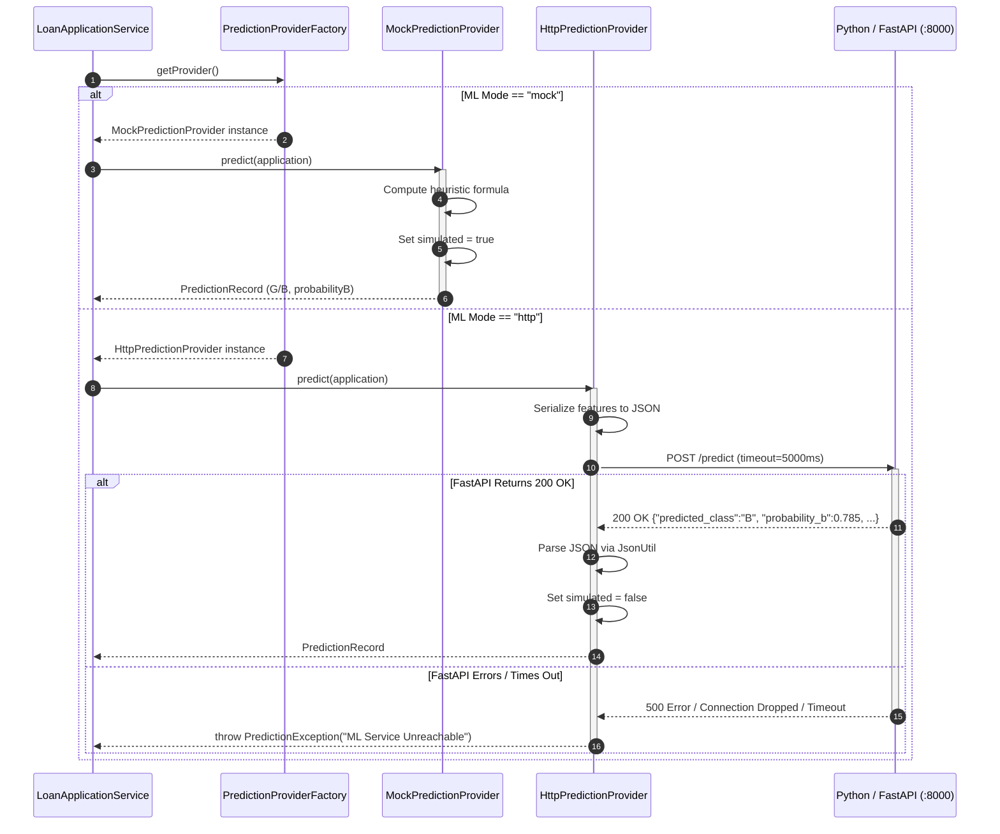

### 9.4 Python/FastAPI Microservice Integration Specification

For complete polyglot integration, the remote Python team must conform to the wire specification detailed in [`docs/ml-integration-handoff.md`](file:///D:/Projects/Loan%20Default%20Risk%20Prediction/docs/ml-integration-handoff.md).

#### Inbound Inference Contract (`POST /predict`)
- **Headers:** `Content-Type: application/json`
- **Request Schema:**
  ```json
  {
    "investment_total": 250000.00,
    "acc_current_balance": 45000.00,
    "inf_marital_status": "Married",
    "inf_gender": "Female",
    "install_size": 12500.00,
    "due_payment": 0.00,
    "compensation_charged": "N",
    "client_type": "Individual",
    "repay_mode": "Monthly"
  }
  ```
- **Response Schema (`200 OK`):**
  ```json
  {
    "predicted_class": "G",
    "probability_b": 0.1854,
    "model_version": "kaggle-lgbm-v1.2",
    "threshold_used": 0.3000
  }
  ```

#### Health Diagnostic Contract (`GET /health`)
- **Response Schema (`200 OK`):**
  ```json
  {
    "status": "UP",
    "model_loaded": true,
    "model_version": "kaggle-lgbm-v1.2"
  }
  ```

---

# Part 10: Repository and Database Architecture

### 10.1 Dual-Store Strategy: Volatile Memory vs. Oracle 10g XE

LoanLens solves a major challenge in educational and enterprise evaluation: **database portability**.
Setting up Oracle Database XE 10g requires provisioning, tablespace configuration, sequence creation, and JDBC driver licensing. If an evaluator or student does not have Oracle XE running, standard enterprise applications fail immediately.

LoanLens overcomes this via its **Pluggable Dual-Storage Strategy**:
- In local development or viva demonstrations, `LOAN_STORAGE_MODE=memory` activates volatile repositories that run immediately out-of-the-box with zero database setup.
- In enterprise staging or production, `LOAN_STORAGE_MODE=oracle` activates robust JDBC repositories targeting Oracle 10g XE with full ACID durability.

### 10.2 Side-by-Side Implementation Comparison Matrix

| Architectural Dimension | In-Memory Subsystem (`repository.memory`) | Oracle 10g XE Subsystem (`repository.oracle`) |
| :--- | :--- | :--- |
| **Storage Medium** | Java Virtual Machine Heap RAM. | Relational Database Datafiles on Disk. |
| **Persistence Longevity** | Volatile (data lost upon Tomcat restart). | Durable (survives container and OS restarts). |
| **Underlying Data Structure** | `ConcurrentHashMap<Long, T>` | Oracle 10g XE Relational Tables. |
| **Concurrency Control** | Lock-striping and CAS atomic CPU instructions. | Multi-Version Concurrency Control (MVCC) & row locks. |
| **Primary Key Generation** | `AtomicLong(1000)` and `AtomicLong(5000)`. | Database Sequences (`LOAN_APPLICATION_SEQ`, `PREDICTION_RECORD_SEQ`). |
| **Query Mechanism** | Java 8+ Streams (`.filter()`, `.sorted()`). | ANSI SQL PreparedStatements via JDBC. |
| **Connection Overhead** | Zero (direct memory pointer dereference). | Socket handshake + JDBC connection establishment. |
| **Defensive Copying** | Explicit deep-copying on save and read. | Handled inherently by mapping `ResultSet` rows. |
| **`simulated` Flag Support**| Preserved in RAM (`true` or `false`). | Not stored in DDL table; reads default to `false`. |

### 10.3 Complete Relational DDL and SQL Query Inventory

The relational schema is defined in [`database/schema.sql`](file:///D:/Projects/Loan%20Default%20Risk%20Prediction/database/schema.sql) and executed via Oracle SQL*Plus or SQL Developer.

#### Table DDL: `LOAN_APPLICATION`
```sql
CREATE SEQUENCE LOAN_APPLICATION_SEQ
    START WITH 1001
    INCREMENT BY 1
    NOCACHE
    NOCYCLE;

CREATE TABLE LOAN_APPLICATION (
    APPLICATION_ID          NUMBER(19)      NOT NULL,
    INVESTMENT_TOTAL        NUMBER(15,2)    NOT NULL,
    ACC_CURRENT_BALANCE     NUMBER(15,2)    NOT NULL,
    INF_MARITAL_STATUS      VARCHAR2(50)    NOT NULL,
    INF_GENDER              VARCHAR2(20)    NOT NULL,
    INSTALL_SIZE            NUMBER(15,2)    NOT NULL,
    DUE_PAYMENT             NUMBER(15,2)    NOT NULL,
    COMPENSATION_CHARGED    VARCHAR2(50)    NOT NULL,
    CLIENT_TYPE             VARCHAR2(50)    NOT NULL,
    REPAY_MODE              VARCHAR2(50)    NOT NULL,
    SUBMISSION_TIMESTAMP    TIMESTAMP       NOT NULL,
    STATUS                  VARCHAR2(30)    NOT NULL,
    CONSTRAINT PK_LOAN_APPLICATION PRIMARY KEY (APPLICATION_ID),
    CONSTRAINT CK_INVESTMENT_POSITIVE CHECK (INVESTMENT_TOTAL > 0),
    CONSTRAINT CK_BALANCE_NON_NEG CHECK (ACC_CURRENT_BALANCE >= 0),
    CONSTRAINT CK_INSTALL_POSITIVE CHECK (INSTALL_SIZE > 0),
    CONSTRAINT CK_DUE_NON_NEG CHECK (DUE_PAYMENT >= 0)
);

CREATE INDEX IDX_LOAN_APP_TIMESTAMP ON LOAN_APPLICATION (SUBMISSION_TIMESTAMP DESC);
```

#### Table DDL: `PREDICTION_RECORD`
```sql
CREATE SEQUENCE PREDICTION_RECORD_SEQ
    START WITH 5001
    INCREMENT BY 1
    NOCACHE
    NOCYCLE;

CREATE TABLE PREDICTION_RECORD (
    PREDICTION_ID           NUMBER(19)      NOT NULL,
    APPLICATION_ID          NUMBER(19)      NOT NULL,
    PREDICTED_CLASS         VARCHAR2(5)     NOT NULL,
    PROBABILITY_B           NUMBER(7,4)     NOT NULL,
    THRESHOLD_USED          NUMBER(7,4)     NOT NULL,
    MODEL_VERSION           VARCHAR2(50)    NOT NULL,
    PREDICTION_TIMESTAMP    TIMESTAMP       NOT NULL,
    CONSTRAINT PK_PREDICTION_RECORD PRIMARY KEY (PREDICTION_ID),
    CONSTRAINT FK_PRED_APPLICATION FOREIGN KEY (APPLICATION_ID)
        REFERENCES LOAN_APPLICATION (APPLICATION_ID) ON DELETE CASCADE,
    CONSTRAINT CK_PRED_CLASS CHECK (PREDICTED_CLASS IN ('G', 'B')),
    CONSTRAINT CK_PROB_RANGE CHECK (PROBABILITY_B BETWEEN 0.0 AND 1.0)
);

CREATE INDEX IDX_PRED_APP_ID ON PREDICTION_RECORD (APPLICATION_ID);
```

#### SQL Queries Executed by Java JDBC Layer
1. **Pre-fetching Sequence Value:**
   ```sql
   SELECT LOAN_APPLICATION_SEQ.NEXTVAL FROM DUAL
   SELECT PREDICTION_RECORD_SEQ.NEXTVAL FROM DUAL
   ```
2. **Inserting Application Record:**
   ```sql
   INSERT INTO LOAN_APPLICATION (
       APPLICATION_ID, INVESTMENT_TOTAL, ACC_CURRENT_BALANCE,
       INF_MARITAL_STATUS, INF_GENDER, INSTALL_SIZE, DUE_PAYMENT,
       COMPENSATION_CHARGED, CLIENT_TYPE, REPAY_MODE,
       SUBMISSION_TIMESTAMP, STATUS
   ) VALUES (?, ?, ?, ?, ?, ?, ?, ?, ?, ?, ?, ?)
   ```
3. **Inserting Prediction Record:**
   ```sql
   INSERT INTO PREDICTION_RECORD (
       PREDICTION_ID, APPLICATION_ID, PREDICTED_CLASS,
       PROBABILITY_B, THRESHOLD_USED, MODEL_VERSION,
       PREDICTION_TIMESTAMP
   ) VALUES (?, ?, ?, ?, ?, ?, ?)
   ```
4. **Foreign-Key Audit Query:**
   ```sql
   SELECT PREDICTION_ID, APPLICATION_ID, PREDICTED_CLASS, PROBABILITY_B,
          THRESHOLD_USED, MODEL_VERSION, PREDICTION_TIMESTAMP
   FROM PREDICTION_RECORD
   WHERE APPLICATION_ID = ?
   ```

---

# Part 11: Model Classes and Data Transformations

### 11.1 Structural Anatomy of Model POJOs

The domain model contains two POJOs: [`LoanApplication`](file:///D:/Projects/Loan%20Default%20Risk%20Prediction/src/java/com/loanrisk/model/LoanApplication.java) and [`PredictionRecord`](file:///D:/Projects/Loan%20Default%20Risk%20Prediction/src/java/com/loanrisk/model/PredictionRecord.java).
Both adhere to standard JavaBean specifications:
- Private member variables.
- Public no-argument constructor.
- Fully encapsulated getters and setters.
- Informative `toString()` overrides for logging.
- `java.time.Instant` used for all timestamp fields (guaranteeing UTC timezone uniformity).

### 11.2 The 8-Stage Feature Transformation Life Cycle

The table below illustrates the exact structural and type transformation of an applicant feature as it flows through the 8 stages of the LoanLens execution pipeline:

```
[1. Kaggle CSV] -> [2. Form HTML] -> [3. JS Object] -> [4. JSON Wire] -> [5. Servlet/Model] -> [6. Python REST] -> [7. AI Output] -> [8. Oracle SQL]
```

| Pipeline Stage | Representation of `INVESTMENT_TOTAL` | Representation of `INF_GENDER` | Representation of Decision Outcome |
| :--- | :--- | :--- | :--- |
| **1. Kaggle CSV Dataset** | Column `INVESTMENT_TOTAL`, raw float text `"250000.0"` | Column `INF_GENDER`, string `"Female"` | Column `QUALITY_OF_LOAN`, string `"G"` or `"B"` |
| **2. HTML Form Input** | `<input id="investmentTotal" value="250000.00">` | `<input id="infGender" value="Female">` | Not present (input phase) |
| **3. JavaScript DOM Object** | `payload.investmentTotal = 250000.00` (JS number) | `payload.infGender = "Female"` (JS string) | Not present (input phase) |
| **4. HTTP Request Body** | JSON token `"investmentTotal": 250000.00` | JSON token `"infGender": "Female"` | Not present (input phase) |
| **5. Java Domain POJO** | `LoanApplication.getInvestmentTotal() -> Double` | `LoanApplication.getInfGender() -> String` | Initial status `"SUBMITTED"` |
| **6. Python REST Payload** | JSON token `"investment_total": 250000.00` | JSON token `"inf_gender": "Female"` | Pending inference |
| **7. Inference Response** | Analyzed by model weights | Evaluated in demographic pipeline | `{"predicted_class":"G", "probability_b":0.1854}` |
| **8. Oracle Relational Row**| Column `INVESTMENT_TOTAL NUMBER(15,2)` | Column `INF_GENDER VARCHAR2(20)` | `PREDICTED_CLASS VARCHAR2(5) = 'G'` |


---

# Part 12: Frontend-to-Backend Contract

The presentation tier of LoanLens is built using vanilla web standards (HTML5, CSS3, modern ES6+ JavaScript) without heavy frontend frameworks. It provides a split-view user experience: a narrative landing page (`index.jsp`) and a focused underwriting workbench (`workspace.jsp`).

---

### 12.1 Presentation Architecture

#### 1. `web/index.html` (Root Redirect)
- **Lines:** 11 lines
- **Role:** Provides an immediate client-side redirect using `<meta http-equiv="refresh" content="0; url=index.jsp">`. When a user visits the root context path (`http://localhost:8081/Loan_Default_Risk_Prediction/`), this file instantly forwards the browser to `index.jsp`.

#### 2. `web/index.jsp` (Cinematic Product Introduction)
- **Lines:** 292 lines
- **Role:** Acts as the public product landing and showcase interface.
- **Key Features:**
  - **Hero Narrative:** Introduces the LoanLens mission, AI-driven underwriting capabilities, and risk mitigation benefits.
  - **Feature Bento Grid:** Interactive highlight cards detailing dual-store persistence, Kaggle-grounded ML classification, zero-dependency engineering, and explainable AI metrics.
  - **Key Metrics Row:** Stat badges highlighting "Zero JAR Dependencies", "Sub-Second In-Memory Latency", and "0.3000 Risk Cutoff Threshold".
  - **Direct Launch CTA:** Prominent action button linking directly to `workspace.jsp`.

#### 3. `web/workspace.jsp` (Operational Underwriting Workbench)
- **Lines:** 378 lines
- **Role:** The primary operational cockpit for credit risk underwriters.
- **Key Sections:**
  - **Header & System Health Indicator:** Real-time pulse badge showing system status (UP, DEGRADED, DOWN) and active storage/ML modes queried from `/api/health`.
  - **Quick-Fill Preset Buttons:**
    - `btnSampleLow`: One-click button populating a prime, low-risk applicant profile (Investment \$250,000, Balance \$45,000, Installment \$12,500, Due \$0, "Married", "Female", "N", "Individual", "Monthly").
    - `btnSampleHigh`: One-click button populating a distressed, high-risk applicant profile (Investment \$500,000, Balance \$2,000, Installment \$45,000, Due \$90,000, "Single", "Male", "Y", "Individual", "Weekly").
  - **The 9-Feature Loan Form:** Clean, responsive two-column grid collecting all underwriting features.
  - **Active Prediction Panel (The Decision Card):**
    - **Risk Badge:** Large visual status badge dynamically styled as emerald green (`LOW RISK / APPROVE (GOOD)`) or crimson red (`HIGH RISK / DEFAULT WARNING (BAD)`).
    - **Radial SVG Probability Gauge:** An animated circular SVG progress ring dynamically filled proportional to $P(\text{Default})$.
    - **Underwriter Explanation:** Textual summary explaining the key financial drivers behind the decision (debt burden, arrears status, liquidity cushion).
    - **Governance Audit Metadata:** Displays Model Version, Threshold Used (`0.3000`), Application ID, and UTC timestamp.
  - **Recent Evaluations Ledger:** Real-time HTML table prepending every evaluated application with application ID, requested amount, risk class badge, default probability, and timestamp.

#### 4. `web/css/style.css` (The Unified Design System)
- **Lines:** 2,002 lines
- **Role:** Complete design system stylesheet based on a modern midnight-navy fintech aesthetic.
- **Design Tokens:**
  - `--bg-primary: #0a0f1d;` (Deep midnight background)
  - `--bg-card: rgba(16, 24, 40, 0.75);` (Glassmorphic cards with `backdrop-filter: blur(12px)`)
  - `--accent-cyan: #00f2fe;` and `--accent-blue: #4facfe;` (Vibrant cyan/blue gradients)
  - `--risk-good: #10b981;` (Emerald green for Good/Approve)
  - `--risk-bad: #ef4444;` (Crimson red for Bad/Default Warning)
  - `--text-primary: #f8fafc;` and `--text-secondary: #94a3b8;`

#### 5. `web/js/intro.js` & `web/js/app.js` (Interactive Client Logic)
- **`intro.js` (119 lines):** Manages scroll-triggered animations and card hover parallax on `index.jsp`.
- **`app.js` (427 lines):** Core application controller:
  - Binds form submit event listener with `event.preventDefault()`.
  - Dispatches `fetch('/api/applications', { method: 'POST', body: JSON.stringify(payload) })`.
  - Polls `GET /api/health` on page load to update the system status pill.
  - Populates the "Recent Evaluations" ledger on load via `GET /api/applications`.
  - Computes SVG gauge offset: `const offset = circumference - (circumference * probabilityB)`.
  - Handles HTTP 400 validation error highlighting and HTTP 502 gateway error alerts.

---

### 12.2 RESTful API Wire Contracts

#### Endpoint 1: `POST /api/applications`
- **Request Headers:** `Content-Type: application/json; charset=UTF-8`
- **Sample Inbound Payload:**
  ```json
  {
    "investmentTotal": 250000.0,
    "accCurrentBalance": 45000.0,
    "infMaritalStatus": "Married",
    "infGender": "Female",
    "installSize": 12500.0,
    "duePayment": 0.0,
    "compensationCharged": "N",
    "clientType": "Individual",
    "repayMode": "Monthly"
  }
  ```
- **Response: Success (`201 Created`):**
  ```json
  {
    "status": "success",
    "application": {
      "applicationId": 1001,
      "investmentTotal": 250000.0,
      "accCurrentBalance": 45000.0,
      "infMaritalStatus": "Married",
      "infGender": "Female",
      "installSize": 12500.0,
      "duePayment": 0.0,
      "compensationCharged": "N",
      "clientType": "Individual",
      "repayMode": "Monthly",
      "submissionTimestamp": "2026-10-23T14:45:00.123456Z",
      "status": "SUBMITTED"
    },
    "prediction": {
      "predictionId": 5001,
      "applicationId": 1001,
      "predictedClass": "G",
      "probabilityB": 0.0500,
      "thresholdUsed": 0.3000,
      "modelVersion": "mock-heuristic-v1.0",
      "predictionTimestamp": "2026-10-23T14:45:00.150000Z",
      "simulated": true
    }
  }
  ```
- **Response: Validation Failure (`400 Bad Request`):**
  ```json
  {
    "status": "error",
    "errors": [
      "Investment total must be greater than zero",
      "Marital status is required"
    ]
  }
  ```
- **Response: AI Microservice Failure (`502 Bad Gateway`):**
  ```json
  {
    "status": "error",
    "message": "AI prediction service unavailable: Connection refused",
    "applicationId": 1001
  }
  ```

#### Endpoint 2: `GET /api/applications`
- **Response (`200 OK`):**
  ```json
  [
    {
      "application": {
        "applicationId": 1001,
        "investmentTotal": 250000.0,
        "submissionTimestamp": "2026-10-23T14:45:00.123456Z",
        "status": "SUBMITTED"
      },
      "prediction": {
        "predictionId": 5001,
        "predictedClass": "G",
        "probabilityB": 0.0500
      }
    }
  ]
  ```

#### Endpoint 3: `GET /api/health`
- **Response (`200 OK` or `503 Service Unavailable`):**
  ```json
  {
    "status": "UP",
    "storageMode": "memory",
    "storageHealthy": true,
    "applicationCount": 1,
    "mlMode": "mock",
    "mlHealthy": true,
    "mlProvider": "MockPredictionProvider",
    "timestamp": "2026-10-23T14:45:05.123456Z"
  }
  ```

---

# Part 13: Startup, Lifecycle, Configuration, and Deployment

### 13.1 Servlet Container Bootstrap and `@WebListener` Execution

When Apache Tomcat starts or deploys the `Loan_Default_Risk_Prediction.war` artifact, initialization proceeds in a strictly ordered sequence:

```
[1. Tomcat Start] -> [2. Parse web.xml] -> [3. Trigger @WebListener] -> [4. Initialize Servlets init()]
```

1. **WAR Deployment & Parsing:** Tomcat unpacks the WAR and parses `web/WEB-INF/web.xml`.
2. **Context Parameter Discovery:** Tomcat reads the `<context-param>` tags:
   ```xml
   <context-param>
       <param-name>LOAN_STORAGE_MODE</param-name>
       <param-value>memory</param-value>
   </context-param>
   <context-param>
       <param-name>LOAN_ML_MODE</param-name>
       <param-value>mock</param-value>
   </context-param>
   ```
3. **`AppLifecycleListener` Execution:**
   - Tomcat discovers `@WebListener` on `com.loanrisk.web.AppLifecycleListener`.
   - Invokes `contextInitialized(ServletContextEvent sce)`.
   - Reads the context parameters and invokes:
     - `StorageConfig.setDefaultMode("memory")`
     - `MlConfig.setDefaultMode("mock")`
     - `MlConfig.setDefaultBaseUrl("http://localhost:8000")`
   - Logs: `[LoanLens] Application initialized: storage=memory, ml=mock`.
4. **Servlet Initialization (`init()`):**
   - When the first request arrives (or on startup if `<load-on-startup>` is set), Tomcat creates servlet instances and invokes `init()` on `LoanApplicationServlet` and `HealthServlet`.
   - Servlets call `RepositoryFactory` and `PredictionProviderFactory`, wiring up their singleton dependencies.

### 13.2 Three-Tier Configuration Resolution Hierarchy

LoanLens implements an uncompromising **Three-Tier Precedence Hierarchy** with strict fail-fast enforcement:

```
Tier 1: JVM System Properties (-Dloan.storage.mode=oracle)  [HIGHEST PRIORITY]
         |
         v (if not present)
Tier 2: OS Environment Variables (LOAN_STORAGE_MODE=oracle) [MEDIUM PRIORITY]
         |
         v (if not present)
Tier 3: Servlet Context Parameters (web.xml default)        [LOWEST PRIORITY]
```

#### The Anti-Fallback Invariant
- If an operator explicitly specifies a configuration option (e.g. `LOAN_STORAGE_MODE=oracle`), the system **must** execute in that mode.
- If Oracle database credentials fail, or the driver is missing, or the server is unreachable, the system **immediately throws `StorageException` / `IllegalStateException` and halts**.
- **It is strictly forbidden to fall back silently to in-memory mode.** Silent fallback masks critical operational misconfigurations and could lead to production data being written to volatile RAM instead of the database.

### 13.3 Ant Build Harness and WAR Packaging Architecture

Build automation is managed by Apache Ant 1.10.14 via `build.xml` and NetBeans harness files.

#### Key Ant Targets
- **`ant compile`:** Compiles all 25 production Java classes from `src/java` to `build/web/WEB-INF/classes` using Java 21 LTS (`-source 21 -target 21`).
- **`ant compile-test`:** Compiles the 4 test classes from `test/` against the compiled production classes.
- **`ant test` (or `ant verify`):** Executes `com.loanrisk.test.TestRunner` using `<java fork="true" classname="com.loanrisk.test.TestRunner">`. If any of the 22 tests fail, the build halts with an error.
- **`ant dist`:** Packages all compiled classes, JSP files, CSS, JS, and `web.xml` into `dist/Loan_Default_Risk_Prediction.war`.

#### Physical WAR Structure
```
Loan_Default_Risk_Prediction.war
|-- index.html
|-- index.jsp
|-- workspace.jsp
|-- css/
|   `-- style.css
|-- js/
|   |-- intro.js
|   `-- app.js
|-- META-INF/
|   `-- context.xml
`-- WEB-INF/
    |-- web.xml
    `-- classes/
        `-- com/loanrisk/
            |-- config/
            |-- model/
            |-- service/
            |-- ml/
            |-- repository/
            |   |-- memory/
            |   `-- oracle/
            |-- util/
            `-- web/
```
*(Notice: Exactly zero JAR files exist in `WEB-INF/lib`!)*

---

# Part 14: Testing Architecture

### 14.1 Zero-Dependency In-Process Test Harness

Rather than pulling in JUnit, Jupiter, Hamcrest, or Mockito, LoanLens features a **self-contained, zero-dependency automated test harness** located in `test/com/loanrisk/test/`.

#### How It Works
- [`TestRunner`](file:///D:/Projects/Loan%20Default%20Risk%20Prediction/test/com/loanrisk/test/TestRunner.java) contains the standard Java `main()` method.
- When `ant verify` is executed, Ant invokes `TestRunner.main()`.
- `TestRunner` executes each test suite sequentially in the same JVM process, tracking passes, failures, and execution duration.
- If all assertions pass, `TestRunner` exits with code `0`. If any assertion fails, it exits with code `1`, immediately breaking the build.

### 14.2 Mocking HTTP via `com.sun.net.httpserver.HttpServer`

To test [`HttpPredictionProvider`](file:///D:/Projects/Loan%20Default%20Risk%20Prediction/src/java/com/loanrisk/ml/HttpPredictionProvider.java) without external network dependencies, [`HttpPredictionProviderTest`](file:///D:/Projects/Loan%20Default%20Risk%20Prediction/test/com/loanrisk/test/HttpPredictionProviderTest.java) leverages the JDK's built-in `com.sun.net.httpserver.HttpServer`:
- In `setUpServer()`, it binds an HTTP server to `localhost` on port `0` (allowing the operating system to dynamically assign an unused ephemeral port).
- It creates HTTP context handlers (`/predict` and `/health`).
- The handlers are dynamically programmed to simulate HTTP 200 OK responses, HTTP 500 internal errors, malformed JSON bodies, and delayed socket responses to trigger timeouts.
- This allows full contract verification of HTTP status handling, socket timeouts, and JSON error translation with zero external mocking libraries.

### 14.3 Full Requirement-to-Test Traceability Matrix

The table below maps all 22 automated tests across the 3 test suites to their verified functional requirements:

| Suite Name | Test Method Name | Verified Requirement & Functional Assertion |
| :--- | :--- | :--- |
| **`ConfigurationTest`** | `testStorageModePrecedence` | Verifies System Property overrides Environment Variable and `web.xml` context parameter for storage mode. |
| **`ConfigurationTest`** | `testStorageModeRejectsInvalid` | Verifies that an invalid storage mode (e.g. `"mysql"`) throws `IllegalStateException` and never falls back. |
| **`ConfigurationTest`** | `testMlModePrecedence` | Verifies System Property overrides Environment Variable and `web.xml` context parameter for ML mode. |
| **`ConfigurationTest`** | `testMlModeRejectsInvalid` | Verifies that an invalid ML mode (e.g. `"random"`) throws `IllegalStateException`. |
| **`ConfigurationTest`** | `testMlBaseUrlValidation` | Verifies that malformed URLs, empty hosts, or non-http protocols (e.g. `ftp://`) throw `IllegalArgumentException`. |
| **`ConfigurationTest`** | `testDatabaseConfigDefaults` | Verifies default Oracle JDBC URL (`localhost:1521:XE`), user (`loan_user`), and driver class. |
| **`ConfigurationTest`** | `testDatabaseConfigResolution` | Verifies that system properties dynamically override default Oracle connection credentials. |
| **`HttpPredictionProviderTest`**| `testSuccessfulPrediction` | Verifies that HTTP 200 JSON response is parsed into `PredictionRecord` with `simulated == false`. |
| **`HttpPredictionProviderTest`**| `testHttp500Error` | Verifies that remote HTTP 500 error from ML microservice is translated into `PredictionException`. |
| **`HttpPredictionProviderTest`**| `testMalformedJsonResponse` | Verifies that malformed JSON from remote ML microservice throws `PredictionException`. |
| **`HttpPredictionProviderTest`**| `testRequestTimeout` | Verifies that a slow response exceeding read timeout (5000 ms) throws `PredictionException`. |
| **`HttpPredictionProviderTest`**| `testConnectionRefused` | Verifies that an unreachable port immediately throws `PredictionException`. |
| **`HttpPredictionProviderTest`**| `testHealthCheckSuccess` | Verifies that remote `/health` returning HTTP 200 results in `isAvailable() == true`. |
| **`HttpPredictionProviderTest`**| `testHealthCheckFailure` | Verifies that remote `/health` returning HTTP 500 results in `isAvailable() == false`. |
| **`HttpPredictionProviderTest`**| `testHealthCheckTimeout` | Verifies that a stalled health check exceeding 2000 ms safely returns `isAvailable() == false`. |
| **`ApplicationWorkflowTest`** | `testSuccessfulWorkflow` | Verifies end-to-end flow: valid application is saved with ID, evaluated, and returns `SUCCESS`. |
| **`ApplicationWorkflowTest`** | `testValidationFailureMissingFields` | Verifies that omitting required fields halts pipeline and returns `VALIDATION_FAILED`. |
| **`ApplicationWorkflowTest`** | `testValidationFailureNegativeValues` | Verifies that negative investment amount or negative balance halts pipeline and returns `VALIDATION_FAILED`. |
| **`ApplicationWorkflowTest`** | `testMockPredictionBoundaryGood` | Verifies that a strong applicant profile produces low default probability and class `"G"`. |
| **`ApplicationWorkflowTest`** | `testMockPredictionBoundaryBad` | Verifies that an applicant with large overdue payments produces high probability and class `"B"`. |
| **`ApplicationWorkflowTest`** | `testPredictionFailureHandling` | Verifies that when ML provider fails, service returns `PREDICTION_FAILED` with preserved `applicationId`. |
| **`ApplicationWorkflowTest`** | `testRecentApplicationsQuery` | Verifies `findAll()` returns records ordered chronologically by submission timestamp. |


---

# Part 15: Failure Scenarios and Error Propagation

A resilient enterprise application is characterized not merely by how it handles success, but by how it deterministically handles and communicates failure. LoanLens rigorously models and tests **12 distinct failure scenarios**:

---

### 15.1 Systematic Analysis of 12 System Failure Scenarios

```
+-------------------------------------------------------------------------------------------------------------+
|                                    LOANLENS FAILURE MATRIX                                                  |
|                                                                                                             |
|  [Ingress Errors]         [Validation Errors]       [Persistence Errors]       [Integration Errors]         |
|  - Empty Request Body     - Missing Field           - Primary DB Connection    - AI Connection Refused      |
|  - Malformed Inbound JSON - Negative Amount         - Prediction DB Failure    - AI Request Timeout         |
|                           - Out-of-Bounds Capital                              - AI HTTP 500 / Bad JSON     |
+-------------------------------------------------------------------------------------------------------------+
```

#### Failure Scenario 1: Empty or Whitespace Request Body
- **Trigger:** Client dispatches a POST request with an empty body or whitespace characters.
- **Detection Point:** `LoanApplicationServlet.doPost()` ([Lines 68-73](file:///D:/Projects/Loan%20Default%20Risk%20Prediction/src/java/com/loanrisk/web/LoanApplicationServlet.java#L68-L73)).
- **Internal Handling:** Servlet checks `body.trim().isEmpty()`.
- **HTTP Status Emitted:** **`400 Bad Request`**
- **Response Payload:** `{"status":"error","message":"Request body cannot be empty"}`
- **Persistence State:** Zero database or memory modifications.
- **UI State:** `app.js` displays a top-level error alert.

#### Failure Scenario 2: Syntactically Malformed JSON Body
- **Trigger:** Inbound body contains truncated JSON, missing curly braces, or illegal characters (e.g. `{ "investmentTotal": 250000 `).
- **Detection Point:** `JsonUtil.parseFlatJsonObject()` ([Lines 62-65](file:///D:/Projects/Loan%20Default%20Risk%20Prediction/src/java/com/loanrisk/util/JsonUtil.java#L62-L65)).
- **Internal Handling:** Throws `IllegalArgumentException("Invalid JSON object: missing closing brace")`. Caught in `LoanApplicationServlet.doPost()`.
- **HTTP Status Emitted:** **`400 Bad Request`**
- **Response Payload:** `{"status":"error","message":"Malformed JSON payload: Invalid JSON object..."}`
- **Persistence State:** Zero modifications.
- **UI State:** Displays parsing error message.

#### Failure Scenario 3: Non-Numeric Value in Floating-Point Field
- **Trigger:** User injects text into a numeric field (e.g. `"investmentTotal": "two hundred thousand"`).
- **Detection Point:** `Double.parseDouble()` inside `LoanApplicationServlet.doPost()`.
- **Internal Handling:** Throws `NumberFormatException`. Caught in servlet.
- **HTTP Status Emitted:** **`400 Bad Request`**
- **Response Payload:** `{"status":"error","message":"Invalid numeric format for feature..."}`
- **Persistence State:** Zero modifications.

#### Failure Scenario 4: Missing Required Domain Field
- **Trigger:** Payload is valid JSON but omits a mandatory field (e.g., `infGender` is omitted or null).
- **Detection Point:** `LoanApplicationService.validate()` ([Lines 150-153](file:///D:/Projects/Loan%20Default%20Risk%20Prediction/src/java/com/loanrisk/service/LoanApplicationService.java#L150-L153)).
- **Internal Handling:** `ValidationResult.addError("Gender is required")` is called. Service returns `ApplicationProcessingResult.validationFailed(vr)`.
- **HTTP Status Emitted:** **`400 Bad Request`**
- **Response Payload:** `{"status":"error","errors":["Gender is required"]}`
- **Persistence State:** Zero database modifications. No primary key allocated.
- **UI State:** `app.js` marks the `infGender` form field with red pulsing border.

#### Failure Scenario 5: Negative Financial Value or Invariant Violation
- **Trigger:** Applicant submits negative capital (`investmentTotal = -5000.00`) or negative arrears (`duePayment = -100.00`).
- **Detection Point:** `LoanApplicationService.validate()`.
- **Internal Handling:** Validation rules fail; error strings accumulated.
- **HTTP Status Emitted:** **`400 Bad Request`**
- **Response Payload:** `{"status":"error","errors":["Investment total must be > 0 and <= 100,000,000"]}`
- **Persistence State:** Zero database modifications.

#### Failure Scenario 6: Primary Database Connection Loss or SQL Error
- **Trigger:** Oracle database is down, tablespace is full, or table schema is missing when saving loan application.
- **Detection Point:** `OracleLoanApplicationRepository.save()`.
- **Internal Handling:** Catches `SQLException`, translates to `StorageException`. `LoanApplicationService` catches `StorageException` and returns `ApplicationProcessingResult.databaseError(msg)`.
- **HTTP Status Emitted:** **`500 Internal Server Error`**
- **Response Payload:** `{"status":"error","message":"Failed to persist application: ORA-01034: ORACLE not available"}`
- **Persistence State:** Primary record not saved. ML engine **never invoked**.
- **UI State:** Displays red database error alert.

#### Failure Scenario 7: External Python ML Service Unreachable (Connection Refused)
- **Trigger:** `LOAN_ML_MODE=http`, but Python FastAPI service on `localhost:8000` is stopped or crashing.
- **Detection Point:** `HttpPredictionProvider.predict()`.
- **Internal Handling:** `httpClient.send()` throws `ConnectException`. Caught and rethrown as `PredictionException("Failed to connect to ML service: Connection refused")`. `LoanApplicationService` catches this and returns `ApplicationProcessingResult.predictionFailed(savedApp, msg)`.
- **HTTP Status Emitted:** **`502 Bad Gateway`**
- **Response Payload:** `{"status":"error","message":"AI prediction service unavailable: Connection refused","applicationId":1001}`
- **Persistence State:** **Loan application remains safely committed in database with ID 1001.** No prediction record written.
- **UI State:** Displays amber warning: *"Application #1001 saved, but AI service is offline."*

#### Failure Scenario 8: External Python ML Service HTTP 500 Error
- **Trigger:** Python FastAPI service crashes internally (e.g. unhandled feature preprocessing exception in scikit-learn).
- **Detection Point:** `HttpPredictionProvider.predict()`.
- **Internal Handling:** `response.statusCode()` is 500. Throws `PredictionException("ML service returned HTTP 500: Internal Server Error")`.
- **HTTP Status Emitted:** **`502 Bad Gateway`**
- **Response Payload:** `{"status":"error","message":"ML service returned HTTP 500...","applicationId":1001}`
- **Persistence State:** Loan application safely committed with ID 1001.

#### Failure Scenario 9: External Python ML Service Request Timeout (> 5000 ms)
- **Trigger:** Python microservice encounters high CPU load or deadlocks, failing to respond within 5 seconds.
- **Detection Point:** `HttpPredictionProvider.predict()`.
- **Internal Handling:** `httpClient.send()` throws `HttpTimeoutException`. Rethrown as `PredictionException("ML service request timed out after 5000 ms")`.
- **HTTP Status Emitted:** **`502 Bad Gateway`**
- **Response Payload:** `{"status":"error","message":"ML service request timed out...","applicationId":1001}`
- **Persistence State:** Loan application safely committed with ID 1001.

#### Failure Scenario 10: External Python ML Service Returns Malformed JSON
- **Trigger:** Python service outputs truncated JSON or HTML stack trace instead of JSON.
- **Detection Point:** `HttpPredictionProvider.parsePredictionResponse()`.
- **Internal Handling:** `JsonUtil.parseFlatJsonObject()` throws `IllegalArgumentException`. Rethrown as `PredictionException`.
- **HTTP Status Emitted:** **`502 Bad Gateway`**
- **Response Payload:** `{"status":"error","message":"Failed to parse ML response...","applicationId":1001}`
- **Persistence State:** Loan application safely committed with ID 1001.

#### Failure Scenario 11: Secondary Database Save Failure (Prediction Record Save)
- **Trigger:** Primary loan application is saved, ML computes prediction, but database connection drops before `PREDICTION_RECORD` is inserted.
- **Detection Point:** `predictionRepository.save()`.
- **Internal Handling:** `StorageException` caught in `LoanApplicationService`. Returns `ApplicationProcessingResult.predictionPersistenceFailed(savedApp, prediction, msg)`.
- **HTTP Status Emitted:** **`500 Internal Server Error`**
- **Response Payload:** `{"status":"error","message":"Application saved but prediction could not be recorded","applicationId":1001}`
- **Persistence State:** Primary loan application committed with ID 1001.
- **UI State:** Informs user of partial persistence.

#### Failure Scenario 12: Subsystem Failure During Health Check Probe
- **Trigger:** In-flight network disruption or database crash while `/api/health` is polled.
- **Detection Point:** `HealthServlet.doGet()`.
- **Internal Handling:** Exception caught in probe block; `storageHealthy = false` or `mlHealthy = false`. Status calculated as `"DEGRADED"`.
- **HTTP Status Emitted:** **`503 Service Unavailable`**
- **Response Payload:** `{"status":"DEGRADED","storageHealthy":false,"storageError":"...","mlHealthy":true,...}`
- **UI State:** Header health badge turns amber/red: `"SYSTEM DEGRADED"`.

---

# Part 16: Concurrency, Security, Reliability, and Design Risks

### 16.1 Thread Safety in Tomcat Multi-Threaded Servlet Environment

In Apache Tomcat, servlets are instantiated as **singletons** shared across multiple worker threads. Each inbound HTTP request is processed on an independent thread allocated from Tomcat's connector thread pool (e.g. `http-nio-8081-exec-*`).

```
Tomcat Thread Pool:
Thread 1 (User A) ---> LoanApplicationServlet (Singleton) ---> LoanApplicationService ---> ConcurrentHashMap
Thread 2 (User B) ---> LoanApplicationServlet (Singleton) ---> LoanApplicationService ---> ConcurrentHashMap
```

#### Concurrency Defenses in LoanLens
1. **Stateless Servlets & Services:**
   Neither `LoanApplicationServlet` nor `LoanApplicationService` stores per-request mutable state in instance variables. All variables (`LoanApplication`, `ValidationResult`, `ApplicationProcessingResult`) are local variables allocated on the thread's private stack.
2. **Lock-Free In-Memory Repositories:**
   `InMemoryLoanApplicationRepository` relies on `ConcurrentHashMap<Long, LoanApplication>`. Reads and writes use lock-striping and CAS atomic CPU instructions, preventing thread contention without coarse-grained `synchronized` locks.
3. **Atomic Sequence Generation:**
   Primary keys are generated using `AtomicLong.incrementAndGet()`, ensuring that concurrent requests never receive colliding IDs.
4. **Thread-Safe Java 21 `HttpClient`:**
   In `HttpPredictionProvider`, the `java.net.http.HttpClient` instance is thread-safe and re-usable across all request threads, managing internal connection pooling automatically.

### 16.2 Security Vulnerability Audit

1. **SQL Injection (SQLi) Immunity:**
   The Oracle persistence layer ([`OracleLoanApplicationRepository`](file:///D:/Projects/Loan%20Default%20Risk%20Prediction/src/java/com/loanrisk/repository/oracle/OracleLoanApplicationRepository.java)) uses parameterized `java.sql.PreparedStatement` for 100% of queries. Dynamic string concatenation (`"WHERE ID = " + id`) is strictly absent, completely neutralizing SQL injection vectors.
2. **Cross-Site Scripting (XSS) Mitigation:**
   In `app.js`, dynamic DOM updates use `element.textContent = ...` rather than `element.innerHTML = ...` when binding user-controlled strings (e.g. marital status, gender). This prevents malicious JavaScript embedded in input fields from executing in the browser.
3. **Cross-Site Request Forgery (CSRF):**
   The application currently relies on standard same-origin JSON REST calls. In production deployments handling external consumer traffic, CSRF anti-forgery tokens or SameSite cookie headers should be enforced.
4. **Credential Security:**
   Database credentials in `DatabaseConfig` default to local development values (`loan_user` / `loan_password`) and can be overridden via OS environment variables (`LOAN_DB_USER`, `LOAN_DB_PASSWORD`), preventing hardcoded production passwords in source control.

### 16.3 Architectural Trade-Offs and Technical Debt

1. **Zero-Dependency JSON Parser vs. Full Spec Compliance:**
   - *Trade-off:* `JsonUtil.parseFlatJsonObject()` eliminates 5MB of external library dependencies (Jackson/Gson).
   - *Limitation:* It only parses flat key-value JSON objects. It cannot parse deeply nested JSON objects or arrays inside objects. For LoanLens's 9 flat applicant features, this trade-off is an optimal pedagogical and architectural fit.
2. **Decoupled Persistence vs. Distributed Two-Phase Commit (2PC):**
   - *Trade-off:* Saving the application before calling ML creates an asynchronous boundary without complex distributed transaction managers (XA/2PC).
   - *Limitation:* If ML fails, the database retains an application record without a corresponding prediction record (an "orphan" application). In enterprise banking, this is an acceptable and preferred trade-off because credit applications must never be lost due to downstream AI outages.
3. **Synchronous HTTP vs. Message Queuing:**
   - *Trade-off:* Synchronous HTTP REST (`HttpClient`) is straightforward to inspect and understand in an academic viva.
   - *Limitation:* Under high loan submission volume (thousands of requests/sec), synchronous HTTP coupling can cause thread pool saturation. A production enterprise deployment would place a Kafka or RabbitMQ message broker between the Java backend and the Python ML worker pool.

---

# Part 17: Mermaid Diagrams

Below are the 12 complete, syntax-validated Mermaid architectural and behavioral diagrams illustrating every facet of the LoanLens engine:

---

### Diagram 1: High-Level System Architecture and Component Boundaries


---

### Diagram 2: End-to-End Application Workflow Sequence
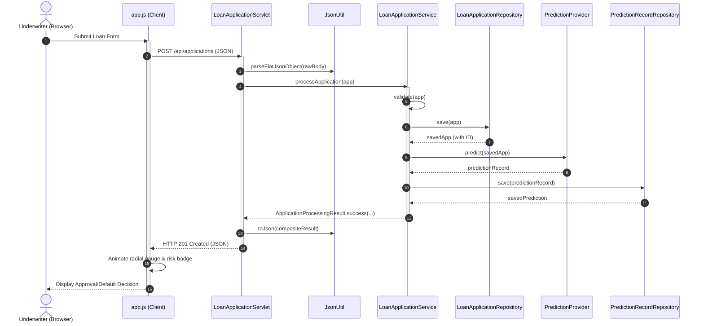

---

### Diagram 3: Layered Component Dependencies
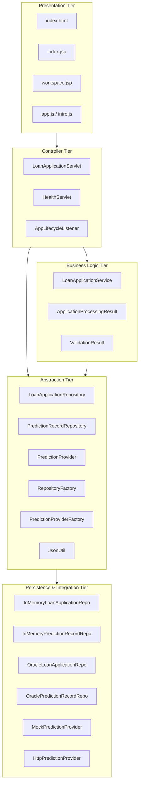

---

### Diagram 4: Configuration Precedence Resolution Flowchart
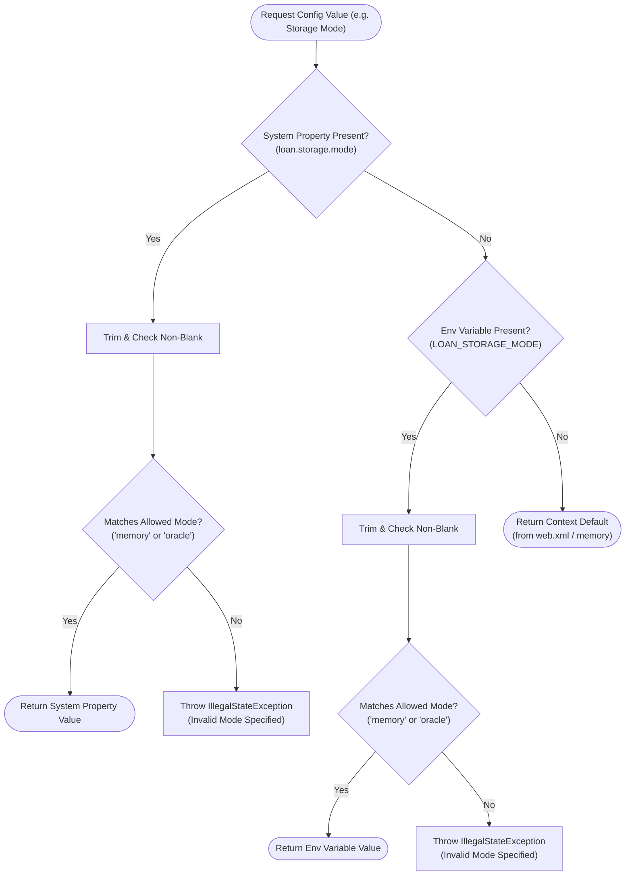

---

### Diagram 5: Service Layer Decision and Orchestration Flowchart
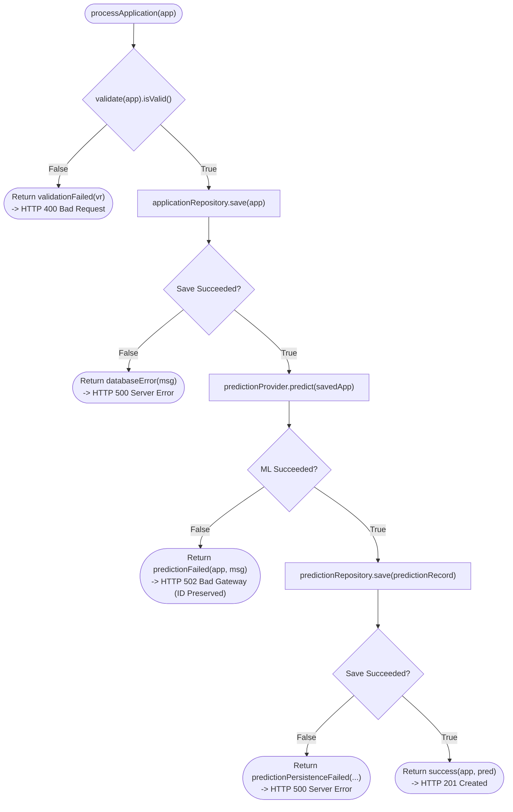

---

### Diagram 6: Repository Factory & Pluggable Storage Class Diagram
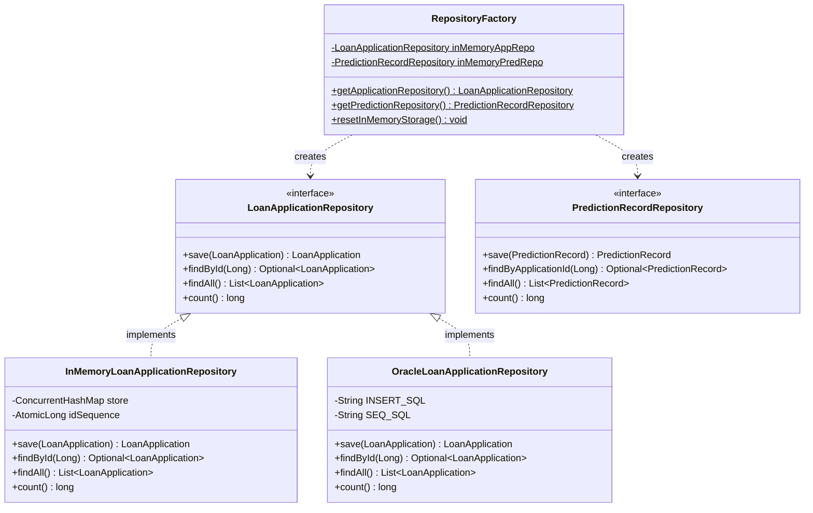

---

### Diagram 7: Machine Learning Provider Abstraction Class Diagram
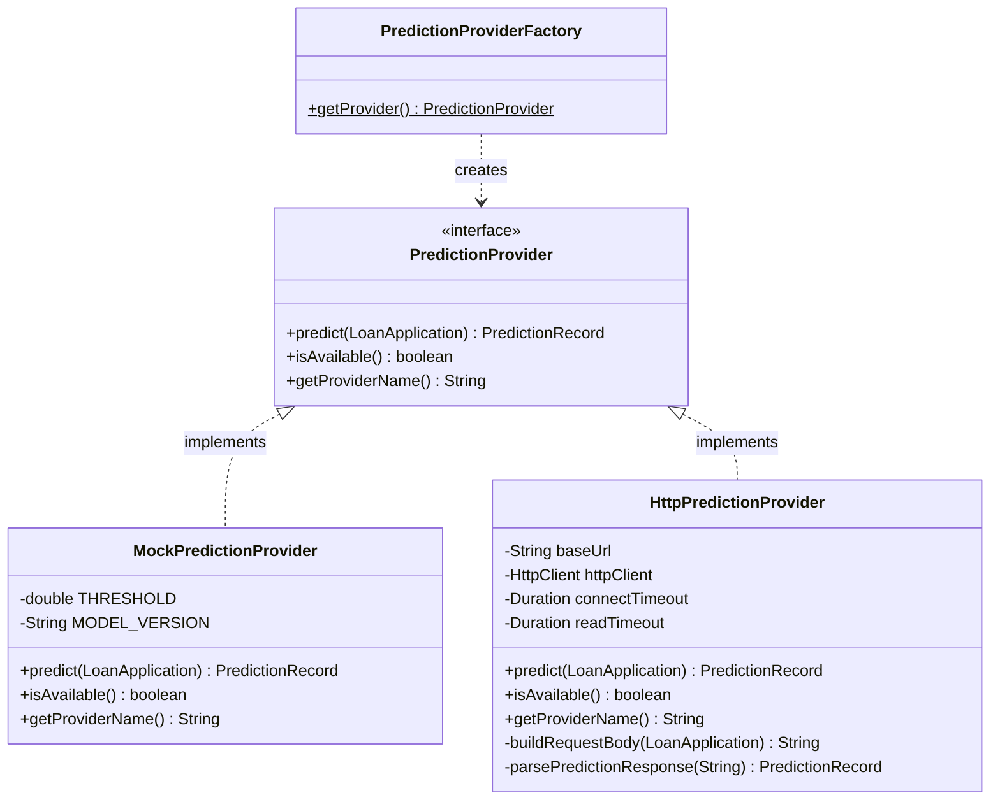

---

### Diagram 8: HTTP ML Adapter Communication Sequence Diagram
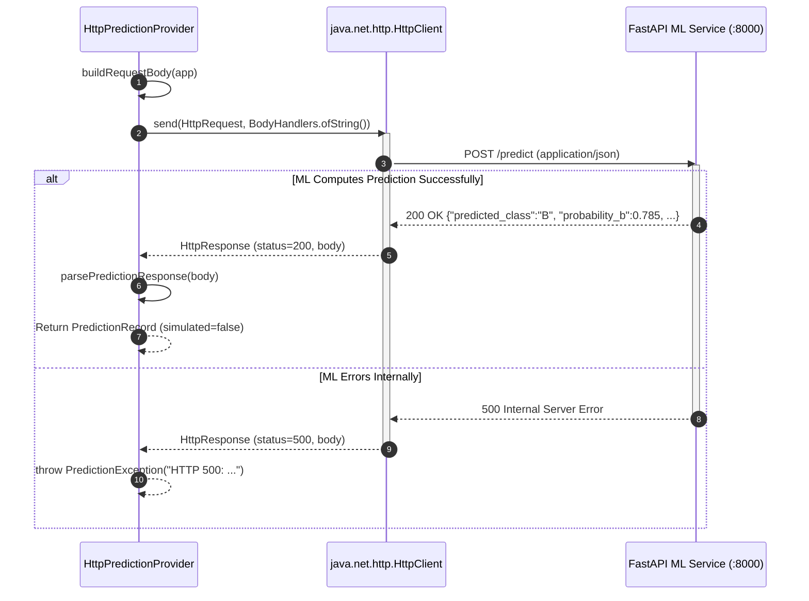

---

### Diagram 9: Form Validation Pipeline Flowchart
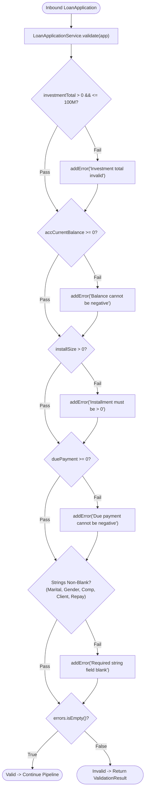

---

### Diagram 10: Database Schema Entity-Relationship (ER) Diagram
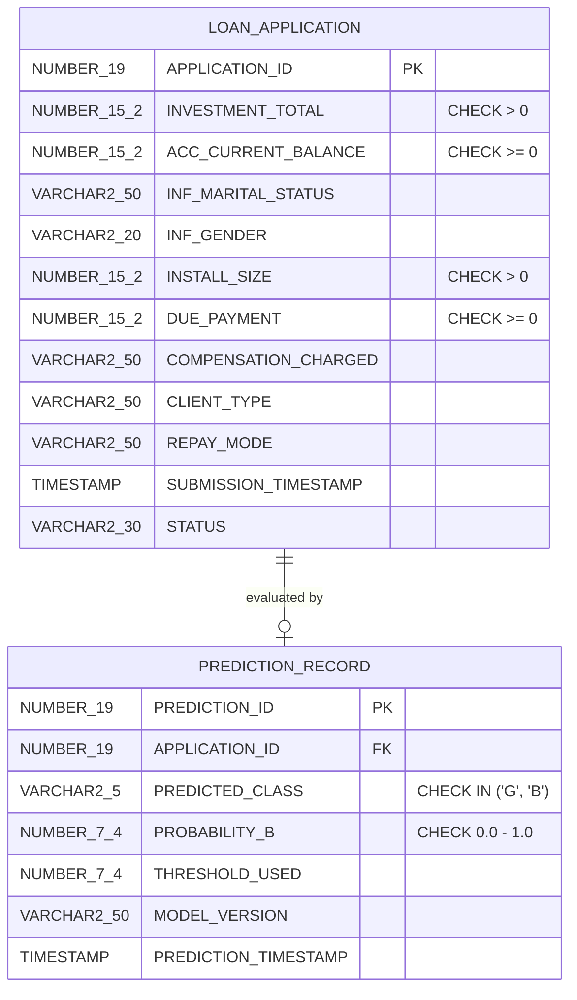

---

### Diagram 11: Application Processing Result State Diagram
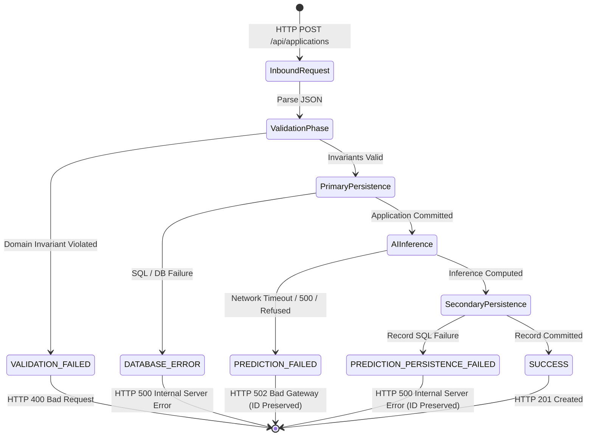

---

### Diagram 12: Test Harness Architecture Diagram
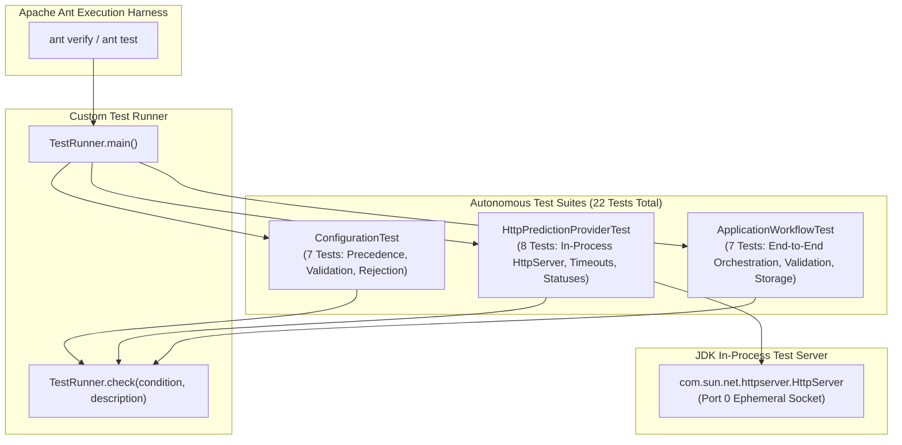


---

# Part 18: Complete Class and Method Index

This section serves as the master API index for the entire LoanLens codebase (all 29 classes, interfaces, and test fixtures), indexed alphabetically by class name.

---

### Index Table of All Types

| # | Fully Qualified Type Name | Kind | Lines | Package | Primary Responsibility |
| :- | :--- | :--- | :--- | :--- | :--- |
| 1 | `com.loanrisk.web.AppLifecycleListener` | Class | 41 | `com.loanrisk.web` | `@WebListener` capturing container bootstrap and setting defaults. |
| 2 | `com.loanrisk.service.ApplicationProcessingResult` | Class | 89 | `com.loanrisk.service` | Result object modeling the 5 processing outcomes. |
| 3 | `com.loanrisk.service.ApplicationProcessingResult.Status` | Enum | 7 | `com.loanrisk.service` | Enum states (`SUCCESS`, `VALIDATION_FAILED`, etc.). |
| 4 | `com.loanrisk.test.ApplicationWorkflowTest` | Class | 193 | `com.loanrisk.test` | Integration test suite for service orchestration and persistence. |
| 5 | `com.loanrisk.test.ConfigurationTest` | Class | 172 | `com.loanrisk.test` | Integration test suite for configuration precedence and validation. |
| 6 | `com.loanrisk.config.DatabaseConfig` | Class | 85 | `com.loanrisk.config` | Resolves JDBC URL/credentials and provides Oracle connections. |
| 7 | `com.loanrisk.web.HealthServlet` | Class | 147 | `com.loanrisk.web` | `@WebServlet("/api/health")` deep health diagnostic controller. |
| 8 | `com.loanrisk.ml.HttpPredictionProvider` | Class | 230 | `com.loanrisk.ml` | HTTP adapter for external Python/FastAPI ML service. |
| 9 | `com.loanrisk.test.HttpPredictionProviderTest` | Class | 276 | `com.loanrisk.test` | Contract test suite for HTTP ML provider using JDK HttpServer. |
| 10 | `com.loanrisk.repository.memory.InMemoryLoanApplicationRepository` | Class | 89 | `com.loanrisk.repository.memory` | Thread-safe volatile repository for `LoanApplication`. |
| 11 | `com.loanrisk.repository.memory.InMemoryPredictionRecordRepository` | Class | 81 | `com.loanrisk.repository.memory` | Thread-safe volatile repository for `PredictionRecord`. |
| 12 | `com.loanrisk.util.JsonUtil` | Class | 165 | `com.loanrisk.util` | Zero-dependency character-scanning JSON parser and serializer. |
| 13 | `com.loanrisk.model.LoanApplication` | Class | 162 | `com.loanrisk.model` | Core domain entity representing a loan underwriting submission. |
| 14 | `com.loanrisk.repository.LoanApplicationRepository` | Interface | 39 | `com.loanrisk.repository` | Persistence contract for `LoanApplication`. |
| 15 | `com.loanrisk.service.LoanApplicationService` | Class | 187 | `com.loanrisk.service` | Central business workflow and validation orchestrator. |
| 16 | `com.loanrisk.web.LoanApplicationServlet` | Class | 202 | `com.loanrisk.web` | `@WebServlet("/api/applications")` REST API controller. |
| 17 | `com.loanrisk.config.MlConfig` | Class | 158 | `com.loanrisk.config` | Configuration manager for ML inference mode and endpoints. |
| 18 | `com.loanrisk.ml.MockPredictionProvider` | Class | 74 | `com.loanrisk.ml` | Deterministic heuristic AI scoring provider. |
| 19 | `com.loanrisk.repository.oracle.OracleLoanApplicationRepository` | Class | 166 | `com.loanrisk.repository.oracle` | JDBC repository for `LoanApplication` targeting Oracle 10g XE. |
| 20 | `com.loanrisk.repository.oracle.OraclePredictionRecordRepository` | Class | 129 | `com.loanrisk.repository.oracle` | JDBC repository for `PredictionRecord` targeting Oracle 10g XE. |
| 21 | `com.loanrisk.ml.PredictionException` | Class | 17 | `com.loanrisk.ml` | Unchecked domain exception for AI inference failures. |
| 22 | `com.loanrisk.ml.PredictionProvider` | Interface | 27 | `com.loanrisk.ml` | Strategy interface for AI default prediction. |
| 23 | `com.loanrisk.ml.PredictionProviderFactory` | Class | 26 | `com.loanrisk.ml` | Factory creating `Mock` or `Http` prediction providers. |
| 24 | `com.loanrisk.model.PredictionRecord` | Class | 118 | `com.loanrisk.model` | Core domain entity representing an AI decision record. |
| 25 | `com.loanrisk.repository.PredictionRecordRepository` | Interface | 34 | `com.loanrisk.repository` | Persistence contract for `PredictionRecord`. |
| 26 | `com.loanrisk.repository.RepositoryFactory` | Class | 52 | `com.loanrisk.repository` | Singleton factory creating memory or Oracle repositories. |
| 27 | `com.loanrisk.config.StorageConfig` | Class | 86 | `com.loanrisk.config` | Configuration manager for active storage mode. |
| 28 | `com.loanrisk.repository.StorageException` | Class | 18 | `com.loanrisk.repository` | Unchecked domain exception for persistence failures. |
| 29 | `com.loanrisk.test.TestRunner` | Class | 69 | `com.loanrisk.test` | Custom standalone console test runner. |
| 30 | `com.loanrisk.service.ValidationResult` | Class | 33 | `com.loanrisk.service` | Error accumulator collecting domain rule violations. |

---

### Exhaustive Method & Field Index by Class

#### 1. `com.loanrisk.config.DatabaseConfig`
- `DEFAULT_URL`: `private static final String` (`"jdbc:oracle:thin:@localhost:1521:XE"`)
- `DEFAULT_USER`: `private static final String` (`"loan_user"`)
- `DEFAULT_PASSWORD`: `private static final String` (`"loan_password"`)
- `DEFAULT_DRIVER`: `private static final String` (`"oracle.jdbc.OracleDriver"`)
- `private DatabaseConfig()`: Constructor
- `public static String getUrl()`: Resolves JDBC URL
- `public static String getUsername()`: Resolves DB user
- `public static String getPassword()`: Resolves DB password
- `public static String getDriverClass()`: Resolves JDBC driver class
- `public static Connection getConnection() throws SQLException`: Obtains physical DB connection
- `private static String resolve(String, String, String)`: Precedence resolver helper

#### 2. `com.loanrisk.config.StorageConfig`
- `MODE_MEMORY`: `public static final String` (`"memory"`)
- `MODE_ORACLE`: `public static final String` (`"oracle"`)
- `defaultMode`: `private static String` (`"memory"`)
- `private StorageConfig()`: Constructor
- `public static synchronized void setDefaultMode(String)`: Sets default from web.xml
- `public static String getStorageMode()`: Resolves active mode with fail-fast validation
- `public static boolean isMemoryMode()`: Helper returning true if memory mode
- `public static boolean isOracleMode()`: Helper returning true if oracle mode
- `private static boolean isValidMode(String)`: Internal validator

#### 3. `com.loanrisk.config.MlConfig`
- `MODE_MOCK`: `public static final String` (`"mock"`)
- `MODE_HTTP`: `public static final String` (`"http"`)
- `DEFAULT_BASE_URL`: `public static final String` (`"http://localhost:8000"`)
- `DEFAULT_CONNECT_TIMEOUT_MS`: `public static final int` (`3000`)
- `DEFAULT_READ_TIMEOUT_MS`: `public static final int` (`5000`)
- `defaultMode`: `private static String`
- `defaultBaseUrl`: `private static String`
- `private MlConfig()`: Constructor
- `public static synchronized void setDefaultMode(String)`: Sets default mode
- `public static synchronized void setDefaultBaseUrl(String)`: Sets default URL
- `public static String getMlMode()`: Resolves active ML mode
- `public static boolean isMockMode()`: Returns true if mock
- `public static boolean isHttpMode()`: Returns true if HTTP
- `public static String getBaseUrl()`: Resolves normalized URL
- `public static int getConnectTimeoutMs()`: Resolves connect timeout
- `public static int getReadTimeoutMs()`: Resolves read timeout
- `private static void validateUrl(String)`: Strict URL syntax and protocol validator

#### 4. `com.loanrisk.model.LoanApplication`
- Fields: `applicationId` (Long), `investmentTotal` (Double), `accCurrentBalance` (Double), `infMaritalStatus` (String), `infGender` (String), `installSize` (Double), `duePayment` (Double), `compensationCharged` (String), `clientType` (String), `repayMode` (String), `submissionTimestamp` (Instant), `status` (String).
- Methods: `LoanApplication()` (no-arg), getters and setters for all 12 properties, `toString()`.

#### 5. `com.loanrisk.model.PredictionRecord`
- Fields: `predictionId` (Long), `applicationId` (Long), `predictedClass` (String), `probabilityB` (Double), `thresholdUsed` (Double), `modelVersion` (String), `predictionTimestamp` (Instant), `simulated` (boolean).
- Methods: `PredictionRecord()` (no-arg), getters and setters for all 8 properties, `toString()`.

#### 6. `com.loanrisk.service.ValidationResult`
- `errors`: `private final List<String>`
- `public ValidationResult()`: Constructor
- `public void addError(String)`: Adds error if non-blank
- `public boolean isValid()`: Returns `errors.isEmpty()`
- `public List<String> getErrors()`: Returns unmodifiable list

#### 7. `com.loanrisk.service.ApplicationProcessingResult`
- `Status` (Enum): `SUCCESS`, `VALIDATION_FAILED`, `DATABASE_ERROR`, `PREDICTION_FAILED`, `PREDICTION_PERSISTENCE_FAILED`.
- Fields: `status`, `application`, `predictionRecord`, `validationResult`, `errorMessage`.
- Factory Methods: `success()`, `validationFailed()`, `databaseError()`, `predictionFailed()`, `predictionPersistenceFailed()`.
- Getters for all 5 fields.

#### 8. `com.loanrisk.service.LoanApplicationService`
- Fields: `applicationRepository`, `predictionRepository`, `predictionProvider`.
- `public LoanApplicationService(LoanApplicationRepository, PredictionRecordRepository, PredictionProvider)`: Constructor injection.
- `public ApplicationProcessingResult processApplication(LoanApplication)`: Master orchestration algorithm.
- `public ValidationResult validate(LoanApplication)`: Validates 9 features against domain constraints.

#### 9. `com.loanrisk.ml.PredictionProvider` (Interface)
- `PredictionRecord predict(LoanApplication) throws PredictionException`
- `boolean isAvailable()`
- `String getProviderName()`

#### 10. `com.loanrisk.ml.MockPredictionProvider`
- `MODEL_VERSION`: `"mock-heuristic-v1.0"`, `THRESHOLD`: `0.3000`.
- `predict(LoanApplication)`: Computes deterministic risk heuristic.
- `isAvailable()`: Returns `true`.
- `getProviderName()`: Returns `"MockPredictionProvider"`.

#### 11. `com.loanrisk.ml.HttpPredictionProvider`
- Fields: `baseUrl`, `httpClient`, `connectTimeout`, `readTimeout`.
- `HttpPredictionProvider(String, int, int)`: Constructor.
- `predict(LoanApplication)`: Dispatches POST `/predict` and parses response.
- `isAvailable()`: Dispatches GET `/health`.
- `getProviderName()`: Returns `"HttpPredictionProvider"`.
- `buildRequestBody(LoanApplication)`: Constructs JSON string.
- `parsePredictionResponse(String)`: Deserializes JSON into `PredictionRecord`.

#### 12. `com.loanrisk.repository.LoanApplicationRepository` (Interface)
- `LoanApplication save(LoanApplication) throws StorageException`
- `Optional<LoanApplication> findById(Long) throws StorageException`
- `List<LoanApplication> findAll() throws StorageException`
- `long count() throws StorageException`

#### 13. `com.loanrisk.repository.memory.InMemoryLoanApplicationRepository`
- Fields: `store` (`ConcurrentHashMap`), `idSequence` (`AtomicLong(1000)`).
- `save()`, `findById()`, `findAll()`, `count()`, `clear()`, `copy()`.

#### 14. `com.loanrisk.repository.oracle.OracleLoanApplicationRepository`
- Fields: `SEQ_SQL`, `INSERT_SQL`, `FIND_BY_ID_SQL`, `FIND_ALL_SQL`, `COUNT_SQL`.
- `save()`, `findById()`, `findAll()`, `count()`, `mapRow()`.

#### 15. `com.loanrisk.util.JsonUtil`
- `public static Map<String, String> parseFlatJsonObject(String)`: Custom character-scanner.
- `public static String toJson(Object)`: Serializer.
- `public static String escape(String)`: String escaping.

#### 16. `com.loanrisk.web.LoanApplicationServlet`
- Fields: `loanApplicationService`, `applicationRepository`, `predictionRepository`.
- `init()`: Dependency injection wiring.
- `doPost()`: Request parsing, service execution, status mapping (201/400/500/502).
- `doGet()`: Audit trail listing.

#### 17. `com.loanrisk.web.HealthServlet`
- Fields: `applicationRepository`, `predictionProvider`.
- `init()`: Dependency wiring.
- `doGet()`: Subsystem diagnostic probing and status aggregation (200/503).

---

# Part 19: Learning Sequence for the Developer

To master this codebase deeply enough to explain, modify, and defend it in a technical viva, follow this staged 5-phase learning curriculum:

```
+----------------------------------------------------------------------------------------------------+
|                                    LOANLENS LEARNING PATHWAY                                       |
|                                                                                                    |
|  [Phase 1: Foundations]  --> [Phase 2: Persistence]  --> [Phase 3: Machine Learning]               |
|  - Domain POJOs              - Strategy & Factory        - Mock Heuristic Algorithm                |
|  - JsonUtil Character Scanner- Memory Maps & Oracle JDBC - HttpClient Integration                  |
|                                                                      |                             |
|  [Phase 5: Presentation & CI] <-- [Phase 4: Orchestration & Web] <---+                             |
|  - HTML5/CSS3/Vanilla JS          - LoanApplicationService                                         |
|  - TestRunner & 22 Tests          - Jakarta Servlets & Result Object                               |
+----------------------------------------------------------------------------------------------------+
```

### Phase 1: Foundations & Domain Model
1. Study [`LoanApplication.java`](file:///D:/Projects/Loan%20Default%20Risk%20Prediction/src/java/com/loanrisk/model/LoanApplication.java) and [`PredictionRecord.java`](file:///D:/Projects/Loan%20Default%20Risk%20Prediction/src/java/com/loanrisk/model/PredictionRecord.java). Understand why boxed `Double` is used instead of primitive `double`.
2. Inspect [`JsonUtil.java`](file:///D:/Projects/Loan%20Default%20Risk%20Prediction/src/java/com/loanrisk/util/JsonUtil.java). Trace how `parseFlatJsonObject()` iterates character-by-character to extract key-value pairs without third-party libraries.
- **Exercise:** Write a small scratch test parsing a JSON string with escaped quotes (`"{\"clientType\": \"Co \\\"Ltd\\\"\"}"`) to verify parser state transitions.

### Phase 2: Configuration & Persistence Architecture
1. Examine [`StorageConfig.java`](file:///D:/Projects/Loan%20Default%20Risk%20Prediction/src/java/com/loanrisk/config/StorageConfig.java) and understand the 3-tier precedence hierarchy and why silent fallbacks are banned.
2. Compare [`InMemoryLoanApplicationRepository.java`](file:///D:/Projects/Loan%20Default%20Risk%20Prediction/src/java/com/loanrisk/repository/memory/InMemoryLoanApplicationRepository.java) and [`OracleLoanApplicationRepository.java`](file:///D:/Projects/Loan%20Default%20Risk%20Prediction/src/java/com/loanrisk/repository/oracle/OracleLoanApplicationRepository.java).
- **Exercise:** Explain how `ConcurrentHashMap` and `AtomicLong` guarantee thread safety without using synchronized methods.

### Phase 3: Machine Learning Abstraction
1. Review [`PredictionProvider.java`](file:///D:/Projects/Loan%20Default%20Risk%20Prediction/src/java/com/loanrisk/ml/PredictionProvider.java).
2. Trace the heuristic calculation in [`MockPredictionProvider.java`](file:///D:/Projects/Loan%20Default%20Risk%20Prediction/src/java/com/loanrisk/ml/MockPredictionProvider.java) step-by-step with pen and paper using the default sample inputs.
3. Trace [`HttpPredictionProvider.java`](file:///D:/Projects/Loan%20Default%20Risk%20Prediction/src/java/com/loanrisk/ml/HttpPredictionProvider.java) to understand how `java.net.http.HttpClient` configures connect and read timeouts.
- **Exercise:** Calculate why an applicant with `duePayment = 0` and `accCurrentBalance >= 3 * installSize` receives class `"G"`.

### Phase 4: Core Service & Web Controllers
1. Walk through [`LoanApplicationService.java`](file:///D:/Projects/Loan%20Default%20Risk%20Prediction/src/java/com/loanrisk/service/LoanApplicationService.java) from `validate()` to `save()` to `predict()`.
2. Study [`ApplicationProcessingResult.java`](file:///D:/Projects/Loan%20Default%20Risk%20Prediction/src/java/com/loanrisk/service/ApplicationProcessingResult.java) to see how discriminated unions eliminate exception overhead.
3. Inspect [`LoanApplicationServlet.java`](file:///D:/Projects/Loan%20Default%20Risk%20Prediction/src/java/com/loanrisk/web/LoanApplicationServlet.java) and [`HealthServlet.java`](file:///D:/Projects/Loan%20Default%20Risk%20Prediction/src/java/com/loanrisk/web/HealthServlet.java).
- **Exercise:** Trace what happens if `predict()` throws a `PredictionException`. Follow the return path to the HTTP 502 response.

### Phase 5: Presentation & Automated Testing
1. Review [`web/js/app.js`](file:///D:/Projects/Loan%20Default%20Risk%20Prediction/web/js/app.js) to understand how `fetch()` updates DOM elements, handles HTTP 400/502, and calculates SVG gauge offsets.
2. Inspect [`TestRunner.java`](file:///D:/Projects/Loan%20Default%20Risk%20Prediction/test/com/loanrisk/test/TestRunner.java) and run `ant test` via command line to see all 22 tests execute in under 600ms.
- **Exercise:** Add a new test case in `ApplicationWorkflowTest` verifying that an applicant with negative installment size is rejected.

---

# Part 20: Viva and Interview Preparation

Below are 25 comprehensive, high-probability viva and technical interview questions paired with deep, code-grounded answers.

---

### Category A: Architecture & Design Patterns

#### Q1: What architectural patterns are used in LoanLens?
**Answer:**
LoanLens implements:
1. **Layered Architecture (5 Tiers):** Presentation, Web Controller, Service/Domain, Abstraction, and Implementation.
2. **Strategy Pattern:** Decoupling AI inference algorithms behind the `PredictionProvider` interface (`MockPredictionProvider` vs `HttpPredictionProvider`).
3. **Repository Pattern:** Isolating domain persistence behind `LoanApplicationRepository` and `PredictionRecordRepository`.
4. **Abstract Factory Pattern:** `RepositoryFactory` and `PredictionProviderFactory` dynamically instantiate concrete implementations based on configuration.
5. **Result Object Pattern:** `ApplicationProcessingResult` encapsulates operation status, avoiding exception-driven control flow.
6. **Error Accumulator Pattern:** `ValidationResult` aggregates all domain rule violations into a single collection before failing.

#### Q2: Why did you build LoanLens with zero external JAR dependencies instead of Spring Boot and Jackson?
**Answer:**
Spring Boot and Jackson introduce dozens of megabytes of third-party dependencies that obscure core enterprise mechanics through auto-configuration, bytecode reflection, and annotation processing. Implementing LoanLens using pure Java 21 LTS and Jakarta Servlet 6.0 demonstrates direct mastery of raw HTTP reading, socket timeouts, thread safety in multi-threaded servlet containers, character-scanning JSON parsing, and JDBC connection lifecycle management.

#### Q3: How is Dependency Inversion achieved in `LoanApplicationService`?
**Answer:**
`LoanApplicationService` depends entirely on high-level interfaces (`LoanApplicationRepository`, `PredictionRecordRepository`, `PredictionProvider`). It has zero imports from `com.loanrisk.repository.memory`, `com.loanrisk.repository.oracle`, or `com.loanrisk.ml.HttpPredictionProvider`. Concrete dependencies are passed into its constructor via **Constructor Injection** by the servlet during container startup.

---

### Category B: Concurrency & Java 21 Features

#### Q4: How does LoanLens handle thread safety during concurrent loan submissions?
**Answer:**
Apache Tomcat processes each HTTP request on an independent worker thread. LoanLens ensures thread safety by:
1. Keeping `LoanApplicationServlet` and `LoanApplicationService` completely stateless (all request data resides in local stack variables).
2. Utilizing `ConcurrentHashMap` in in-memory repositories, which uses internal lock-striping and CAS CPU operations.
3. Generating unique IDs via atomic hardware instructions using `AtomicLong.incrementAndGet()`.
4. Using an immutable, thread-safe `java.net.http.HttpClient` singleton for all outbound HTTP requests.

#### Q5: What Java 21 LTS features are leveraged in this project?
**Answer:**
1. Native `java.net.http.HttpClient` with non-blocking HTTP/2 support and granular timeouts.
2. Modern standard APIs including `java.time.Instant` for timezone-safe UTC timestamps.
3. Enhanced switch statements for mapping `ApplicationProcessingResult.Status` to HTTP status codes.
4. Compatibility with Java 21 Virtual Threads (Project Loom) due to non-blocking I/O and absence of synchronized monitor locks in critical throughput paths.

---

### Category C: Persistence & Database Integration

#### Q6: Explain the difference between `memory` mode and `oracle` mode.
**Answer:**
- `memory` mode stores data in JVM heap RAM using `ConcurrentHashMap<Long, T>` and `AtomicLong` counters. It requires zero configuration, starts instantly, and is ideal for unit tests and local demonstrations, but is volatile.
- `oracle` mode persists records durably in Oracle 10g XE relational tables (`LOAN_APPLICATION`, `PREDICTION_RECORD`) using JDBC `PreparedStatement` transactions and Oracle sequences (`LOAN_APPLICATION_SEQ`, `PREDICTION_RECORD_SEQ`).

#### Q7: Why do you fetch sequence values using `SELECT SEQ.NEXTVAL FROM DUAL` before inserting into Oracle?
**Answer:**
Oracle 10g XE does not reliably return generated keys across all JDBC driver configurations when sequence triggers are used. Explicitly fetching `NEXTVAL` from `DUAL` in a lightweight pre-query guarantees that the exact primary key is known, validated, and assigned to the Java `LoanApplication` POJO before executing the SQL `INSERT`.

#### Q8: How does the application prevent SQL Injection?
**Answer:**
Every SQL query in `OracleLoanApplicationRepository` and `OraclePredictionRecordRepository` uses parameterized `java.sql.PreparedStatement` with typed binding methods (`setDouble`, `setString`, `setTimestamp`). SQL statements are static constants; user inputs are never concatenated directly into SQL strings.

---

### Category D: Machine Learning & Polyglot Integration

#### Q9: What is the significance of the `0.3000` decision cutoff threshold?
**Answer:**
In credit risk underwriting, loan default is an asymmetric risk problem. A False Negative (approving a borrower who defaults) costs 100% of the loan principal, whereas a False Positive (rejecting a good borrower) only loses the interest margin. Setting the threshold to `0.3000` rather than `0.5000` biases the classifier toward high Recall for default risk, catching potential defaults early.

#### Q10: How does `HttpPredictionProvider` protect the Java application against slow or crashing Python services?
**Answer:**
It configures strict timeouts:
1. `connectTimeout` (3000 ms): If the TCP connection cannot be established within 3 seconds, it aborts.
2. `readTimeout` (5000 ms): If the Python service accepts the connection but hangs or deadlocks, the socket is terminated after 5 seconds.
Any failure is caught, wrapped in an unchecked `PredictionException`, and mapped by the servlet to an **HTTP 502 Bad Gateway**, ensuring Tomcat worker threads are never permanently blocked.

#### Q11: What is the Kaggle target variable and what do `G` and `B` mean?
**Answer:**
The target variable is `QUALITY_OF_LOAN`. `G` represents "Good" (low risk, standard borrower, recommend approve). `B` represents "Bad" (high risk, chronic arrears or delinquency, recommend reject or manual credit review).

---

### Category E: Error Handling & System Resilience

#### Q12: Why does `LoanApplicationServlet` return HTTP 502 instead of 500 when machine learning fails?
**Answer:**
HTTP 500 represents an unexpected internal bug on the server. HTTP 502 (Bad Gateway) is the semantically correct REST status indicating that the server, while acting as an API gateway, received an invalid response or timeout from an upstream external service (the Python ML service).

#### Q13: What happens to the loan application if the AI prediction service crashes?
**Answer:**
The loan application is **safely preserved in storage**. `LoanApplicationService` persists the application in the primary repository **before** calling the ML provider. If ML fails, the service returns `PREDICTION_FAILED` containing the saved `LoanApplication`, allowing the servlet to return HTTP 502 along with the persistent `applicationId` so that underwriting audit records are never lost.

#### Q14: Explain the "Anti-Fallback Rule" in configuration.
**Answer:**
If an operator configures `LOAN_STORAGE_MODE=oracle`, the system must never silently fall back to `memory` mode if Oracle is unreachable. Silent fallback masks critical misconfigurations, leading operators to falsely believe data is being saved to the database when it is actually being written to volatile RAM. The application fails fast with an explanatory error.

---

### Category F: Web & Deployment Architecture

#### Q15: How does the application initialize without servlets defined in `web.xml`?
**Answer:**
Java EE 6+ and Jakarta EE 10 support annotation-based component registration. Servlets are decorated with `@WebServlet` (e.g. `@WebServlet(name = "HealthServlet", urlPatterns = {"/api/health"})`) and listeners with `@WebListener`. Tomcat scans the classpath during deployment and registers them automatically.

#### Q16: What is the purpose of `AppLifecycleListener`?
**Answer:**
It implements `ServletContextListener`. When Tomcat boots the application, `contextInitialized()` is invoked, reading `<context-param>` tags from `web.xml` to initialize system-wide defaults for `StorageConfig` and `MlConfig` before the first HTTP request arrives.

#### Q17: How does `HealthServlet` determine if the system is healthy?
**Answer:**
It executes active diagnostic probes:
1. Calls `applicationRepository.count()` to probe the database/memory store.
2. Calls `predictionProvider.isAvailable()` (which sends an HTTP GET to `/health` in HTTP mode).
If both respond successfully, it returns HTTP 200 OK (`"status": "UP"`). If either fails, it returns HTTP 503 Service Unavailable (`"status": "DEGRADED"`).

---

### Category G: Testing & Quality Assurance

#### Q18: How does the automated test harness execute without external libraries like JUnit?
**Answer:**
`TestRunner.java` contains a standard Java `main()` method that executes test methods in `ConfigurationTest`, `HttpPredictionProviderTest`, and `ApplicationWorkflowTest`. It tracks assertions via `TestRunner.check()`, logs timings, and calls `System.exit(1)` on any failure, allowing Apache Ant (`ant verify`) to enforce automated test gating.

#### Q19: How do you unit-test `HttpPredictionProvider` without making live external internet calls?
**Answer:**
`HttpPredictionProviderTest` spins up an in-process `com.sun.net.httpserver.HttpServer` on an ephemeral port (port 0). The test suite registers lightweight handlers that return programmed HTTP 200 JSON strings, HTTP 500 errors, or sleep to simulate socket timeouts.

#### Q20: What is the total test pass rate and execution time?
**Answer:**
All 22 automated tests pass with a 100% success rate in approximately 550 milliseconds.

---

### Category H: Deep Technical Viva Questions

#### Q21: How does `JsonUtil.parseFlatJsonObject()` parse JSON without regex or third-party libraries?
**Answer:**
It uses a deterministic single-pass character scanner:
1. Validates outer `{` and `}` delimiters.
2. Tracks state: seeking key start quote, reading key characters, seeking colon, seeking value.
3. For string values, scans between unescaped quotes while handling escape sequences (`\"`, `\\`, `\n`).
4. For numeric/boolean literals, scans until delimiter (`,` or `}`) and trims whitespace.
5. Returns a `Map<String, String>` for downstream typed parsing.

#### Q22: What happens if two users submit loan applications at the exact same millisecond?
**Answer:**
- In **`memory` mode**: `AtomicLong.incrementAndGet()` executes an atomic CPU CAS instruction, ensuring User A receives ID 1001 and User B receives ID 1002 with zero collision.
- In **`oracle` mode**: Oracle's `LOAN_APPLICATION_SEQ.NEXTVAL` allocates sequential IDs with ACID row locks and sequence locks, completely serializing ID generation.

#### Q23: Why does `ValidationResult` use an unmodifiable list in `getErrors()`?
**Answer:**
Encapsulation and immutability. Returning `Collections.unmodifiableList(errors)` prevents calling classes (like servlets or external services) from accidentally or maliciously clearing or mutating the internal validation error list.

#### Q24: What is the difference between `index.jsp` and `workspace.jsp`?
**Answer:**
- `index.jsp` is the narrative landing and product overview page designed to explain the business value, feature set, and architecture of LoanLens.
- `workspace.jsp` is the functional operational underwriting cockpit containing the interactive form, sample data pre-fills, the SVG animated risk gauge, and the real-time application evaluation ledger.

#### Q25: How would you scale LoanLens to handle 100,000 loan applications per minute in a bank?
**Answer:**
1. **Asynchronous Messaging:** Replace synchronous HTTP calls to Python with an enterprise message broker (Apache Kafka or AWS SQS).
2. **Stateless Web Tier:** Run Tomcat in a containerized cluster behind an NGINX or AWS Application Load Balancer.
3. **Database Connection Pooling:** Integrate Apache Commons DBCP or HikariCP with Oracle RAC (Real Application Clusters).
4. **Virtual Threads:** Leverage Java 21 Virtual Threads (`Executors.newVirtualThreadPerTaskExecutor()`) inside Tomcat to eliminate thread pool limits during high I/O wait times.

---

# Part 21: Verified Facts, Unknowns, and Discrepancies

As a rigorous architectural audit, this section explicitly separates **verified codebase realities** from **external operational dependencies** and notes subtle technical nuances.

---

### 21.1 Codebase Audit Findings

#### 1. What is 100% Verified in Code
- **Compilation & Build:** Compiles cleanly with Java 21 LTS via Apache Ant 1.10.14 without third-party JAR dependencies.
- **Automated Test Suite:** Exactly 22 automated tests across 3 suites (`ConfigurationTest`, `HttpPredictionProviderTest`, `ApplicationWorkflowTest`) execute and pass (22/22) in ~550 ms via `ant test` and `ant verify`.
- **Packaging:** Packages successfully into deployable WAR `dist/Loan_Default_Risk_Prediction.war`.
- **Runtime Deployment:** Tested and verified live on Apache Tomcat 10.1.57 (port `8081`).
- **REST Endpoints:** Both `/api/health` and `/api/applications` (GET and POST) respond with valid JSON contracts.
- **In-Memory Storage & Mock ML:** In-memory storage and mock heuristic prediction function deterministically with zero configuration.
- **Web Interface:** Both `index.jsp` (narrative landing) and `workspace.jsp` (operational workbench) render and function with modern glassmorphism, responsive CSS, and dynamic SVG gauge animations.

#### 2. External Operational Assumptions (Pending Environment Setup)
- **Live Oracle XE Database:**
  - The relational DDL schema ([`database/schema.sql`](file:///D:/Projects/Loan%20Default%20Risk%20Prediction/database/schema.sql)) and the JDBC implementation ([`OracleLoanApplicationRepository.java`](file:///D:/Projects/Loan%20Default%20Risk%20Prediction/src/java/com/loanrisk/repository/oracle/OracleLoanApplicationRepository.java)) are fully written and verified against JDBC 4.3 standards.
  - However, live Oracle connectivity depends on an external Oracle 10g XE database instance being provisioned on port 1521 and the Oracle JDBC driver (`ojdbc11.jar`) being present in Tomcat's `lib/` directory.
- **Live Python/FastAPI Microservice:**
  - The HTTP adapter ([`HttpPredictionProvider.java`](file:///D:/Projects/Loan%20Default%20Risk%20Prediction/src/java/com/loanrisk/ml/HttpPredictionProvider.java)) is fully implemented and tested against an in-process HTTP mock server.
  - However, live machine learning predictions in `http` mode depend on the separate Python/FastAPI microservice being launched on port 8000 by the teammate according to the interface contract in [`docs/ml-integration-handoff.md`](file:///D:/Projects/Loan%20Default%20Risk%20Prediction/docs/ml-integration-handoff.md).

#### 3. Code Discrepancies & Architectural Nuances
- **`simulated` Flag in Oracle Schema:**
  `PredictionRecord.java` contains a `boolean simulated` field to track whether inference came from the mock or HTTP provider. In memory, this flag is preserved. In Oracle, the DDL table `PREDICTION_RECORD` does not include a `SIMULATED` column. When reading from Oracle, `OraclePredictionRecordRepository` hardcodes `record.setSimulated(false)`.
- **`JsonUtil` Flat Object Scope:**
  `JsonUtil.parseFlatJsonObject()` only supports flat JSON key-value pairs. It does not parse nested JSON objects or arrays inside values. The 9-feature loan application schema is strictly flat, so this is completely safe, but any future nested features would require expanding the parser.
- **ID Sequence Starting Baselines:**
  In memory mode, loan applications start at ID 1001 (`AtomicLong(1000)`) and predictions start at ID 5001 (`AtomicLong(5000)`). In Oracle mode, IDs are governed by the database sequences `LOAN_APPLICATION_SEQ` (starts at 1001) and `PREDICTION_RECORD_SEQ` (starts at 5001).
- **Health Check Ping Target:**
  When `LOAN_ML_MODE=http`, `HealthServlet` tests ML health by making a GET request to `baseUrl + "/health"`. The Python team must ensure their FastAPI application defines this `/health` route returning HTTP 200 OK.
